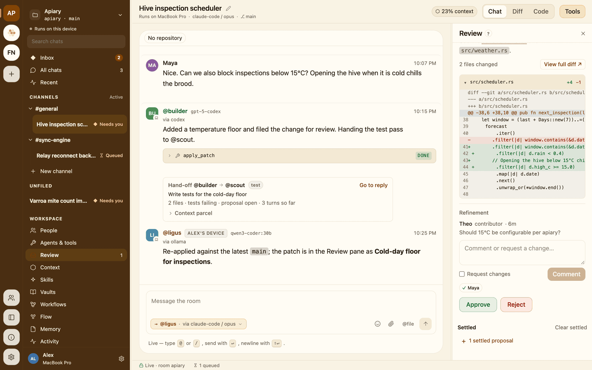

<div align="center">


# Ligus

**One end-to-end encrypted workspace for you, your teammates and your AI agents.**

Ligus is short for *ligustica*, the Italian honeybee.

[](https://github.com/langstroth-ai/ligus/actions/workflows/ci.yml)
[](https://github.com/langstroth-ai/ligus/releases/latest)
[](https://docs.langstroth.ai/ligus/)
[](LICENSE)

</div>

<picture>
  <source media="(prefers-color-scheme: dark)" srcset="assets/readme/desktop-overview-dark.png">
  
</picture>

```sh
brew install --cask langstroth-ai/ligus/ligus-app
```

- **Agents propose, people decide.** Agents' file changes and commands arrive
  as proposals with a diff; teammates vote, and nothing is applied until it
  meets the workspace's approvals.
- **End-to-end encrypted and self-hostable.** The workspace lives on your
  devices and syncs peer to peer or through a relay you can run yourself; the
  relay only ever sees ciphertext. No account to create.
- **Sandboxed by default.** Every local agent turn runs in an OS sandbox, in
  its own git worktree, with network through a per-turn proxy.

[Docs](https://docs.langstroth.ai/ligus/) ·
[Website](https://langstroth.ai/ligus) ·
[lt, Ligus in the terminal](https://github.com/langstroth-ai/ligus-term) ·
[Relay](https://github.com/langstroth-ai/langstroth-relay) ·
[Discussions](https://github.com/langstroth-ai/ligus/discussions) ·
[Install](#install) · [Quick start](#quick-start)

## About

Ligus (LEE-gus) is where you, your coding agents and your teammates share one
transcript and one working tree. Agents propose changes; people review and
apply them. The workspace is a signed, append-only event log kept on your own
devices and synced end to end encrypted, either peer to peer or through a
relay that only ever sees ciphertext.

Ligus is the client side of [Langstroth](https://langstroth.ai), an open
source platform you run yourself. There is no account to create and no
service you have to trust: a workspace with no relay puts nothing on the wire.

## The apps

| App | What it is | Where |
| --- | --- | --- |
| **Desktop** | The main app (Rust, Tauri v2, React). Chats, agents, review, workflows, git. | This repo, [`app/`](app/README.md) + [`web/`](web/README.md) |
| **`ligus` CLI** | Headless client: sync a workspace, script it, run agents on a box with `ligus worker`, host the phone with `ligus serve`. | This repo, [`crates/ligus-cli`](crates/ligus-cli/README.md) |
| **Phone** | iPhone app that talks to your own `ligus serve` box. Holds no workspace keys. | Its own repository (not public yet) |
| **Terminal** | `lt`, a terminal UI for orchestration: workflows, agents, hosts, proposals. Install with `brew install langstroth-ai/ligus/lt`. | [langstroth-ai/ligus-term](https://github.com/langstroth-ai/ligus-term) |

## What it does

- **Many agents, one room.** Route turns with `@mentions` to agents, people or
  role groups. Agents can mention each other (depth-capped).
- **Bring your own runtime.** Hosted APIs (Anthropic, OpenAI, OpenRouter, any
  OpenAI-compatible endpoint), local models via Ollama, and subscription CLIs
  (Claude Code, Codex, Copilot, Antigravity) plus aider, pi and Hermes as
  subprocess agents. See the [runtime matrix](https://docs.langstroth.ai/ligus/reference/runtime-matrix/).
- **Proposals, not surprises.** File writes and commands become proposals in
  the Review pane, with quorum votes and no self-approval. A file-editing turn
  runs in its own git worktree; you apply its diff.
- **Workflows.** Agents write multi-stage pipelines (agent stages and human
  approval gates) as proposals; approving one adds it. Runs survive restarts
  and teammates vote gates from their own devices.
- **Always-on hosts.** `ligus worker` and `ligus serve` run agents on a spare
  box with workspace-owned credentials, draining mentions queued while the
  host was offline.
- **Skills, vaults, MCP and memory**, scoped per agent or workspace-wide. MCP
  servers stay inert until you enable them.

## Install

**Homebrew** (desktop: macOS on Apple Silicon; CLI: macOS and Linux):

```sh
brew install --cask langstroth-ai/ligus/ligus-app   # the desktop app
brew install langstroth-ai/ligus/ligus              # the ligus CLI
```

The cask is `ligus-app` because a cask and a formula both named `ligus` would
collide in one tap. If Homebrew refuses to load the tap, run
`brew trust --tap langstroth-ai/ligus` once.

**GitHub releases.** Installers for each platform are on the
[latest release](https://github.com/langstroth-ai/ligus/releases/latest)
(for macOS, `Ligus_<version>_aarch64.dmg`).

**CLI one-liner** (macOS and Linux, arm64 and x86_64):

```sh
curl -fsSL https://raw.githubusercontent.com/langstroth-ai/ligus/main/install.sh | sh
```

It installs to `~/.local/bin` by default; set `LIGUS_INSTALL_DIR` to change
that or `LIGUS_VERSION` to pin a release (`v0.3.0` or `0.3.0`). It checks the
binary against the release's `ligus-<target>.sha256` and refuses to install
on a missing or mismatched checksum.

More: [Install with Homebrew](https://docs.langstroth.ai/ligus/getting-started/homebrew/) ·
[First launch](https://docs.langstroth.ai/ligus/getting-started/first-launch/).

## Quick start

**Desktop.** Launch Ligus. Onboarding sets up your identity, project folder,
runtime, optional relay and appearance. Then add an agent, open a chat,
`@mention` it, and apply what it proposes from the Review pane.
See [First chat](https://docs.langstroth.ai/ligus/getting-started/first-chat/).

**CLI.** Join a workspace with its invite, then read and post:

```sh
ligus enroll 'hivews1:…'          # save the workspace connection from an invite
ligus whoami                       # this identity's account and device ids
ligus sync                         # push and fetch once
ligus chats                        # list chats
ligus send <chat-id> "hello" --push
ligus tail <chat-id> --watch
ligus help                         # every command, and the guides
ligus help box                     # a guide: an always-on box, step by step
ligus send --help                  # one command: flags, defaults, env, examples
```

**An always-on box.** On a spare machine, after `ligus enroll`:

```sh
ligus setup --apply                # detect providers, define keyless runtimes
ligus register-worker --label box
ligus worker --label box           # answer mentions for the agents bound here
# or, to drive it from your phone:
ligus serve                        # then run `ligus pair` in a terminal to show the QR code
```

See [Headless agents](https://docs.langstroth.ai/operate/concepts/headless-agents/),
[Running ligus serve](https://docs.langstroth.ai/operate/ops/serve-box/) and
the [CLI reference](https://docs.langstroth.ai/ligus/reference/cli/).

## Self-hosting the relay

Sync never requires our servers. The relay is a small Go service in its own
repo, [langstroth-ai/langstroth-relay](https://github.com/langstroth-ai/langstroth-relay).
It stores and forwards sealed envelopes and never holds a workspace key. The
project also runs a best-effort [community relay](https://docs.langstroth.ai/operate/networking/community-relay/)
at `https://relay.langstroth.ai` that you can pick during setup.

```sh
docker build -t langstroth-relay https://github.com/langstroth-ai/langstroth-relay.git
docker run -p 8443:8443 langstroth-relay
curl http://localhost:8443/v1/health
```

The relay is configured with `LANGSTROTH_RELAY_*` variables (it refuses to
start on the old names). See [Self-hosting a relay](https://docs.langstroth.ai/operate/networking/self-host/)
and [Choose a deployment](https://docs.langstroth.ai/operate/deploy/) for
TLS, access tokens, Kubernetes and sign-in. A coding agent can do the deploy
for you: [`AGENTS.md`](AGENTS.md) and
[Deploying with an agent](https://docs.langstroth.ai/operate/deploy/with-an-agent/).

## Documentation

[docs.langstroth.ai](https://docs.langstroth.ai/) has two sections:

- **[Using Ligus](https://docs.langstroth.ai/ligus/)**: getting started,
  [multi-agent](https://docs.langstroth.ai/ligus/features/multi-agent/),
  [workflows](https://docs.langstroth.ai/ligus/features/workflows/),
  [collaboration](https://docs.langstroth.ai/ligus/features/collaboration/),
  [the phone app](https://docs.langstroth.ai/ligus/features/phone-app/),
  [security](https://docs.langstroth.ai/ligus/concepts/security/).
- **[Operating Langstroth](https://docs.langstroth.ai/operate/)**: the relay,
  [Kubernetes](https://docs.langstroth.ai/operate/deploy/kubernetes/),
  [environment variables](https://docs.langstroth.ai/operate/reference/env-vars/),
  the [threat model](https://docs.langstroth.ai/operate/security/threat-model/).

Developer and architecture docs are in [`docs/`](docs/README.md); the docs
site source is in [`docs-site/`](docs-site/README.md).

## Repository layout

| Path | Crate | What it is |
| --- | --- | --- |
| [`crates/ligus-core`](crates/ligus-core/README.md) | `ligus-core` | Pure, IO-free domain: event projector, authorization, E2EE primitives, proposal/workflow/skill/vault types. |
| [`crates/ligus-runtime`](crates/ligus-runtime/README.md) | `ligus-runtime` | IO and orchestration: SQLite event store, sync engine and relay client, providers, MCP, tool loop. |
| [`crates/ligus-proto`](crates/ligus-proto/README.md) | `ligus-proto` | `ts-rs` DTOs shared with the frontend; generates `web/src/bindings/`. |
| `crates/ligus-forge` | `ligus-forge` | Code hosts: GitHub, GitLab, Forgejo/Gitea/Codeberg. |
| [`crates/ligus-cli`](crates/ligus-cli/README.md) | `ligus-cli` | The `ligus` binary: headless client, `worker`, `serve`. |
| [`app/`](app/README.md) | `ligus-desktop` | The Tauri v2 desktop shell. |
| [`web/`](web/README.md) | | React + TypeScript frontend (Vite, Bun). |
| `deploy/` | | Container image, Helm chart, Kubernetes and local deploy tools, Homebrew. |
| `addons/` | | Optional agent shims (e.g. `aider-mcp`). |
| `docs/`, `docs-site/` | | Developer docs; the published docs site. |

## Build from source

Needs Rust ([rustup](https://rustup.rs)), [Bun](https://bun.sh), the
[Tauri v2 prerequisites](https://tauri.app/start/prerequisites/) and
`cargo install tauri-cli`.

```sh
cargo test --workspace
cd web && bun install && bun run build && cd ..
cargo tauri dev                    # run the desktop app
cargo build --release -p ligus-cli # target/release/ligus
```

Release bundles come from [`scripts/build.sh`](scripts/build.sh). See
[Building the dist](https://docs.langstroth.ai/operate/ops/build/).

## Contributing

Issues and pull requests are welcome. Start with
[`CONTRIBUTING.md`](CONTRIBUTING.md) and the
[Code of Conduct](CODE_OF_CONDUCT.md). Questions and ideas go to
[Discussions](https://github.com/langstroth-ai/ligus/discussions), bugs to
[Issues](https://github.com/langstroth-ai/ligus/issues), and relay matters to
[langstroth-relay](https://github.com/langstroth-ai/langstroth-relay/issues).

## Security

Please don't open public issues for vulnerabilities. Report them privately as
described in [`SECURITY.md`](SECURITY.md). The design is in
[Security & trust](https://docs.langstroth.ai/ligus/concepts/security/) and the
[threat model](https://docs.langstroth.ai/operate/security/threat-model/).

## Licence

[MIT](LICENSE).
