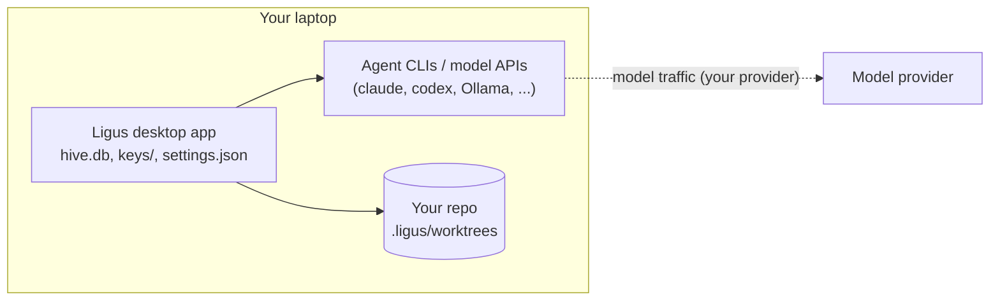
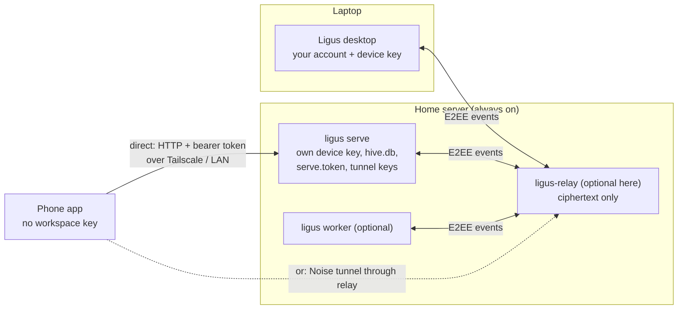
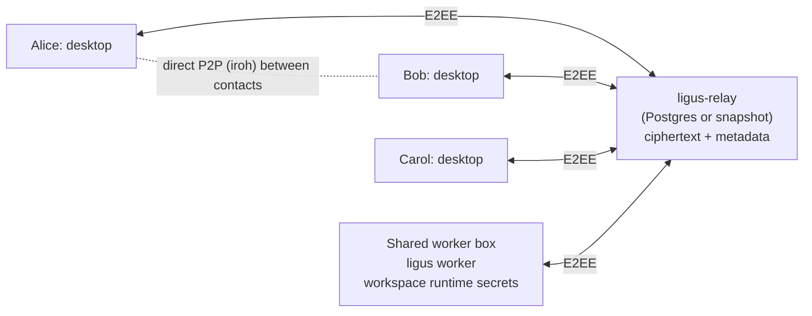
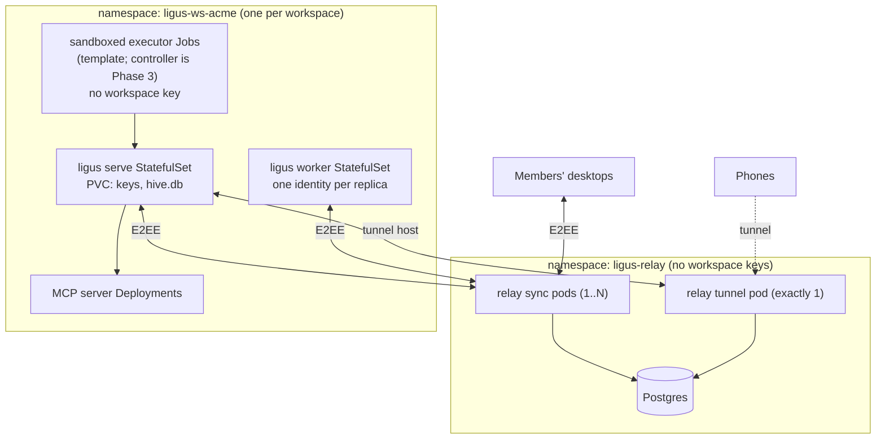
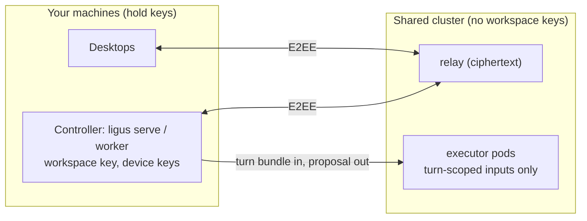

# Choose a deployment

Ligus is local-first: every device (a desktop app, a `ligus serve` box, a
`ligus worker`) keeps its own copy of the workspace and its own keys. The
only shared service is an optional **relay** that forwards end-to-end
encrypted events between devices and, if you want, tunnels your phone to
your home box. So "deploying Ligus" means deciding which devices you run and
whether, and where, you run a relay.

There are five shapes. The first three ship today, the fourth is in preview,
and the fifth is a design.

| Shape | Status | You run | Who it's for |
|---|---|---|---|
| [Solo laptop](#1-solo-laptop) | supported | the desktop app | one person, one machine |
| [Personal fleet](#2-personal-fleet) | supported | desktop + an always-on home box (`ligus serve`, optionally `ligus worker`) + a relay + the phone app | one person, several machines, agents that keep working while the laptop sleeps |
| [Team on a relay](#3-team-on-a-relay) | supported | one relay; each member runs the desktop; optional shared workers | a team sharing workspaces |
| [Kubernetes for one organisation](#4-kubernetes-for-one-organisation) | **preview** | relay chart + one `ligus` release per workspace + sandboxed executors | an organisation that runs its always-on parts on a cluster |
| [Relay and executors only, keys off the cluster](#5-relay-and-executors-only-keys-off-the-cluster) | **design, not shipped** | a cluster that never holds a workspace key | organisations that won't put keys on shared infrastructure |

Multi-tenant hosting (one operator, many unrelated organisations) is a
separate design: see [Multi-tenant (design)](multi-tenant.md).

Before choosing, two rules hold in every shape:

1. **One data dir is one device.** Its keys and its SQLite log belong to one
   process. Never run two processes on one data dir, and never put it on a
   network filesystem.
2. **The relay never holds keys.** It sees ciphertext and metadata. Whoever
   holds the workspace key (the invite) can read the workspace. See the
   [security model](../security/index.md).

## 1. Solo laptop

Nothing leaves the laptop except what your model runtime sends to its
provider (and nothing at all with a local model). No relay, no account
needed. Guide: [Solo laptop](solo.md).

## 2. Personal fleet

The home box is a Ligus device that stays online: it answers agents while the
laptop sleeps and is what the phone talks to. The phone holds no workspace
key; it reads and writes **through** `ligus serve`. The relay can run on the
home box itself or anywhere else. Phones reach the box either directly
(same LAN, or Tailscale) or through the relay's tunnel. Guide:
[Personal fleet](personal-fleet.md).

## 3. Team on a relay

Every member's device syncs through one relay (and directly peer to peer
when it can). Roles (Owner, Admin, Contributor, Viewer) are enforced by
every device on every event, not by the relay. The relay can additionally
gate who may connect with tokens. Guide:
[Team on a relay](../ops/deployment.md).

## 4. Kubernetes for one organisation

!!! warning "Preview"
    The Helm charts are on review branches and not published. Once merged,
    they live under `deploy/helm` in this repository and in the relay
    repository. Expect changes. See [Kubernetes (preview)](kubernetes.md).

The relay runs in its own namespace and never sees a key. Each workspace
gets its own namespace with a `ligus serve` StatefulSet (and optional
workers) that **does** hold that workspace's key on its volume. Turn
executors are hardened Jobs that would hold no workspace key; the template
ships, the controller that launches them does not yet.

## 5. Relay and executors only, keys off the cluster

!!! danger "Design, not shipped"
    Nothing on this page section is implemented. It records the intended
    shape so security reviews can weigh it. See
    [Keys off the cluster (design)](keys-off-cluster.md).

The cluster runs only the relay and the executors that do agent work; every
key-holding controller stays on machines the organisation controls.
