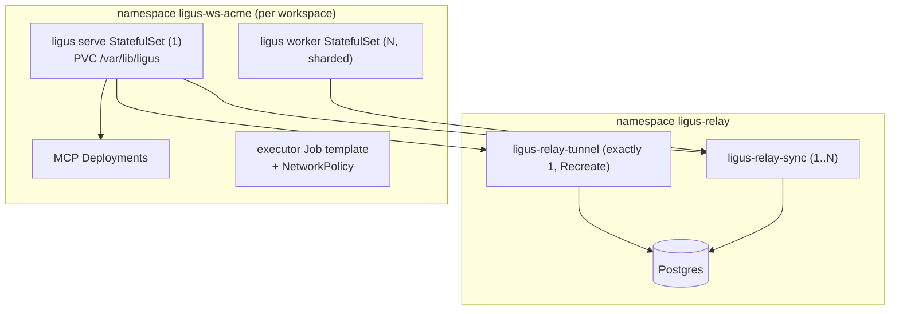

# Kubernetes for one organisation (preview)

!!! warning "Preview: charts not merged or published"
    Two Helm charts exist on review branches: `ligus-relay` in the relay
    repository and `ligus` in this one. Once merged they live under
    `deploy/helm/` in each repository; until then they are not published to
    a chart registry and no container images are published either. Values
    and behaviour may change before release. The design they implement is
    [`docs/design/kubernetes.md`](https://github.com/ligus-ai/ligus/blob/main/docs/design/kubernetes.md).

This shape runs the always-on parts of Ligus for one organisation on a
cluster: the relay, and per workspace a `ligus serve` device, optional
workers, MCP servers and a template for sandboxed turn executors. Members
still use the desktop app and the phone app as usual.



## What runs where, and what it holds

| Component | Kubernetes shape | Holds |
|---|---|---|
| Relay sync | Deployment, 1..N replicas, Postgres required for more than one | DB password, token-issuer **public** key. Never a workspace key |
| Relay tunnel | Deployment, exactly one replica, `Recreate` | as above, plus the APNs key if push is on |
| `ligus serve` | StatefulSet, 1 replica, `ReadWriteOnce` PVC | the workspace key, its device key, `hive.db`, `serve.token`, tunnel keys, checkouts, model and MCP secrets you give it |
| `ligus worker` | StatefulSet, one identity and PVC per replica; agents sharded by `ligus set-agent-host` | same kinds of secrets as serve, for its own identity |
| MCP servers | Deployment + Service + NetworkPolicy each | their own tokens |
| Executors | hardened Job **template** only; the controller (`ligus exec-turn`) is not built | designed to hold no workspace key, device key, SA token or git credentials |

The serve and worker volumes are as sensitive as the workspace key. Use an
encrypted StorageClass and never put them on NFS or RWX volumes.

## Hardening the charts apply

- Every pod: UID 65532, read-only root filesystem, all capabilities dropped,
  `RuntimeDefault` seccomp, no service-account token, no `hostNetwork`. The
  namespaces can enforce Pod Security `restricted`.
- `ligus serve` binds `0.0.0.0:8787` inside its pod with
  `LIGUS_SERVE_ALLOW_ANY_BIND=1`; the Service (ClusterIP) and NetworkPolicy
  decide who reaches it. Reach it from phones through the relay tunnel, not an
  Ingress.
- Relay NetworkPolicy restricts egress to DNS, the database and listed peers
  (add 443 for APNs). The relay chart sets `LIGUS_RELAY_REQUIRE_DB=1` whenever
  a database is configured.
- Executor template: `agent-turn` gets DNS, `serve:8787` and the egress you
  list; `pr-test` gets no egress and refuses to render without a
  `runtimeClassName` (gVisor, Kata) unless you set `allowDefaultRuntime`.
  Plain runc is not a security boundary.

!!! note "Tunnel default differs"
    The relay **binary** defaults `LIGUS_RELAY_TUNNEL=off`; the relay
    **chart** defaults `tunnel.mode: open`. Set `tunnel.mode: allowlist` (or
    `off`) explicitly if you don't want any host to register.

## Install (from the review branches)

Build the images yourself:

```sh
# in a relay checkout (branch with deploy/helm)
docker build -f deploy/container/Dockerfile -t registry.example.com/ligus-relay:0.2.0 .
# in a ligus checkout
docker build -f deploy/container/Dockerfile -t registry.example.com/ligus:2.0.0 .
```

### Relay

```sh
kubectl create namespace ligus-relay
kubectl label namespace ligus-relay pod-security.kubernetes.io/enforce=restricted
kubectl -n ligus-relay create secret generic relay-db --from-literal=DATABASE_URL='postgres://…'
kubectl -n ligus-relay create secret generic relay-env \
  --from-literal=LIGUS_RELAY_TOKEN_PUBKEY=<issuer public key> \
  --from-literal=LIGUS_RELAY_METRICS_TOKEN=<random>
helm install ligus-relay <relay-checkout>/deploy/helm/ligus-relay -n ligus-relay \
  --set image.repository=registry.example.com/ligus-relay --set image.tag=0.2.0 \
  --set externalDatabase.existingSecret=relay-db \
  --set config.existingSecret=relay-env \
  --set tunnel.mode=allowlist \
  --set ingress.enabled=true --set ingress.host=relay.example.com
helm test ligus-relay -n ligus-relay
```

With the release name `ligus-relay` the in-cluster Services are
`ligus-relay-sync` and `ligus-relay-tunnel`. `postgres.enabled=true` runs a
development Postgres pod (no backups, TLS or HA); don't use it for anything
you keep.

### One workspace

Create the workspace on a desktop first (**Add workspace → Create**) and copy
its invite; take the room and key from it, or from **Settings → Team sync**.

```sh
mkdir -p deploy/helm/ligus/charts
helm package -d deploy/helm/ligus/charts <relay-checkout>/deploy/helm/ligus-relay

kubectl create namespace ligus-ws-acme
kubectl label namespace ligus-ws-acme pod-security.kubernetes.io/enforce=restricted
kubectl -n ligus-ws-acme create secret generic acme-workspace \
  --from-literal=room=<room> --from-literal=key=<workspace key> \
  --from-literal=relay-access-token=<hrt1 token>
helm install acme deploy/helm/ligus -n ligus-ws-acme \
  --set image.repository=registry.example.com/ligus --set image.tag=2.0.0 \
  --set relayUrl=https://relay.example.com \
  --set workspace.existingSecret=acme-workspace
```

Then, from your own terminal (these print secrets; never run them as Jobs,
whose logs are kept):

```sh
kubectl -n ligus-ws-acme exec -it acme-ligus-serve-0 -- ligus serve enroll      # optional: make it your device
kubectl -n ligus-ws-acme exec -it acme-ligus-serve-0 -- ligus pair --relay-only  # needs remote.enabled
```

Useful values of the `ligus` chart: `remote.enabled` / `remote.relayUrl`
(phone tunnel), `serve.owner`, `serve.defaultAgent`, `serve.applyOnApprove`,
`serve.secretEnv.existingSecret` (every key becomes env:
`LIGUS_WS_SECRET_*`, model keys, MCP tokens), `serve.runtimesToml`,
`serve.mcpToml`, `worker.enabled` / `worker.replicas` /
`worker.permissionMode`, `mcp.servers[]`, `sandbox.*`,
`networkPolicy.restrictEgress`. `workspace.generate=true` makes a throwaway
workspace for CI only.

## Known limits

- `ligus worker` has no health endpoint, so worker pods have no probes.
- The executor controller is not built; the sandbox is a template and a smoke
  test.
- In-cluster model endpoints are accepted as keyless/private only by their
  full `*.svc.cluster.local` name.
- On some CNIs a new pod's first moments of traffic can precede its
  NetworkPolicy.
- Behind an ingress, the relay sees the ingress's IP for every client, so
  per-IP rate limits apply to everyone together.
- OpenTelemetry export (`otel.*`) is not implemented yet.

## Operating it

- Back up the serve and worker PVCs (volume snapshots) and the relay's
  database. See [Operations](../ops/operations.md).
- Upgrade the relay first or last; the protocol is compatible across
  versions. Upgrade `ligus` with `helm upgrade`; the StatefulSet restarts
  serve on the same volume and identity.
- Rotating the workspace key or revoking a device follows the normal
  [runbooks](../security/runbooks.md); update the workspace Secret afterwards.
