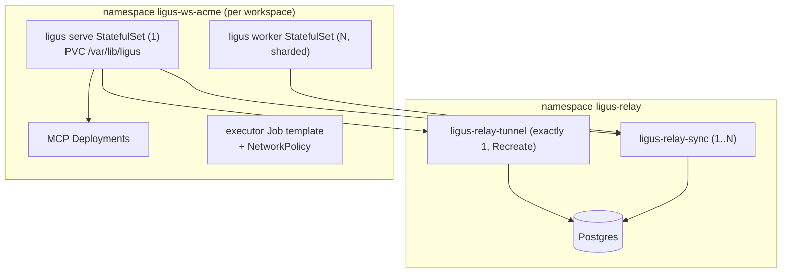

# Kubernetes for one organisation (preview)

!!! warning "Preview: charts not published"
    Two Helm charts implement Phase 1: `ligus` in this repository
    ([`deploy/helm/ligus`](https://github.com/ligus-ai/ligus/tree/main/deploy/helm/ligus))
    and `ligus-relay` in relay v0.2.0 (`deploy/helm/ligus-relay`). Neither is
    published to a chart registry yet and no container images are published:
    build them yourself. Values and behaviour may change. The design they
    implement is
    [`docs/design/kubernetes.md`](https://github.com/ligus-ai/ligus/blob/main/docs/design/kubernetes.md).

This shape runs the always-on parts of Ligus for one organisation on a
cluster: the relay, and per workspace a `ligus serve` device, optional
workers, MCP servers and a template for sandboxed turn executors. Members
still use the desktop app and the phone app as usual.



## What runs where, and what it holds

| Component | Kubernetes shape | Holds |
|---|---|---|
| Relay sync | Deployment, 1..N replicas, Postgres required for more than one | DB password, token-issuer **public** key. Never a workspace key |
| Relay tunnel | Deployment, exactly one replica, `Recreate` | as above, plus the APNs key if push is on |
| `ligus serve` | StatefulSet, 1 replica, `ReadWriteOnce` PVC | the workspace key, its device key, `hive.db`, `serve.token`, tunnel keys, checkouts, model and MCP secrets you give it |
| `ligus worker` | StatefulSet, one identity and PVC per replica; agents sharded by `ligus set-agent-host` | same kinds of secrets as serve, for its own identity |
| MCP servers | Deployment + Service + NetworkPolicy each | their own tokens |
| Executors | hardened Job **template** only; the controller (`ligus exec-turn`) is not built | designed to hold no workspace key, device key, SA token or git credentials |

The serve and worker volumes are as sensitive as the workspace key. Use an
encrypted StorageClass and never put them on NFS or RWX volumes.

## Hardening the charts apply

- Every pod: UID 65532, read-only root filesystem, all capabilities dropped,
  `RuntimeDefault` seccomp, no service-account token, no `hostNetwork`. The
  namespaces can enforce Pod Security `restricted`.
- `ligus serve` binds `0.0.0.0:8787` inside its pod with
  `LIGUS_SERVE_ALLOW_ANY_BIND=1`. That is safe only because the pod's network
  namespace is private and the chart never sets `hostNetwork`: the Service
  (ClusterIP) and NetworkPolicy decide who reaches it. Reach it from phones
  through the relay tunnel, not an Ingress.
- **Serve ingress.** By default only this release's own pods (serve,
  workers, executors, `helm test`) reach `serve:8787`; MCP server pods and
  any other pod in the namespace don't. `networkPolicy.serveIngressFrom`
  replaces that list: add your tailnet proxy or ingress controller there if
  you expose the API.
- **DNS.** Every policy that allows DNS allows it only to the cluster
  resolver, `networkPolicy.dns` (kube-system pods labelled
  `k8s-app: kube-dns` by default). Change it if your cluster DNS is labelled
  differently (`k8s-app: coredns`, a node-local cache). Port 53 to any
  address would be a direct exfiltration channel.
- **Executors wait for their policy.** Some CNIs (kind's kindnet among them)
  program a new pod's NetworkPolicy a moment after it starts. Executor Jobs
  therefore start with a `netpol-gate` init container that waits until a
  connection the policy must block fails (`sandbox.policyGate.probe`, by
  default the cluster DNS metrics port; for `pr-test` also until DNS fails),
  and fails the Job if that doesn't happen within
  `sandbox.policyGate.timeoutSeconds` (60). If your cluster DNS doesn't serve
  metrics on 9153, point the probe at another address that is reachable
  without the policy and blocked with it.
- **MCP server images are pinned.** Each `mcp.servers[].image` must be pinned
  by digest (`registry/image@sha256:…`); a tag refuses to render unless that
  server sets `allowUnpinned: true`. These pods run third-party code with
  their own secrets and open egress, and a tag lets whoever controls it swap
  the code.
- Relay NetworkPolicy restricts egress to DNS (the cluster resolver only),
  the database and `networkPolicy.extraEgress`. The relay chart sets
  `LIGUS_RELAY_REQUIRE_DB=1` whenever a database is configured.
- Executor template: `agent-turn` gets DNS, `serve:8787` and the egress you
  list; `pr-test` gets no egress and refuses to render without a
  `runtimeClassName` (gVisor, Kata) unless you set `allowDefaultRuntime`.
  Plain runc is not a security boundary.
- `deploy/helm/ligus/ci/security_test.py` renders the chart with several value
  sets and checks these properties (DNS scope, serve ingress, the executor
  gate, digest pinning); run it after changing the chart
  (`python3 deploy/helm/ligus/ci/security_test.py`, needs `helm` and PyYAML).
  CI runs it with `helm lint --strict`.

!!! note "Relay tunnel is off by default"
    Since relay v0.2.0 the relay chart, like the binary, defaults
    `tunnel.mode: off`. Turn it on only if you use the phone app: prefer
    `allowlist` (`tunnel.allowedHosts`), and use `open` only with a token
    gate (`LIGUS_RELAY_TOKEN_PUBKEY` or `LIGUS_RELAY_ACCESS_TOKENS` in
    `config.existingSecret`), which a host's first registration must pass.

## Install

Build the images yourself:

```sh
# in a relay checkout at v0.2.0 or later
docker build -f deploy/container/Dockerfile -t registry.example.com/ligus-relay:0.2.0 .
# in a ligus checkout
docker build -f deploy/container/Dockerfile -t registry.example.com/ligus:2.0.0 .
```

### Relay

```sh
kubectl create namespace ligus-relay
kubectl label namespace ligus-relay pod-security.kubernetes.io/enforce=restricted
kubectl -n ligus-relay create secret generic relay-db --from-literal=DATABASE_URL='postgres://…'
kubectl -n ligus-relay create secret generic relay-env \
  --from-literal=LIGUS_RELAY_TOKEN_PUBKEY=<issuer public key> \
  --from-literal=LIGUS_RELAY_METRICS_TOKEN=<random>
helm install ligus-relay <relay-checkout>/deploy/helm/ligus-relay -n ligus-relay \
  --set image.repository=registry.example.com/ligus-relay --set image.tag=0.2.0 \
  --set externalDatabase.existingSecret=relay-db \
  --set config.existingSecret=relay-env \
  --set tunnel.mode=allowlist \
  --set ingress.enabled=true --set ingress.host=relay.example.com
helm test ligus-relay -n ligus-relay
```

With the release name `ligus-relay` the in-cluster Services are
`ligus-relay-sync` and `ligus-relay-tunnel`. `postgres.enabled=true` runs a
development Postgres pod (no backups, TLS or HA); don't use it for anything
you keep.

Settings to get right on the relay:

- **Behind the ingress**, set `clientIP.trustedProxies` (the relay's
  `LIGUS_RELAY_TRUSTED_PROXIES`) to the CIDRs your ingress controller or load
  balancer connects from, and `clientIP.header` if it doesn't set
  `X-Forwarded-For`. Without it every client shares the ingress's address and
  one rate-limit bucket. `Fly-Client-IP` is never trusted off Fly.
- **Egress.** `networkPolicy.restrictEgress` is on by default, so list in
  `networkPolicy.extraEgress` what the relay must reach: an external
  database, `api.github.com:443` for the directory, account and friends
  routes, and APNs (`api.push.apple.com:443`) on the tunnel pod if push is
  on. NetworkPolicy can't match host names, so these are usually `ipBlock`
  rules on port 443.
- **APNs** keys go only in `tunnel.apns.existingSecret`, a Secret of their
  own; the chart refuses them in `config.existingSecret` or `config.env`,
  which reach the sync pods too.
- **Workspace scope.** Issue tokens with `--workspace <id>` and set
  `LIGUS_RELAY_WORKSPACE_SCOPE=claims` (or `strict`) in the config Secret;
  see [Self-hosting a relay](../networking/self-host.md#per-workspace-token-scope).
- **Retention.** Postgres keeps the newest `LIGUS_RELAY_MAX_ENVELOPES` per
  workspace (default 50000, pruned hourly; `0` = unbounded).
- A malformed `LIGUS_RELAY_TOKEN_PUBKEY` keeps the relay from starting, so a
  crash-looping pod after a key change usually means a bad key.
- There is no environment switch for the relay's admin API in the
  open-source image; per-person tokens are signed tokens.

### One workspace

Create the workspace on a desktop first (**Add workspace → Create**) and copy
its invite; take the room and key from it, or from **Settings → Team sync**.

```sh
mkdir -p deploy/helm/ligus/charts
helm package -d deploy/helm/ligus/charts <relay-checkout>/deploy/helm/ligus-relay

kubectl create namespace ligus-ws-acme
kubectl label namespace ligus-ws-acme pod-security.kubernetes.io/enforce=restricted
kubectl -n ligus-ws-acme create secret generic acme-workspace \
  --from-literal=room=<room> --from-literal=key=<workspace key> \
  --from-literal=relay-access-token=<hrt1 token>
helm install acme deploy/helm/ligus -n ligus-ws-acme \
  --set image.repository=registry.example.com/ligus --set image.tag=2.0.0 \
  --set relayUrl=https://relay.example.com \
  --set workspace.existingSecret=acme-workspace
```

Then, from your own terminal (these print secrets; never run them as Jobs,
whose logs are kept):

```sh
kubectl -n ligus-ws-acme exec -it acme-ligus-serve-0 -- ligus serve enroll      # optional: make it your device
kubectl -n ligus-ws-acme exec -it acme-ligus-serve-0 -- ligus pair --relay-only  # needs remote.enabled
```

Useful values of the `ligus` chart: `remote.enabled` / `remote.relayUrl`
(phone tunnel), `serve.owner`, `serve.defaultAgent`, `serve.applyOnApprove`,
`serve.secretEnv.existingSecret` (every key becomes env:
`LIGUS_WS_SECRET_*`, model keys, MCP tokens), `serve.runtimesToml`,
`serve.mcpToml`, `worker.enabled` / `worker.replicas` /
`worker.permissionMode`, `mcp.servers[]`, `sandbox.*`,
`sandbox.policyGate.*`, `networkPolicy.restrictEgress`,
`networkPolicy.serveIngressFrom`, `networkPolicy.dns`.
`workspace.generate=true` makes a throwaway workspace for CI only. The full
table is in the chart's
[README](https://github.com/ligus-ai/ligus/tree/main/deploy/helm/ligus).

!!! warning "Model keys reach CLI agents"
    Ligus scrubs its own secrets (the workspace key, relay and tunnel tokens,
    `LIGUS_WS_SECRET_*`) from agent processes, but model provider keys in
    `secretEnv` (`ANTHROPIC_API_KEY`, `OPENAI_API_KEY`, ...) and MCP tokens
    under other names pass through to CLI agents, which need them. An agent
    with a shell can print them. Give the pods keys you can rotate and limit
    with the provider.

!!! warning "Workers with write access"
    `worker.permissionMode` (`acceptEdits`, `runCommands`,
    `bypassPermissions`) lets CLI agents on the workers edit files or run
    commands. The tool gate then defaults to Admin, so only members you'd
    trust with a shell on the pod can drive those agents; below it, Claude
    Code, Antigravity and Copilot run read-only and the other CLIs are
    refused. Agent processes run in the bubblewrap sandbox, which needs
    unprivileged user namespaces in the pod; where the cluster forbids them,
    write-capable turns are refused. `HOME` is `/home/ligus` (a `home`
    subdirectory of the data volume), outside the data dir agents can't read.

## Known limits

- `ligus worker` has no health endpoint, so worker pods have no probes.
- The executor controller is not built; the sandbox is a template and a smoke
  test.
- In-cluster model endpoints are accepted as keyless/private only by their
  full `*.svc.cluster.local` name.
- On some CNIs a new pod's first moments of traffic can precede its
  NetworkPolicy.
- OpenTelemetry export (`otel.*`) is not implemented yet.

## Residual risks {#residual-risks}

- **DNS tunnelling.** Executors and restricted pods may only query the
  cluster resolver, but the resolver forwards names it doesn't own upstream,
  so code in a pod can still leak data encoded in DNS queries to a domain
  its author controls. Closing that needs a resolver that refuses external
  names for those pods (a CoreDNS policy or a separate resolver); the chart
  doesn't do it.
- **Executor policy timing** depends on the gate's probe actually being
  blocked by the policy; a probe address that some other rule allows would
  let the gate pass early.
- On kindnet, egress to the `kubernetes` Service VIP was observed to bypass
  an egress policy in some runs; executors have no service account token, so
  only anonymous API access is possible.
- The serve and worker volumes hold the workspace key; anyone who can
  `exec` into those pods or read their volumes can read the workspace.

## Operating it

- Back up the serve and worker PVCs (volume snapshots) and the relay's
  database. See [Operations](../ops/operations.md).
- Upgrade the relay first or last; the protocol is compatible across
  versions. Upgrade `ligus` with `helm upgrade`; the StatefulSet restarts
  serve on the same volume and identity.
- Rotating the workspace key or revoking a device follows the normal
  [runbooks](../security/runbooks.md); update the workspace Secret afterwards.
