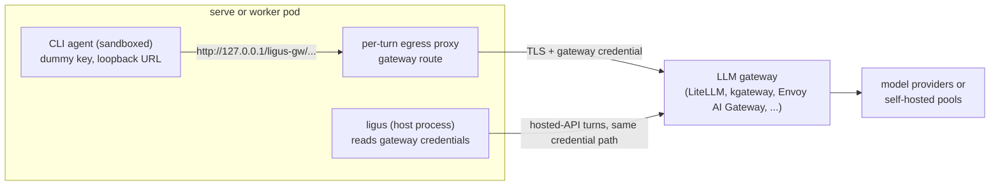

# Deploying with an LLM gateway

Many teams run a dedicated LLM gateway: one place that holds the provider
keys, enforces quotas and records cost. Ligus can send its agents' model
traffic through one. This page covers the Kubernetes shape (`ligus serve` and
`ligus worker` pods from the `ligus` chart); the same allow-list file works on
any serve or worker host.

Ligus is **gateway-agnostic**. A gateway is any endpoint that speaks the
OpenAI chat-completions wire or the Anthropic Messages wire, in the same
cluster or another one. No gateway is required and none is embedded: without
`modelGateways` nothing on this page changes, and a desktop keeps using a
plain custom base URL.

The design record is
[`docs/design/v2/model-gateways.md`](https://github.com/ligus-ai/ligus/blob/main/docs/design/v2/model-gateways.md).

## How it fits together



- The **operator** lists the gateways a host may use (`modelGateways` in the
  chart). The list is mounted into the pod as a file; workspace members and
  agents can't change it.
- The host **advertises the gateway names** (and their wire, `openai` or
  `anthropic`) to the workspace on its host record. Never a URL, a path or a
  secret.
- An Admin points an agent at a gateway by name, on a workspace runtime, and
  binds the agent to a host that offers it.
- Credentials (a projected ServiceAccount token, an API key or a client
  certificate) are files the host process reads. Agent processes never see
  them: the egress proxy adds them to each request.

## Chart values

```yaml
modelGateways:
  - name: litellm                 # [a-z0-9-]{1,63}; what the workspace sees
    url: https://litellm.gw.svc.cluster.local:4000   # base URL; the API path is appended
    api: openai                   # openai | anthropic: the wire it speaks
    auth:
      mode: serviceAccountToken   # serviceAccountToken | apiKey | mtls | none
      audience: litellm           # serviceAccountToken: the token's audience
      expirationSeconds: 3600     # serviceAccountToken: kubelet rotates at 80 %
      # apiKey: secretName, secretKey, header (default Authorization: Bearer)
      # mtls:   secretName with tls.crt, tls.key and ca.crt
    caSecret: { name: "", key: ca.crt }   # optional pinned CA for https (any mode)
    allowPlaintext: false         # http:// only inside a mesh or an isolated path
    attribution: false            # pseudonymous workspace and agent ids
    networkPolicy:                # what serve and workers may reach for it
      namespaceSelector: { matchLabels: { kubernetes.io/metadata.name: gw } }
      podSelector: { matchLabels: { app: litellm } }
      # or: ipBlock: { cidrs: [203.0.113.10/32] }
      ports: [4000]

# Every agent turn on these hosts must go through a listed gateway (default).
# false: runtimes that don't name a gateway still run directly.
modelGatewaysExclusive: true

# The key for attribution hashes. Use one Secret for serve and every worker
# so the ids agree across hosts; without it each host generates its own.
modelGatewayAttribution:
  secretName: ""
  secretKey: key
```

What the chart renders:

- **An allow-list file**, `model-gateways.json`, in a ConfigMap mounted
  read-only into serve and every worker. `LIGUS_MODEL_GATEWAYS_FILE` points
  at it. It holds each gateway's name, URL, wire, auth mode, the in-pod paths
  of its credential files and the attribution switch. It holds no secret.
- **Credential volumes**, under `/etc/ligus/model-gateways/<name>/`:
  - `serviceAccountToken`: a projected volume with a
    `serviceAccountToken` source (your `audience` and `expirationSeconds`).
    The pod keeps `automountServiceAccountToken: false`; only this
    audience-bound token is mounted.
  - `apiKey`: the Secret key, mounted as a file (mode 0400), never put in
    the environment.
  - `mtls`: the client certificate, key and CA from the Secret.
- **A NetworkPolicy**, `<release>-model-gateways`, that opens egress from
  serve and worker pods to exactly the selectors or CIDRs and ports you
  list, one rule per gateway. NetworkPolicies add up, so it only opens what
  you list. It renders when `networkPolicy.enabled` and
  `networkPolicy.restrictEgress` are on (the defaults).

The chart refuses to render:

- a duplicate or malformed name;
- a URL with user info, or one that isn't `https://` (`http://` needs
  `allowPlaintext: true`, and `mtls` always needs `https://`);
- a gateway with neither selectors nor CIDRs (a rule without `to` would
  open everything) or without ports;
- a catch-all CIDR (`0.0.0.0/0`, `::/0`, an IPv4 prefix shorter than /8, an
  IPv6 prefix shorter than /16);
- a CIDR that overlaps link-local or a cloud metadata address
  (169.254.0.0/16, 100.100.100.200/32, fd00:ec2::254/128).

A private-range CIDR is fine, but only exactly as listed: nothing else in
the private ranges opens.

### Outside Kubernetes

On a serve or worker box without the chart, write the same JSON file
yourself and set `LIGUS_MODEL_GATEWAYS_FILE` to it. An unreadable or invalid
file stops the host at startup: a host whose operator listed gateways never
runs without them. `LIGUS_MODEL_GATEWAYS_EXCLUSIVE=0` turns off exclusive
mode.

## Choosing a gateway for an agent

1. Check which hosts offer it. Serve and each worker publish their gateway
   names on their host record; the app lists them per host (the hosts list
   in the right rail and the agent's host menu).
2. Set the gateway on a workspace runtime (`gateway = "litellm"`) instead of
   an endpoint URL. The runtime's model is the model name the gateway
   expects.
3. Bind the agent to that runtime and to a host that offers the gateway.

Steps 2 and 3 are workspace config changes: they need an Admin and passkey
presence, like every other change to a workspace runtime or an agent's host
and runtime binding. A Contributor can't redirect an agent's model traffic.

Binding an agent to a host that doesn't offer its gateway is allowed (the
operator may add it later), but the agent won't run there until it does.

A device-local runtime can name a gateway too:

```toml
[[runtimes]]
id = "team-gw"
name = "Team gateway"
provider = "custom"
model = "gpt-4o-mini"
gateway = "litellm"
```

### What a gateway host refuses

| Runtime | Host without gateways | Gateway host |
|---|---|---|
| names a gateway this host lists | refused: the host doesn't offer it | runs through that gateway |
| names a gateway this host doesn't list | refused | refused |
| no gateway, endpoint is a listed gateway's URL | runs directly | runs through that gateway, credential added |
| no gateway, any other endpoint, or a CLI's own vendor endpoint | runs directly | refused (exclusive, the default); runs directly with `modelGatewaysExclusive: false` |

## CLI agents: what the agent process sees

A CLI agent (Claude Code, Codex, Aider, pi, Hermes) on a gateway runtime gets
a loopback base URL and a dummy key, nothing else:

| CLI | Variables set |
|---|---|
| Claude Code (`api: anthropic`) | `ANTHROPIC_BASE_URL`, `ANTHROPIC_API_KEY=ligus-gateway` |
| Codex, Hermes, Aider, pi (`api: openai`) | `OPENAI_BASE_URL`, `OPENAI_API_BASE`, `OPENAI_API_KEY=ligus-gateway` |
| Aider, Hermes (`api: anthropic`) | `ANTHROPIC_BASE_URL`, `ANTHROPIC_API_KEY=ligus-gateway` |
| Antigravity, Copilot | refused: these CLIs have no base-URL setting |

The base URL is `http://127.0.0.1:<port>/ligus-gw/<turn token>/<name>`, a
route on the turn's own egress proxy. On each request the proxy:

1. checks the turn token and that the gateway is the turn's;
2. drops every credential the client sent (`Authorization`,
   `Proxy-Authorization`, `X-Api-Key`, `Api-Key`, `Cookie`, any
   `X-Ligus-*`);
3. adds the gateway's credential and, if enabled, the attribution headers;
4. sends the request over its own TLS client (client certificate and pinned
   CA where configured) to an address it resolved and checked itself (never
   loopback-by-rebinding, link-local or metadata);
5. streams the response back.

The agent can't read the credential files (they are on the sandbox's deny
list), and the credential is never in its environment, argv or files. Its
allow-list holds no vendor endpoint and not the gateway itself: the proxy
route is its only way to a model.

Hosted-API turns (an OpenAI-wire or Anthropic runtime that the host calls
itself) use the same gateway object: the same credential, the same TLS
settings and the same header handling. A runtime's own API key is never sent
to a gateway.

## Authentication

### ServiceAccount tokens

`serviceAccountToken` mounts a projected token for the pod's ServiceAccount,
bound to the audience you set. Ligus re-reads the file when it changes (and
at least every minute) and sends it as `Authorization: Bearer <jwt>`. The
kubelet replaces it at 80 % of its lifetime, so rotation needs no restart.

The gateway must verify, on every request:

- **signature** against the cluster's issuer: either with a
  [TokenReview](https://kubernetes.io/docs/reference/kubernetes-api/authentication-resources/token-review-v1/)
  call to the API server (passing the expected audience), or against the
  cluster's JWKS (`<issuer>/openid/v1/jwks`, from
  `/.well-known/openid-configuration`);
- **issuer** (`iss`) equal to the cluster's service-account issuer;
- **audience** (`aud`) equal to the gateway's `audience` value, and nothing
  else accepted;
- **subject** (`sub`) equal to
  `system:serviceaccount:<namespace>:<serviceaccount>` of the Ligus release
  (or the `kubernetes.io.namespace` and `serviceaccount.name` claims), so a
  token from another namespace or another workload is rejected;
- **expiry** (`exp`, `nbf`).

Use one audience per gateway. A gateway that is compromised can then replay
the tokens it receives only to itself.

### API keys

`apiKey` mounts one key of a Secret as a file. Ligus sends it as
`Authorization: Bearer <key>` by default, or in the header you name
(`x-api-key`, `api-key`). Re-read on change like the token.

### mTLS

`mtls` mounts `tls.crt`, `tls.key` and `ca.crt` from a Secret (a
cert-manager `Certificate` works). Ligus presents the client certificate and
trusts **only** that CA for the gateway; it rebuilds its client when the
files change. No header is added.

### Service mesh instead

In a mesh with mutual TLS (Istio, Linkerd, Cilium), the mesh can carry the
workload identity: set `auth.mode: none` and authorize the Ligus
ServiceAccount at the gateway with the mesh's policy. Use
`allowPlaintext: true` only when the mesh encrypts the pod-to-pod hop;
without a mesh, plain HTTP exposes bearer tokens to anyone on the node
network.

## Cross-cluster: OIDC federation

When the gateway runs in another cluster, it verifies the Ligus cluster's
tokens as an external OIDC issuer:

1. Find the Ligus cluster's issuer
   (`kubectl get --raw /.well-known/openid-configuration`).
2. Make its JWKS reachable by the gateway: publish the discovery document
   and JWKS (managed clusters such as EKS, GKE and AKS can expose a public
   issuer URL), or copy the JWKS into the gateway's configuration and update
   it when the cluster's signing keys rotate.
3. Configure the gateway's JWT validation with that issuer, the JWKS, the
   audience you set in `modelGateways`, and the expected `sub`.
4. List the gateway's address in `networkPolicy.ipBlock.cidrs` (or reach it
   through an egress gateway you select with `podSelector`), and pin its CA
   with `caSecret` if it isn't publicly trusted.

## Attribution headers

With `attribution: true`, every request through that gateway carries

```
X-Ligus-Workspace: <32 hex characters>
X-Ligus-Agent:     <32 hex characters>
```

Each is a keyed hash (HMAC-SHA256, truncated to 16 bytes) of the workspace
or agent id under the attribution key. The gateway can count, rate-limit and
bill per workspace and per agent, but can't recover the ids, names or
anything else. No message content is sent in headers. Give serve and every
worker the same key (`modelGatewayAttribution.secretName`) so the ids match
across hosts.

## Gateway options

Any OpenAI- or Anthropic-compatible endpoint works. These are known to fit
the model above.

| Gateway | Notes | Status |
|---|---|---|
| [kgateway](https://kgateway.dev) | CNCF Envoy and Gateway API project with AI backends. | TODO-E2E |
| [Envoy AI Gateway](https://aigateway.envoyproxy.io) | Envoy Gateway extension for LLM traffic. | TODO-E2E |
| [LiteLLM](https://docs.litellm.ai) | Python proxy with keys, budgets and per-key spend. | TODO-E2E |
| [Gateway API Inference Extension](https://gateway-api-inference-extension.sigs.k8s.io) | Routes to self-hosted vLLM or KServe model pools behind a Gateway API implementation; Ligus talks to the gateway in front of it. | TODO-E2E |

### Example: LiteLLM with an API key

Adapt this example to your setup. LiteLLM's master key (or a virtual key)
goes in a Secret Ligus mounts as a file:

```yaml
# litellm config.yaml (in the gateway's namespace)
model_list:
  - model_name: gpt-4o-mini
    litellm_params:
      model: openai/gpt-4o-mini
      api_key: os.environ/OPENAI_API_KEY
general_settings:
  master_key: os.environ/LITELLM_MASTER_KEY
```

```sh
kubectl -n ligus-ws-acme create secret generic litellm-key \
  --from-literal=key=<a LiteLLM virtual key>
```

```yaml
# ligus values
modelGateways:
  - name: litellm
    url: http://litellm.gw.svc.cluster.local:4000
    api: openai
    allowPlaintext: true          # in-cluster hop; prefer https or a mesh
    auth:
      mode: apiKey
      secretName: litellm-key
      secretKey: key
    networkPolicy:
      namespaceSelector: { matchLabels: { kubernetes.io/metadata.name: gw } }
      podSelector: { matchLabels: { app: litellm } }
      ports: [4000]
```

### Example: ServiceAccount tokens at the gateway

Adapt this to your gateway's JWT validation. The values side:

```yaml
modelGateways:
  - name: team-gw
    url: https://ai-gw.gw.svc.cluster.local
    api: openai
    caSecret: { name: gw-ca, key: ca.crt }
    auth:
      mode: serviceAccountToken
      audience: team-gw
      expirationSeconds: 3600
    networkPolicy:
      namespaceSelector: { matchLabels: { kubernetes.io/metadata.name: gw } }
      ports: [443]
```

The gateway side validates issuer, audience (`team-gw`), subject
(`system:serviceaccount:ligus-ws-acme:<release ServiceAccount>`) and expiry
against the cluster's JWKS, as above.

## Troubleshooting

| Message (in the chat or the host log) | Meaning |
|---|---|
| this host doesn't offer gateway `X` | The agent's runtime names a gateway this host's operator didn't list. Bind the agent to a host that offers it, or add it to that host's `modelGateways`. |
| this host only runs agents through its model gateways | Exclusive mode: the runtime has no gateway and its endpoint isn't a listed gateway. Set the runtime's gateway, or set `modelGatewaysExclusive: false`. |
| `<CLI>` has no base-URL setting, so it can't use a gateway | Antigravity and Copilot can't be pointed at a gateway. Use another CLI or a hosted-API runtime. |
| startup error naming `LIGUS_MODEL_GATEWAYS_FILE` | The allow-list file is missing, unreadable or invalid; the host won't start without it. |
| 401 or 403 from the gateway | The gateway rejected the credential: check the audience, issuer and subject it expects, or the key. |
| the turn hangs, then times out connecting | NetworkPolicy doesn't open the gateway: check the selectors or CIDRs and ports in `modelGateways[].networkPolicy`. |

## Residual risks

- The gateway operator sees all model traffic, by design: prompts, code
  excerpts the agent sends and responses.
- `allowPlaintext` without a mesh exposes bearer tokens and traffic to the
  node network.
- A compromised host process (serve or worker itself, not an agent child)
  holds the gateway credentials.
- A token replayed within its lifetime is accepted by its own audience: keep
  `expirationSeconds` short.
