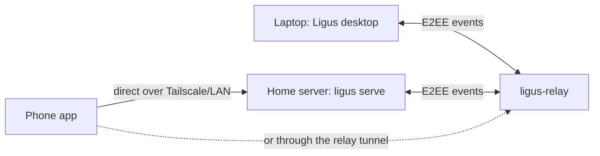

# Personal fleet: laptop, home server and phone

One person, several devices. Your laptop runs the desktop app; an always-on
home server runs `ligus serve` (and optionally `ligus worker`) so agents keep
working while the laptop sleeps; your phone talks to the home server. A relay
carries the encrypted events between the laptop and the server, and can also
carry the phone's traffic.



Time: about 30 minutes. You'll end with:

- a relay (on the home server or anywhere else);
- a workspace on the laptop, synced through that relay;
- `ligus serve` on the home server as one of **your** devices;
- the phone paired to it, directly over Tailscale, through the relay, or both.

## What each piece holds

| Device | Holds | Doesn't hold |
|---|---|---|
| Laptop | your account key, its device key, the workspace key, all events | |
| Home server | its own device key (certified by your account), the workspace key, all events, `serve.token`, tunnel host keys, checkouts | your account key |
| Relay | ciphertext, metadata, (tunnel) host public keys and push tokens | any key that decrypts the workspace |
| Phone | a bearer token and/or its tunnel credential and pairing key | the workspace key, any device key |

## 1. Run a relay

Skip this if you already have one. The simplest place is the home server
itself, in Docker:

```sh
docker build -t ligus-relay https://github.com/ligus-ai/relay.git
docker run -d --name ligus-relay --restart unless-stopped \
  -p 127.0.0.1:8443:8443 -v ligus-relay:/data \
  -e LIGUS_RELAY_DATA_DIR=/data \
  -e LIGUS_RELAY_TUNNEL=open \
  ligus-relay
curl -s localhost:8443/v1/health
# ok
```

Give it an `https://` URL your laptop (and, for the tunnel, your phone) can
reach. Two common options:

- **Tailscale** on the home server: `tailscale serve --bg 8443` publishes it
  at `https://<machine>.<tailnet>.ts.net` to your tailnet only.
- **A public name** with a reverse proxy (Caddy) in front; then also gate the
  relay with tokens. See [Self-hosting a relay](../networking/self-host.md).

`LIGUS_RELAY_TUNNEL=open` is only needed for the phone tunnel (step 6). On a
relay others can reach, prefer `allowlist` once you know the home server's
host id.

Check from the laptop:

```sh
curl -s https://relay.example.ts.net/v1/health
# ok
curl -s https://relay.example.ts.net/v1/tunnel/info
# {"versions":[1],"push":false,"billing":"none"}
```

## 2. Create the workspace on the laptop

1. Install the desktop app ([Solo laptop](solo.md#1-install)).
2. **Settings → Team sync**: set **Relay URL** (and **Relay access token** if
   your relay is gated). Save.
3. In the workspace rail, **Add workspace → Create**, give it a name,
   **Create workspace**. Ligus picks a random room and a random workspace key
   and shows an **Invite code** (`hivews1:…`). **Copy invite**.

The invite contains the relay URL, the room **and the workspace key**.
Anyone holding it can read the workspace. Move it only over a channel you
trust (SSH, a password manager), never chat or email.

Expected result: the sync pill reads **live** and shows the workspace as
encrypted.

## 3. Install `ligus` on the home server

```sh
brew install ligus-ai/ligus/ligus      # macOS or Linux with Homebrew
ligus --version
# ligus 2.0.0
```

Or build the container image (`deploy/container/Dockerfile`) and run
`ligus` from it with a volume at `/var/lib/ligus`.

## 4. Enroll the server in the workspace

Use a dedicated data dir and keep it private:

```sh
export LIGUS_DATA_DIR=$HOME/.ligus-serve
install -d -m 700 "$LIGUS_DATA_DIR"
ligus enroll 'hivews1:…'            # paste the invite; add --token <hrt1…> for a gated relay
ligus sync
# pushed 0, pulled 42
ligus chats                          # the laptop's chats are here
```

## 5. Run `ligus serve` as a service

The repository ships a systemd user unit and an env file in
[`deploy/ligus-serve/`](https://github.com/ligus-ai/ligus/tree/main/deploy/ligus-serve).

```sh
install -Dm644 ligus-serve.service ~/.config/systemd/user/ligus-serve.service
install -Dm600 ligus-serve.env.example ~/.config/ligus-serve/ligus-serve.env
$EDITOR ~/.config/ligus-serve/ligus-serve.env
```

The settings that matter here:

```sh
LIGUS_DATA_DIR=/home/you/.ligus-serve
LIGUS_SERVE_LISTEN=100.101.102.103:8787   # the server's Tailscale IP (tailscale ip -4), or 127.0.0.1:8787 for tunnel-only
LIGUS_SERVE_LABEL=home-server
LIGUS_SERVE_OWNER=Alice                   # your display name in the workspace: makes the box your device
LIGUS_REPOS_DIR=/home/you/repos           # checkouts agents may work on
```

`ligus serve` refuses `0.0.0.0` and public addresses (the API is plain HTTP
behind one token). Then:

```sh
systemctl --user daemon-reload
systemctl --user enable --now ligus-serve
sudo loginctl enable-linger "$USER"        # keep it running when you're logged out
journalctl --user -u ligus-serve -n 20
```

Expected log lines:

```text
ligus serve: listening on http://100.101.102.103:8787 — workspace '…', host 63f2… ('home-server'). Ctrl-C to stop.
```

plus an enrollment code `hivedev1:…` and a fingerprint, because
`LIGUS_SERVE_OWNER` is set.

## 6. Approve the server as your device

On the laptop: **Settings → Account → My devices → Add a device**, paste the
`hivedev1:…` code, check the fingerprint matches the server's log, approve.
On its next sync the server acts as you: phone messages and votes are yours.
Details: [Running ligus serve as your own device](../ops/serve-box.md).

Check:

```sh
curl -s http://100.101.102.103:8787/v1/health \
  -H "Authorization: Bearer $(cat ~/.ligus-serve/serve.token)"
# {…,"identity":{…,"mode":"owner"},"ok":true,"version":"2.0.0",…}
```

## 7. Bind a repository

```sh
git clone https://github.com/you/project ~/repos/project
LIGUS_DATA_DIR=~/.ligus-serve ligus bind-repo project
LIGUS_DATA_DIR=~/.ligus-serve ligus repos
```

Agents answered on the server then work in isolated worktrees of that
checkout. See [Repos on the home host](../ops/serve-repos.md).

## 8. Pair the phone

Pick one path or both. Run these with the server's environment:

```sh
set -a; . ~/.config/ligus-serve/ligus-serve.env; set +a
```

=== "Direct over Tailscale"

    The phone and the server are on the same tailnet (or LAN), and
    `LIGUS_SERVE_LISTEN` is the server's tailnet address.

    ```sh
    ligus pair
    ```

    Scan the QR code from the phone app. The link carries the server URL and
    `serve.token`: treat it as a password.

=== "Through the relay tunnel"

    No VPN on the phone, no inbound port on the server.

    ```sh
    ligus remote enable --relay https://relay.example.ts.net
    systemctl --user restart ligus-serve
    ligus remote status
    # relay:     https://relay.example.ts.net (enabled)
    # host id:   <host id>
    # serve:     connected for 12s (status active, push unavailable, checked 3s ago)
    # phones:    0 active, 0 revoked
    ligus pair --relay-only
    ```

    The pairing secret works once, for 10 minutes. A relay reachable only on
    your tailnet still needs the phone on the tailnet; use a public relay
    name for "from anywhere" access.

See [Remote access for your phone](../networking/remote-access.md) and
[Ligus on your phone](../features/phone-app.md).

## 9. Optional: a worker for heavy agents

A separate box (or the same one, with its **own** data dir) can host agents
with `ligus worker`:

```sh
export LIGUS_DATA_DIR=$HOME/.ligus-worker
ligus enroll 'hivews1:…'
ligus register-worker --label gpu-box
ligus set-agent-host coder <host id printed above>
ligus worker --label gpu-box
```

See [Headless agents](../concepts/headless-agents.md).

## Verify the whole thing

- [ ] laptop sync pill **live**, encrypted
- [ ] `ligus chats` on the server lists the laptop's chats
- [ ] `/v1/health` with the token shows `"mode":"owner"`
- [ ] a message from the phone shows on the laptop as you
- [ ] with the laptop closed, `@coder` (an agent hosted on the server) answers from the phone

## Operating it

- Upgrades: `brew upgrade ligus && systemctl --user restart ligus-serve`.
- Back up `~/.ligus-serve` (keys, events, phone pairings). See
  [Operations](../ops/operations.md).
- Lost phone: `ligus phones revoke <name>`. Lost server: revoke it in
  **My devices**. See [Runbooks](../security/runbooks.md).
