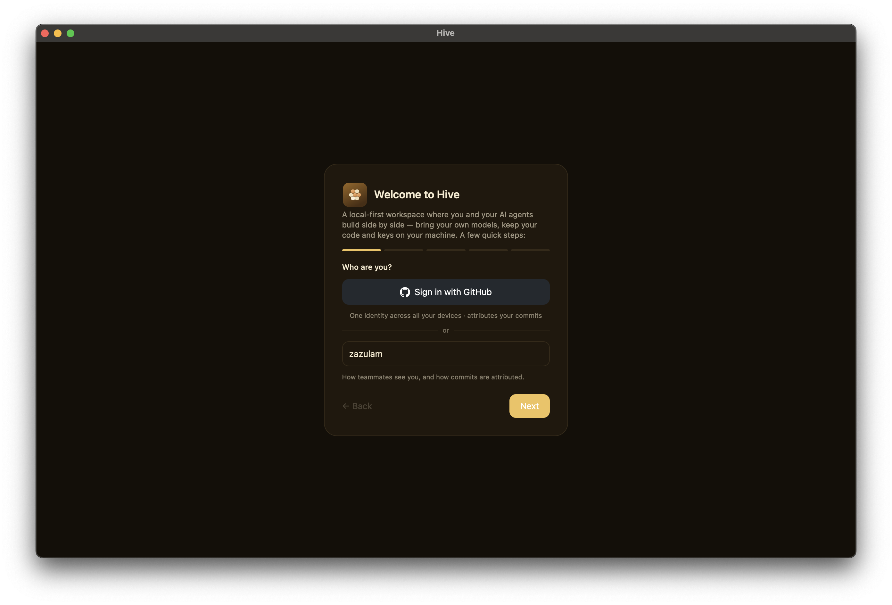
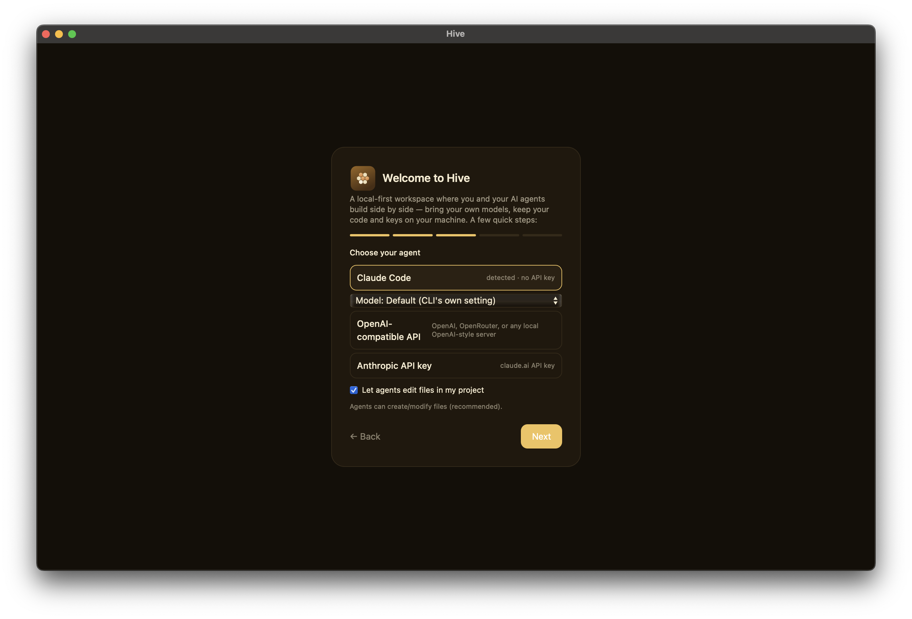
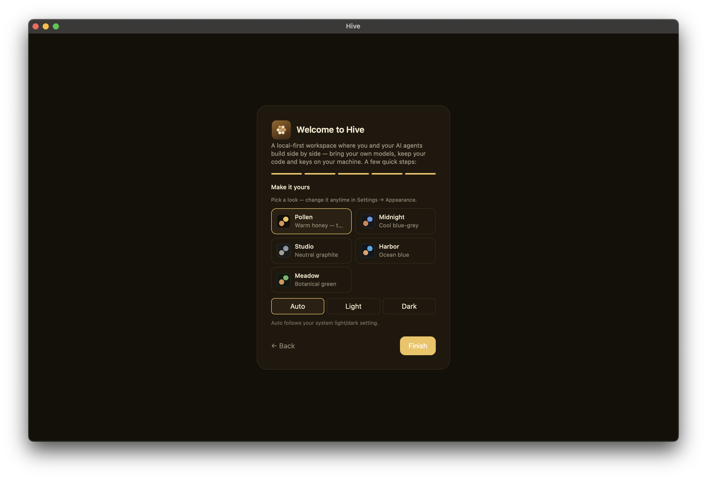

# First launch

Ligus is a desktop app for macOS, Windows and Linux. On first launch
you'll see a guided onboarding wizard that captures your identity, picks a
workspace folder, and configures a runtime.

{ width="720" }

## Install

Grab a bundle for your OS, or build from source:

```bash
git clone https://github.com/langstroth-ai/ligus.git
cd ligus
cargo tauri build        # bundles for the current OS → target/release/bundle/
# or a fast dev loop without bundling:
cargo tauri dev
```

See [Building the dist](../../operate/ops/build.md) for per-OS details and cross-builds.
Release DMGs for macOS (and the Homebrew cask) are signed and notarized, so
they open normally. Windows and Linux release builds, and anything you build
from source, are unsigned, so first launch needs a nudge:

- **macOS:** right-click → **Open** (or `xattr -dr com.apple.quarantine /Applications/Ligus.app`).
- **Windows:** SmartScreen → **More info → Run anyway**.
- **Linux:** `chmod +x Ligus_*.AppImage && ./Ligus_*.AppImage`.

## Wizard steps

The onboarding is **five quick steps** (the progress dots at the top count
them off):

1. **Identity** — enter a display name and, optionally, a picture. Ligus
   has already made your account key and this device's key behind the
   scenes; this step shows your safety code (see below).
2. **Project folder** — pick a folder on disk. Ligus treats this as the
   root; everything agents do (file edits, command runs, git
   operations) is scoped to this directory.
3. **Runtime** — choose the agent that generates replies: **Claude
   Code**, **Codex**, an **OpenAI-compatible API** (OpenAI / OpenRouter / any
   local OpenAI-style server), an **Anthropic API key**, or **Ollama**
   (offered only when a local Ollama daemon is detected). Ligus defaults
   the selection to whatever it finds installed. A **"Let agents edit
   files in my project"** checkbox sets Claude Code's permission mode —
   checked lets agents write files (`acceptEdits`), unchecked is
   read-only. You can add aider, pi, or more runtimes later from
   Settings.
4. **Team & sync** — optional. **Just me (no sync)** keeps everything on
   this machine (the default). **Join a team** takes an invite or short
   code, which carries the relay. **Sync through a relay** offers the
   [community relay](../../operate/networking/community-relay.md)
   (`relay.langstroth.ai`, free and best-effort; preselected) or your own
   relay's URL and token. You can change it later in **Settings → Team
   sync**.
5. **Appearance** — pick a theme (Pollen, Obsidian, Slate, Studio,
   Harbor or Meadow) and light / dark / auto. It applies live as you choose, and
   you can change it anytime from **Settings → Appearance**.

{ width="720" }

{ width="720" }

There's no separate Welcome, Permissions, or Finish/Review screen —
identity is the first thing you see, and the last step's **Finish**
button saves everything.

## What gets written

After onboarding:

- The app data dir `ai.ligus.desktop/` — the event store `ligus.db`
  (every workspace's signed events), your account + device records
  (public bits) in `identity.json`, private key seeds under `keys/`, and
  `settings.json` (runtime/provider config, including any API keys and the
  workspace keys you paste into Settings).
- `<workspace>/ligus.config.toml` — optional file-based runtime +
  transport config.
- `<workspace>/.ligus/` — per-chat git worktrees (`worktrees/`), saved
  patches of interrupted turns (`stopped-turns/`) and the workspace's
  `runtimes.json` / `mcp-servers.json`.

Everything is local. Nothing leaves your machine unless you
explicitly configure a transport (relay endpoint or LAN discovery
toggle).

## Your account and safety code

There is no sign-in. On first launch Ligus makes an account key and a random
account id on this device, silently, and certifies this device with it.
Onboarding shows your **safety code**, the fingerprint of that key, which
people compare with the code they see for you (see
[Identity & devices](../concepts/identity.md#safety-code)).

- **More devices** join your account through an enrollment code, from
  **Settings → Profile → My devices**. They don't sign in anywhere.
- **Commits** Ligus makes on your behalf are attributed to the commit email
  in your profile.
- **Reaching people** works through invite links and through the workspaces
  you share. See [People, contacts & DMs](../features/collaborators.md).

A GitHub, GitLab or Forgejo connection is only ever for repository work,
never for signing in.

## Reset local data

To start completely over on a device, use **Settings → Danger zone →
"Reset local data"**. It wipes this device's chats, identity, keys,
settings, and workspaces, then relaunches Ligus fresh.

This is the **supported way to start over** — uninstalling the app leaves
your data behind on disk. If you ever need to clean up manually, Ligus's
data directory is:

| OS | Path |
|---|---|
| macOS | `~/Library/Application Support/ai.ligus.desktop` |
| Windows | `%APPDATA%\ai.ligus.desktop` (plus `%LOCALAPPDATA%\ai.ligus.desktop` for the WebView2 cache) |
| Linux | `~/.local/share/ai.ligus.desktop` |

!!! danger "Reset is irreversible"
    Reset local data cannot be undone. Anything not synced to a peer or
    pushed to git is gone. Back up your workspace folder first if in doubt.

## Next steps

- [Configure additional runtimes](configuring-a-runtime.md)
- [Start your first chat](first-chat.md)
- [Set up a relay so peers can find you](../../operate/networking/self-host.md)
