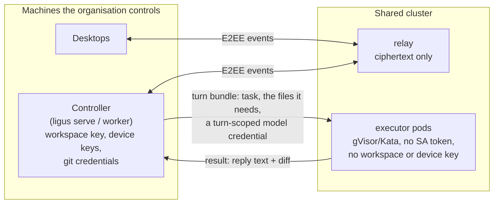

# Relay and executors only, keys off the cluster (design)

!!! danger "Design, not shipped"
    Nothing here is implemented in 0.1. It describes a target shape so it
    can be reviewed and planned. Today, every Ligus process that runs agent
    turns (desktop, `ligus serve`, `ligus worker`) holds the workspace key.
    The [Kubernetes preview](kubernetes.md) puts `ligus serve`, and therefore
    the key, on the cluster.

## Why

Some organisations want a shared cluster for the heavy, untrusted part of
agent work (running tools, tests and builds in sandboxes) without giving the
cluster, or its administrators, the ability to read their workspaces.

## Shape

- **On the cluster:** the relay (as today: ciphertext and metadata) and
  executor pods.
- **Off the cluster:** every component that holds a workspace key or device
  key: desktops and the controller that decides which turns run, packages
  their inputs, verifies results and signs events.
- **An executor** receives one turn's bundle (instructions, the files or
  checkout slice the turn needs, a short-lived model credential), runs the
  agent in a sandbox, and returns a reply and a diff. It never sees the
  workspace key, other chats, device keys or git push credentials, and it
  can't sign events. The controller turns its output into a proposal like
  any other.

## What it would and wouldn't protect

- **Would:** the cluster operator can't decrypt the workspace from the relay
  or from executor state at rest; a compromised executor can't forge events
  or read other turns.
- **Wouldn't:** an executor necessarily sees the plaintext of the turn it
  runs (the task and the files it was given) while it runs. A cluster
  operator who can inspect running pods can read those turns. Keys staying
  off the cluster limits exposure to the turns sent there, not to zero.

## What's missing today

- A controller/executor protocol and the `ligus exec-turn` command (the
  [Kubernetes design](https://github.com/ligus-ai/ligus/blob/main/docs/design/kubernetes.md)
  §3.3 and Phase 3 describe the in-cluster version, where the controller is
  on the cluster).
- A way for an off-cluster controller to reach in-cluster executors (a
  tunnel through the relay, or an executor API).
- Turn-scoped, revocable model credentials.
- Selecting which files leave the controller for a turn.
