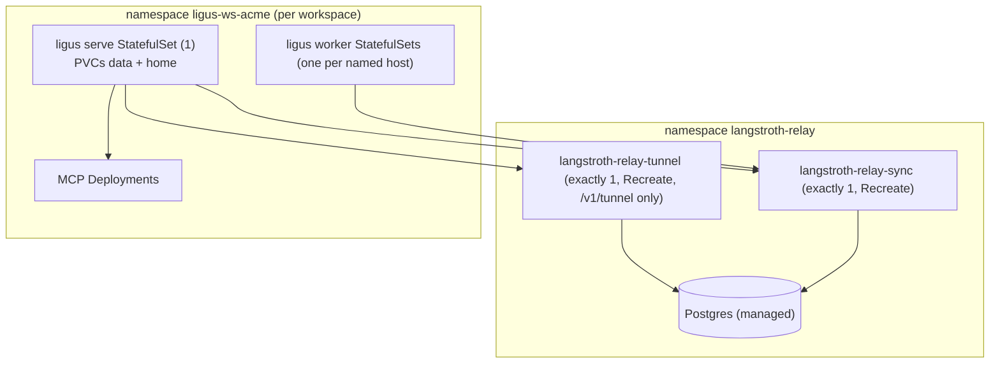

# Kubernetes for one organisation (preview)

!!! warning "Preview: build the `ligus` image yourself"
    Three Helm charts implement this. What is published, and where:

    | Piece | Published? | Reference |
    |---|---|---|
    | `langstroth-relay` chart | yes, 0.3.0 | `oci://ghcr.io/langstroth-ai/charts/langstroth-relay --version 0.3.0` |
    | `langstroth-relay` image | yes, 0.3.0 (amd64, arm64) | `ghcr.io/langstroth-ai/langstroth-relay:0.3.0` |
    | `langstroth-auth` chart | yes, 0.1.0 | `oci://ghcr.io/langstroth-ai/charts/langstroth-auth --version 0.1.0` |
    | `langstroth-auth` image | yes, 0.3.0 | `ghcr.io/langstroth-ai/langstroth-auth:0.3.0` |
    | `ligus` chart | no | [`deploy/helm/ligus`](https://github.com/langstroth-ai/ligus/tree/main/deploy/helm/ligus) in this repository (chart 0.5.0) |
    | `ligus` image | no | build it from [`deploy/container/Dockerfile`](https://github.com/langstroth-ai/ligus/blob/main/deploy/container/Dockerfile) |

    The relay pieces are pulled anonymously; no registry login is needed.
    Each Ligus release publishes the desktop apps and the `ligus` CLI
    binaries (including static Linux builds), not a container image or a
    chart: its Kubernetes check builds the image and installs the chart on
    a throwaway kind cluster, then discards both. Install the `ligus` chart
    from a checkout of this repository and point it at an image you build
    and push to your own registry. Values and behaviour may change. The
    design they implement is
    [`docs/design/kubernetes.md`](https://github.com/langstroth-ai/ligus/blob/main/docs/design/kubernetes.md).

This shape runs the always-on parts of the Langstroth platform for **one trusted
organisation** on a cluster: the relay (and optionally langstroth-auth), and per
workspace a `ligus serve` device, optional named workers and MCP servers.
Members still use the desktop app and the phone app as usual.



## What runs where, and what it holds

| Component | Kubernetes shape | Holds |
|---|---|---|
| Relay sync | Deployment, exactly one replica, `Recreate` | DB URL, token-issuer **public** key, metrics token. Never a workspace key |
| Relay tunnel | Deployment, exactly one replica, `Recreate`, serves only `/v1/tunnel/*` | as above, plus the APNs key if push is on |
| langstroth-auth (optional) | Deployment, exactly one replica, `Recreate` | the token-issuer signing key, IdP client secrets, its DB URL |
| `ligus serve` | StatefulSet, 1 replica, `ReadWriteOncePod` data PVC and a `home` PVC | the workspace key, its device key, `ligus.db`, `serve.token`, tunnel keys, checkouts, model and MCP keys you give it |
| `ligus worker` | one single-replica StatefulSet per `worker.instances[]` entry | the same kinds of secrets as serve, for its own identity |
| MCP servers | Deployment + Service + NetworkPolicy each | their own tokens |

Agent turns (CLI agents, `run_command`, stdio MCP servers) run **inside the
serve and worker pods**, confined by Ligus's own sandbox. There are no
per-turn executor pods.

The serve and worker volumes are as sensitive as the workspace key. Use an
encrypted StorageClass and never put them on NFS or RWX volumes. Enable
[encryption at rest for Secrets in etcd](https://kubernetes.io/docs/tasks/administer-cluster/encrypt-data/)
(a KMS provider where you can): the workspace key's Secret is otherwise
stored in etcd in the clear, and anyone with etcd or its backups reads it.

## Supported nodes: the agent sandbox

In a Pod Security `restricted` pod (`RuntimeDefault` seccomp, all
capabilities dropped) **Landlock is the only sandbox tier**: the container
runtime's default seccomp profile allows `unshare` and namespace `clone` only
with `CAP_SYS_ADMIN`, so bubblewrap can't create its namespaces. Landlock
needs:

- Linux **6.7 or later** (Landlock ABI 4, TCP rules) with `landlock` in the
  kernel's LSM list (`cat /sys/kernel/security/lsm`, or the `lsm=` boot
  parameter);
- a runtime seccomp profile that allows `landlock_create_ruleset`,
  `landlock_add_rule` and `landlock_restrict_self` (containerd's and
  CRI-O's current defaults do; check older ones).

With no confinement at all Ligus refuses **every** agent turn that runs a
local program, read-only ones included (CLI agents, `run_command`, stdio MCP
servers); only tool-less HTTP model chat runs. The chart therefore fails
closed: serve and workers run with `LIGUS_REQUIRE_SANDBOX=1` and
`LIGUS_SANDBOX=landlock` and exit rather than start unconfined, and every pod
starts with a `sandbox-preflight` init container,
`ligus doctor --require-confined --expect-tier landlock --turn-test`, which
runs one real agent turn against an in-process stub model and checks that
its `run_command` runs, can't read `/proc/1/environ` (the pod's environment),
the data dir or the secret files. On a node that fails, the pod stays in
`Init` and never becomes Ready:

```sh
kubectl -n ligus-ws-acme logs acme-ligus-serve-0 -c sandbox-preflight
```

Kernel versions of managed node images change often; **verify each node pool
with the preflight** before relying on it (a test release with
`helm test` runs the same turn). The table says what to expect, not what we
measured:

| Node image / runtime | Expectation |
|---|---|
| Any Linux node, kernel 6.7+, `landlock` in the LSM list, containerd/CRI-O default seccomp | Supported |
| Kernel older than 6.7 (several LTS images of EKS AL2023, Bottlerocket, AKS Ubuntu 22.04 / Azure Linux, older GKE COS) | Not supported: every turn would be refused. Verify with the preflight; pick a newer image |
| Kata Containers with a 6.7+ guest kernel | Expected to work (Landlock runs in the guest); verify with the preflight |
| gVisor (GKE Sandbox, `runsc`) | **Not supported**: gVisor doesn't implement Landlock, so the preflight fails |
| GKE Autopilot, EKS on Fargate, other managed sandboxes | Only if the preflight passes on them |
| A bubblewrap pool (unprivileged user namespaces through a node-installed `Localhost` seccomp profile and an AppArmor profile for bwrap) | Possible but not what the chart ships: it needs a non-`restricted` pod spec. Not covered here |

gVisor or Kata around serve is not a substitute for the in-pod sandbox: they
protect the node, not serve's keys from the agent process next to them.

## Hardening the charts apply

- Every pod: UID 65532, read-only root filesystem, all capabilities dropped,
  `RuntimeDefault` seccomp, no service-account token, no `hostNetwork`. The
  namespaces can enforce Pod Security `restricted`. serve and workers set
  `PR_SET_DUMPABLE=0`, so no other process of the same user reads their
  memory or environment.
- **Secrets are files, not environment variables.** The workspace key (and
  relay token) are mounted `0400` for Ligus's k8s secret-store backend
  (`LIGUS_SECRET_BACKEND=k8s`, `LIGUS_SECRETS_DIR`); workspace runtime
  credentials are a mounted directory (`LIGUS_WS_SECRET_DIR`); the tunnel
  registration and ntfy tokens are `LIGUS_*_FILE`. Ligus denies all of these
  files to agent processes. `envFrom` of whole Secrets is refused. Provider
  keys CLI agents read from their environment go in `serve.agentEnv` /
  `worker.agentEnv`, one allow-listed name at a time. The relay and
  langstroth-auth read their database URL and secret settings from mounted files
  too. Each pod carries a `checksum/secrets` annotation that rolls it when a
  Secret changes (a constant under `helm template`; with Argo CD or Flux use
  [Reloader](https://github.com/stakater/Reloader)).
- **No generated Secrets.** None of the charts creates a Secret with
  `lookup`, so `helm template`, Argo CD and Flux render the same thing every
  time; you create the Secrets first (below).
- `ligus serve` binds `0.0.0.0:8787` inside its pod with
  `LIGUS_SERVE_ALLOW_ANY_BIND=1`. That is safe only because the pod's network
  namespace is private and the chart never sets `hostNetwork`: the Service
  (ClusterIP) and NetworkPolicy decide who reaches it. Reach it from phones
  through the relay tunnel, never a public Ingress or `LoadBalancer`.
- **Network policies.** Egress of serve and workers is closed by default:
  DNS (to the cluster resolver only), the relay, this release's MCP servers,
  and what you allow. `networkPolicy.allowInternetHttps` opens 443 to
  everything except cloud metadata (`169.254.0.0/16`, `100.100.100.200`) and
  private ranges (`networkPolicy.internetExcept`). MCP server pods get the
  same rule (per server `internetHttps`, default on) plus their own
  `egress`. Only this release's own pods reach `serve:8787`.
  `networkPolicy.namespaceDefaultDeny` adds a namespace-wide deny-all.
  langstroth-auth's admin port admits no pod by default; its egress is DNS, the
  IdP (443 outside metadata and private ranges) and your database.
- **MCP server images are pinned** by digest; a tag refuses to render unless
  that server sets `allowUnpinned: true`.
- **Single writers.** serve and every worker are exactly one pod on a
  `ReadWriteOncePod` volume (`ReadWriteOnce` would allow two pods on one
  node); relay-sync, the tunnel and langstroth-auth are exactly one replica with
  `Recreate`. The charts refuse more.
- **Ingress.** The relay chart refuses an Ingress without TLS, refuses a
  public relay without `clientIP.trustedProxies` (every client would share
  one rate-limit bucket: ten bad pairing guesses from anyone lock pairing for
  everyone) or without a metrics token (`/metrics` would be public), and by
  default sets 3600 s WebSocket/SSE timeouts and `proxy-buffering: off` for
  ingress-nginx and AWS ALB (HTTPRoute: 3600 s rule timeouts). List exactly
  the addresses your ingress controller or load balancer connects from,
  never the whole pod CIDR.
- `deploy/helm/ligus/ci/security_test.py` and the relay's
  `helm_chart_test.go` check these properties on the rendered charts.

## Where the relay runs {#where-the-relay-runs}

Hosts in the cluster (serve and workers) only ever dial out to the relay. Pick
one of three patterns. In all three, the relay URL is typed once, by whoever
creates the workspace (on the desktop) or sets up the hosts (the chart's
`relayUrl`), and then travels in every invite, so people who join never
enter it.

1. **External relay, nothing exposed.** The hosts dial out to a relay outside
   the cluster: [the community relay](../networking/community-relay.md)
   (`https://relay.langstroth.ai`, best-effort), or one you
   [run elsewhere](../networking/self-host.md). Set `relayUrl` to it and leave
   `relay.enabled=false`. The cluster needs egress to the relay and no
   Ingress, Gateway or LoadBalancer at all.
2. **In-cluster relay, public.** Install the `langstroth-relay` chart (below)
   and expose it with an Ingress (`ingress.*`) or a Gateway API route
   (`httpRoute.*`), with TLS and a DNS name such as `relay.example.com`.
   Desktops and phones reach it over the internet; hosts in the cluster can
   use the in-cluster Service (`langstroth-relay-sync`) or the public URL. The
   relay chart's public-exposure guards apply; give it a token gate or
   server-side membership.
3. **In-cluster relay, private.** Install the relay chart without a public
   route and reach it only over a VPN or a tailnet, for example by exposing
   its Service with the Tailscale Kubernetes operator. Every device that syncs
   must be on that network, and the URL in invites is the private one (a
   tailnet name or VPN address), so it works only for people on it.

## Install

Build the `ligus` image yourself and push it to a registry your cluster can
pull from. The relay chart and image are published, so the relay needs no
build:

```sh
# in a ligus checkout at v0.5.0
docker build -f deploy/container/Dockerfile -t registry.example.com/ligus:0.5.0 .
docker push registry.example.com/ligus:0.5.0
```

### Relay

```sh
kubectl create namespace langstroth-relay
kubectl label namespace langstroth-relay pod-security.kubernetes.io/enforce=restricted
# The database URL (sslmode=verify-full against a managed Postgres).
kubectl -n langstroth-relay create secret generic relay-db \
  --from-literal=DATABASE_URL='postgres://relay:…@db.example.com:5432/relay?sslmode=verify-full'
# Secret settings, one key per setting name (mounted as files).
kubectl -n langstroth-relay create secret generic relay-env \
  --from-literal=LANGSTROTH_RELAY_TOKEN_PUBKEY=<issuer public key>
kubectl -n langstroth-relay create secret generic relay-metrics --from-literal=token=$(openssl rand -hex 24)
kubectl -n langstroth-relay create secret tls relay-tls --cert=relay.crt --key=relay.key   # or cert-manager
helm install langstroth-relay oci://ghcr.io/langstroth-ai/charts/langstroth-relay \
  --version 0.3.0 -n langstroth-relay \
  --set database.mode=external --set database.external.existingSecret=relay-db \
  --set 'database.external.cidrs[0]=<database address>/32' \
  --set config.existingSecret=relay-env \
  --set metrics.token.existingSecret=relay-metrics \
  --set ingress.enabled=true --set ingress.className=nginx \
  --set ingress.host=relay.example.com --set ingress.tls.secretName=relay-tls \
  --set 'clientIP.trustedProxies[0]=<your ingress controller address>/32'
helm test langstroth-relay -n langstroth-relay
```

The chart's default image is `ghcr.io/langstroth-ai/langstroth-relay` at
the chart's version; set `image.repository` and `image.tag` only to use a
mirror or your own build.

With the release name `langstroth-relay` the in-cluster Services are
`langstroth-relay-sync` and `langstroth-relay-tunnel`. The tunnel is off by default;
for the phone app add `--set tunnel.mode=allowlist --set
'tunnel.allowedHosts[0]=<host id>'` (the host id is printed by
`ligus remote status` on serve), or `open` behind a token gate
(`LANGSTROTH_RELAY_TOKEN_PUBKEY` or `LANGSTROTH_RELAY_ACCESS_TOKENS` in `relay-env`).

`database.mode` picks the relay's Postgres: `external` (above: a managed
or separately run Postgres, the DSN from a Secret, `sslmode=verify-full`),
`cnpg` (a CloudNativePG cluster in the release namespace; the operator must
be installed; 1 or 3+ instances, WAL archiving and scheduled backups) or
`bundled` (one hardened Postgres pod with TLS, a non-superuser role and a
nightly `pg_dump` CronJob; no HA). With the in-memory store
(`database.mode=none`) the chart runs one pod serving every route. The
older `externalDatabase.*` and `postgres.enabled` keys are deprecated; the
latter renders a development pod without TLS or backups. The chart's
[README](https://github.com/langstroth-ai/langstroth-relay/tree/main/deploy/helm/langstroth-relay)
has every value.

Settings to get right on the relay:

- **Egress.** `networkPolicy.restrictEgress` is on: the chart opens DNS and
  the database (`database.external.cidrs` for an external one); list in
  `networkPolicy.extraEgress` anything else the relay must reach, such as
  APNs (`api.push.apple.com:443`) on the tunnel pod if push is on, as
  `ipBlock` rules (NetworkPolicy can't match host names).
- **APNs** keys go only in `tunnel.apns.existingSecret`, a Secret of their
  own; the chart refuses them in `config.existingSecret` or `config.env`, and
  the relay refuses to start with APNs settings on a pod whose tunnel is off.
- **Workspace scope.** Issue tokens with `--workspace <id>` and set
  `LANGSTROTH_RELAY_WORKSPACE_SCOPE=claims` (or `strict`); see
  [Self-hosting a relay](../networking/self-host.md#per-workspace-token-scope).
- **Storage bounds.** The relay never trims a workspace's envelopes (a
  device that joins later rebuilds the workspace from its first event).
  Bound storage with the refusing quotas under the chart's `limits.*`
  (room bytes and envelope counts, rooms per client, idle-room retention);
  see [Self-hosting a relay](../networking/self-host.md#retention).
- A malformed `LANGSTROTH_RELAY_TOKEN_PUBKEY` keeps the relay from starting.

### One workspace

Create the workspace on a desktop first (**Add workspace → Create**) and take
the room and key from its invite, or from **Settings → Team sync**. Then:

```sh
# in a ligus checkout at v0.5.0: fetch the chart's one dependency, the
# published langstroth-relay chart (optional at runtime, needed to render)
helm dependency build deploy/helm/ligus

kubectl create namespace ligus-ws-acme
kubectl label namespace ligus-ws-acme pod-security.kubernetes.io/enforce=restricted
kubectl -n ligus-ws-acme create secret generic acme-workspace \
  --from-literal=room=<room> --from-literal=key=<workspace key> \
  --from-literal=relay-access-token=<hrt1 token>
# serve's box admission: desktop, workspace menu > Admit a box > For Kubernetes
kubectl -n ligus-ws-acme create secret generic acme-serve-admission \
  --from-file=admission=./serve-admission.txt
helm install acme deploy/helm/ligus -n ligus-ws-acme \
  --set image.repository=registry.example.com/ligus --set image.tag=0.5.0 \
  --set relayUrl=https://relay.example.com \
  --set workspace.existingSecret=acme-workspace \
  --set workspace.relayAccessToken=true \
  --set serve.admission.existingSecret=acme-serve-admission \
  --set networkPolicy.allowInternetHttps=true
helm test acme -n ligus-ws-acme --logs
```

`networkPolicy.allowInternetHttps=true` lets serve reach the relay's https
URL and hosted model APIs. For a relay in the same cluster use
`relayUrl=http://langstroth-relay-sync.langstroth-relay.svc.cluster.local:8443` and
`networkPolicy.relayNamespace=langstroth-relay` instead. If the relay admits only
workspace-scoped tokens, add `--set tests.sync.enabled=false` (the sync test
uses a throwaway workspace).

For the phone, from your own terminal (it prints a secret; never run it as a
Job, whose logs are kept, and remember that `kubectl exec` sessions can be
recorded by audit logging):

```sh
kubectl -n ligus-ws-acme exec -it acme-ligus-serve-0 -- ligus pair --relay-only  # needs remote.enabled
```

!!! note "serve and workers are their own members"
    serve and every worker join the workspace as their own **service
    member** (at most Contributor; their votes never count as a person's).
    Each box needs its own single-use admission: make one per box on the
    desktop (workspace menu, **Admit a box… → For Kubernetes**), store it in a
    Secret, and name it in `serve.admission.existingSecret` or
    `worker.instances[].admission.existingSecret`. The box syncs first,
    refuses to start without a copy of the workspace (it never founds one),
    and redeems the code, which binds it to the box's key. Delete the Secret
    once the box has joined. `ligus serve enroll` stops with an error that
    points to admission, and the chart has no `serve.owner` value. See [Admitting a box](../ops/admitting-a-box.md).

Useful values of the `ligus` chart: `remote.enabled` / `remote.relayUrl`
(phone tunnel), `serve.defaultAgent`,
`serve.workspaceSecrets` and `serve.agentEnv` (secrets),
`serve.runtimesToml` (mounted, `LIGUS_RUNTIMES_FILE`), `serve.mcpToml`,
`worker.enabled` / `worker.instances[]` / `worker.permissionMode`,
`mcp.servers[]`, `agentSandbox.*`, `networkPolicy.*`. The full table is in
the chart's
[README](https://github.com/langstroth-ai/ligus/tree/main/deploy/helm/ligus).

!!! warning "Model keys reach CLI agents"
    Ligus keeps its own secrets (the workspace key, relay and tunnel tokens,
    workspace runtime credentials) away from agent processes, but provider
    keys in `agentEnv` (`ANTHROPIC_API_KEY`, `OPENAI_API_KEY`, ...) pass
    through to CLI agents, which need them. An agent with a shell can print
    them. Give the pods keys you can rotate and limit with the provider.
    To keep provider keys off the pods entirely, route agents through an
    LLM gateway: the egress proxy adds the gateway credential and agents
    never see it. See [Deploying with an LLM gateway](model-gateways.md).

!!! warning "Workers with write access"
    `worker.permissionMode` (`acceptEdits`, `runCommands`,
    `bypassPermissions`) lets CLI agents on the workers edit files or run
    commands. The tool gate then defaults to Admin, so only members you'd
    trust with a shell on the pod can drive those agents; below it, Claude
    Code, Antigravity and Copilot run read-only and the other CLIs are
    refused. Every agent process runs under Landlock (above); with no
    confinement, no turn that runs a local program runs at all. `HOME` is
    `/home/ligus`, its own volume, outside the data dir agents can't read.

## Operating it

### Who can read the workspace

Anyone who can `kubectl exec` into a serve or worker pod (`pods/exec` in the
workspace namespace), read its Secrets, or read its volumes or their
snapshots can read the workspace. Grant those verbs as you would the
workspace key itself.

### Backups

- **Back up Postgres, not the identity volumes.** The relay's and
  langstroth-auth's Postgres: point-in-time recovery (WAL archiving: your managed
  database's PITR, or CloudNativePG / pgBackRest), connections with
  `sslmode=verify-full`. Keep relay dumps apart from the APNs key: together
  they are a push channel to every registered phone.
- **Don't back up the serve and worker PVCs.** A restored volume brings back
  revoked phones and tunnel pairings, an old `serve.token`, old device keys
  and an already-rotated langstroth-auth refresh token (whose reuse revokes the
  session). Losing a volume means: revoke that member or device, install a
  fresh identity, rebind its agents. The PVC holds every epoch key, so if
  you lost **control** of the volume (not just the data), also rotate the
  workspace key. If you must keep volume snapshots, encrypt them with a KMS
  key, scale the StatefulSet to 0 before a restore (never two writers), and
  re-pair phones afterwards.

### Upgrades

1. The relay first (migrations run under an advisory lock and are additive,
   so an old pod and a new one can overlap), then langstroth-auth, then the
   workspaces.
2. Pin each serve image (by digest) to the desktop release your members run.
3. `helm upgrade` restarts serve on the same volume and identity; relay-sync
   and the tunnel use `Recreate`, so expect a few seconds without sync.
4. Before turning on `LANGSTROTH_RELAY_WORKSPACE_SCOPE=strict`, issue
   workspace-scoped tokens and roll them out to every client.
5. Changing `persistence.accessMode`, the `home` volume or the worker layout
   changes the StatefulSets' `volumeClaimTemplates`, which Kubernetes doesn't
   allow in place: delete the StatefulSet with `--cascade=orphan` first (its
   PVCs stay).

### Uninstalling is not revoking

`helm uninstall` removes the pods but keeps the PVCs (StatefulSet claims
outlive the release), and the workspace Secret is yours. Neither the
identity nor its access goes away. To retire a workspace install: revoke the
serve and worker members or devices from a desktop, rotate the workspace key
if the cluster should lose access, then delete the Secrets and the PVCs
(`kubectl -n ligus-ws-acme delete pvc -l app.kubernetes.io/instance=acme`).

Rotating the workspace key or revoking a device follows the normal
[runbooks](../security/runbooks.md); update the workspace Secret afterwards.

## Explicitly unsupported in 0.1

- Mutually distrusting tenants on a shared relay, langstroth-auth or cluster.
- HA of relay-sync, the relay tunnel or langstroth-auth (each runs exactly one
  replica), and worker autoscaling.
- Kubernetes per-turn executors, PR-test sandboxes, Kueue / agent-sandbox /
  Substrate integrations.
- [Keys off the cluster](keys-off-cluster.md) (a design only).
- gVisor for serve and worker pods.
- A public Ingress or `LoadBalancer` for `ligus serve`.
- The relay chart's deprecated `postgres.enabled` development pod for
  anything but development (`database.mode=bundled` is the small self-host
  option).
- OpenTelemetry export from Ligus.

## Known limits and residual risks {#residual-risks}

- In-cluster model endpoints are accepted as keyless/private only by their
  full `*.svc.cluster.local` name.
- On some CNIs (kind's kindnet among them) a new pod's first moments of
  traffic can precede its NetworkPolicy.
- **DNS tunnelling.** Pods may query only the cluster resolver, but it
  forwards names it doesn't own upstream, so code in a pod can still leak
  data encoded in DNS queries to a domain its author controls. Closing that
  needs a resolver that refuses external names for those pods.
- The serve and worker volumes hold the workspace key (see *Who can read the
  workspace*).
