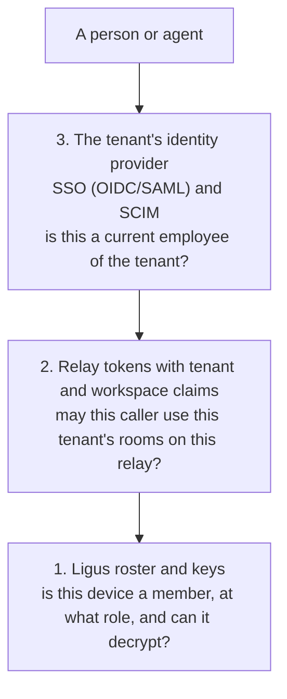

# Multi-tenant hosting (design)

!!! danger "Partly implemented"
    This page describes a design for one self-hosted deployment serving
    several unrelated organisations (tenants). Relay v0.3.0 implements the
    relay side of layer 2 (below) as **tenancy**, off by default; the SSO and
    SCIM coupling to the Ligus roster (layer 3) is a design. Tenancy is
    logical isolation inside one relay process, not separate infrastructure,
    and the relay operator still sees every tenant's metadata. The
    [Kubernetes preview](kubernetes.md) doesn't support mutually distrusting
    tenants on a shared relay, langstroth-auth or cluster.

## Three layers of authorization

Multi-tenant Langstroth keeps three independent layers, each answering a
different question. A request must pass all three.

### 1. Ligus roster and keys (exists today)

The workspace's own membership, roles and end-to-end encryption, enforced by
every device. This is the layer that protects content: the relay operator
never holds keys. It stays authoritative in a multi-tenant design; the
layers below only decide who may reach the relay. See the
[security model](../security/index.md).

### 2. Relay tokens with tenant and workspace claims (relay v0.3.0)

Signed `hrt1` tokens can carry a `workspaces` claim and, from
[langstroth-auth](ligus-auth.md), a `tid` (tenant) claim. Two relay settings
use them:

- `LANGSTROTH_RELAY_TENANTS=<id>,…` admits only tokens whose `tid` is listed.
  It needs `LANGSTROTH_RELAY_TOKEN_PUBKEY` and
  `LANGSTROTH_RELAY_WORKSPACE_SCOPE=strict` (the relay refuses to start
  otherwise), and it doesn't separate tenants' storage.
- **Tenancy**, `LANGSTROTH_RELAY_TENANCY` (JSON, normally from
  `LANGSTROTH_RELAY_TENANCY_FILE`), replaces it for organisations that
  don't trust each other:
    - the tenant comes only from a verified token's `tid`, signed by that
      tenant's own `issuer_pubkeys` or (with `shared_issuer`, the default)
      by `LANGSTROTH_RELAY_TOKEN_PUBKEY`; a token from tenant A's issuer
      naming tenant B gets `401`, and the open policy and
      `LANGSTROTH_RELAY_ACCESS_TOKENS` are refused;
    - workspaces, contacts and pairing codes are stored per tenant, so two
      tenants using the same workspace id get unrelated workspaces; a tunnel
      host is bound to the tenant of its first registration;
    - each tenant gets its own quotas and rates (`max_bytes`, `max_rooms`,
      `room_max_bytes`, `room_max_envelopes`, `rate`/`burst`,
      `max_pairings`, `max_hosts`, `push_per_day` and attachment quotas;
      `507`/`429` past them) and metrics labelled by tenant id;
    - tenant admin routes (`GET /v1/tenant`, `GET /v1/tenant/rooms`,
      `DELETE /v1/tenant/rooms/{id}`) admit a tenant token with the
      `tenant_admin` cap or the tenant's static admin token, for that tenant
      only.

    Tenancy needs `LANGSTROTH_RELAY_METRICS_TOKEN` (an open `/metrics` would
    list every tenant) and refuses the GitHub routes. Turning it on for a
    relay that already holds workspaces hides them, so use it for new
    deployments. The relay repository's `docs/tenancy.md` has the details; the
    Helm chart takes the JSON from a Secret (`tenancy.existingSecret`).

### 3. The tenant's SSO and SCIM (design)

The tenant's identity provider decides who is an employee. Token issuance
would require a fresh SSO login; SCIM deprovisioning would revoke that
person's relay tokens and flag them for removal from the Ligus roster. An
Admin would still perform the removal with key rotation (layer 1), because
only a member's device can rotate a workspace key.

## Open questions

- How SCIM deprovisioning reaches workspaces with headless devices, which
  can't follow a key rotation today.
- Whether tenants should get separate relay processes or databases rather
  than relay v0.3.0's tenant-prefixed storage in one process.
- How much metadata (workspace ids, timing, IPs) one tenant's operator may
  see about another's.
