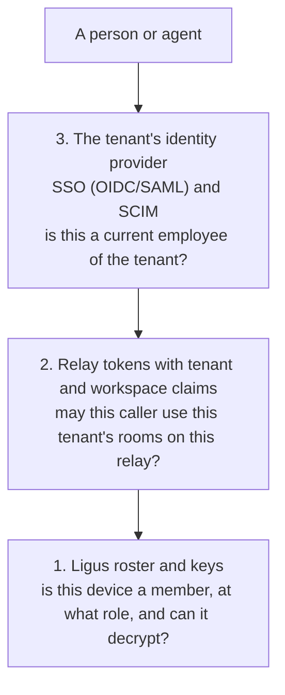

# Multi-tenant hosting (design)

!!! danger "Not yet implemented"
    This page describes a design for one self-hosted deployment serving
    several unrelated organisations (tenants). Most of the tenant-aware parts
    below don't exist in 0.1: an access token admits a caller to the relay,
    not to a tenant, and beyond langstroth-auth's tenant claims and
    `LIGUS_RELAY_TENANTS` the relay has no per-tenant authorization. Don't
    run a relay for mutually distrusting organisations and rely on anything
    on this page.

## Three layers of authorization

Multi-tenant Langstroth keeps three independent layers, each answering a
different question. A request must pass all three.

### 1. Ligus roster and keys (exists today)

The workspace's own membership, roles and end-to-end encryption, enforced by
every device. This is the layer that protects content: the relay operator
never holds keys. It stays authoritative in a multi-tenant design; the
layers below only decide who may reach the relay. See the
[security model](../security/index.md).

### 2. Relay tokens with tenant and workspace claims (design)

Today's signed `hrt1` tokens carry a subject, expiry, caps and optional workspaces. The
design adds **tenant** and **workspace** claims, so the relay can refuse a
token from tenant A on a room of tenant B, scope rate limits and retention
per tenant, and revoke a tenant's access as a whole. The relay's existing
membership and read/write guard seams are where this would plug in.

### 3. The tenant's SSO and SCIM (design)

The tenant's identity provider decides who is an employee. Token issuance
would require a fresh SSO login; SCIM deprovisioning would revoke that
person's relay tokens and flag them for removal from the Ligus roster. An
Admin would still perform the removal with key rotation (layer 1), because
only a member's device can rotate a workspace key.

## Open questions

- How SCIM deprovisioning reaches workspaces with headless devices, which
  can't follow a key rotation today.
- Whether tenants get separate relay processes, separate databases, or
  shared storage with tenant-scoped rows.
- How much metadata (workspace ids, timing, IPs) one tenant's operator may
  see about another's.
