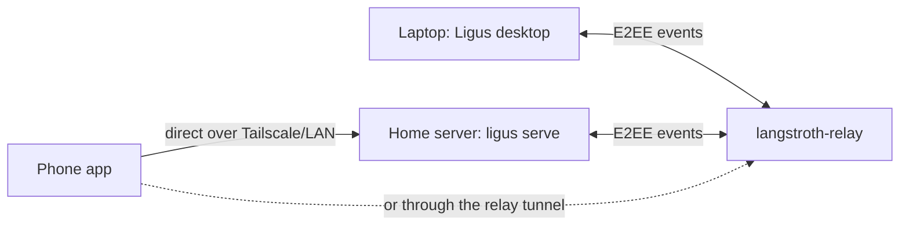

# Personal fleet: laptop, home server and phone

One person, several devices. Your laptop runs the desktop app; an always-on
home server runs `ligus serve` (and optionally `ligus worker`) so agents keep
working while the laptop sleeps; your phone talks to the home server. A relay
carries the encrypted events between the laptop and the server, and can also
carry the phone's traffic.



Time: about 30 minutes. You'll end with:

- a relay (on the home server or anywhere else);
- a workspace on the laptop, synced through that relay;
- `ligus serve` on the home server as its own member of the workspace (a box
  is never one of your devices);
- the phone paired to it, directly over Tailscale, through the relay, or both.

## What each piece holds

| Device | Holds | Doesn't hold |
|---|---|---|
| Laptop | your account key, its device key, the workspace key, all events | |
| Home server | its own member's account and device keys, the workspace key, all events, `serve.token`, `serve.operator.token`, tunnel host keys, checkouts | your account key |
| Relay | ciphertext, metadata, (tunnel) host public keys and push tokens | any key that decrypts the workspace |
| Phone | a bearer token and/or its tunnel credential and pairing key | the workspace key, any device key |

## 1. Run a relay

Skip this if you already have one. The simplest place is the home server
itself, in Docker:

```sh
docker build -t langstroth-relay https://github.com/langstroth-ai/langstroth-relay.git#v0.3.0
docker run -d --name langstroth-relay --restart unless-stopped \
  -p 127.0.0.1:8443:8443 -v langstroth-relay:/data \
  -e LANGSTROTH_RELAY_DATA_DIR=/data \
  -e LANGSTROTH_RELAY_TUNNEL=open \
  langstroth-relay
curl -s localhost:8443/v1/health
# ok
```

Give it an `https://` URL your laptop (and, for the tunnel, your phone) can
reach. Two common options:

- **Tailscale** on the home server: `tailscale serve --bg 8443` publishes it
  at `https://<machine>.<tailnet>.ts.net` to your tailnet only.
- **A public name** with a reverse proxy (Caddy) in front; then also gate the
  relay with tokens. See [Self-hosting a relay](../networking/self-host.md).

`LANGSTROTH_RELAY_TUNNEL=open` is only needed for the phone tunnel (step 8). On a
relay others can reach, prefer `allowlist` once you know the home server's
host id.

Check from the laptop:

```sh
curl -s https://relay.example.ts.net/v1/health
# ok
curl -s https://relay.example.ts.net/v1/tunnel/info
# {"versions":[1],"push":false,"billing":"none"}
```

## 2. Create the workspace on the laptop

1. Install the desktop app ([Solo laptop](solo.md#1-install)).
2. **Settings → Team sync**: set **Relay URL** (and **Relay access token** if
   your relay is gated). Save.
3. In the workspace rail, **Add workspace → Create**, give it a name,
   **Create workspace**. Ligus picks a random room and a random workspace key
   and shows an **Invite code** (`hivews1:…`). **Copy invite**.

The invite contains the relay URL, the room **and the workspace key**.
Anyone holding it can read the workspace. Move it only over a channel you
trust (SSH, a password manager), never chat or email.

Expected result: the sync item in the status bar at the foot of the window
reads **Live**, with a lock for end-to-end encrypted.

## 3. Install `ligus` on the home server

```sh
brew install langstroth-ai/ligus/ligus      # macOS or Linux with Homebrew
ligus --version
# ligus 0.5.0
```

Or build the container image (`deploy/container/Dockerfile`) and run
`ligus` from it with a volume at `/var/lib/ligus`.

## 4. Admit the server to the workspace

The server joins as **its own service member** (at most Contributor; its
votes never count as yours), admitted once by you with your passkey. Use a
dedicated data dir and keep it private.

On the laptop, open the workspace menu (the workspace name at the top of the
sidebar; or ⌘K, "Admit a box") and **Copy** the approval address
(`ligusaddr1:…`). It isn't a secret and grants nothing. On the server:

```sh
export LIGUS_DATA_DIR=$HOME/.ligus-serve
install -d -m 700 "$LIGUS_DATA_DIR"
ligus admit request --to 'ligusaddr1:…' --label home-server
# Code: K7Q4 M9X2  (the approver's screen must show the same)
```

The request appears in your Inbox on the laptop. Open it, check that the
code matches the server's, choose **Codes match** and confirm with your
passkey. The server keeps the admission by itself.

The guided flow and the deploy script take the same address, so nothing is
pasted there either:

```sh
ligus setup box --to 'ligusaddr1:…' --label home-server     # also checks the agent sandbox and ligus serve
deploy/local/ligus-local configure --role serve --data-dir ~/.ligus-serve \
  --label home-server --admit-to 'ligusaddr1:…' --json       # writes the env file, then admits
```

If the relay has no approval mailbox, both fall back to the paste below and
say so (exit 4, with the join request).

Without the address, `ligus admit request --label home-server` prints a join
request (`ligusjoin1:…`) to paste into **Admit a box… → From the box's join
request**; copy the code it gives you back to the server with
`ligus admit redeem 'ligusadmit1:…'` (add `LIGUS_RELAY_ACCESS_TOKEN` for a
gated relay).

The server joins when `ligus serve` starts (next step). See
[Admitting a box](../ops/admitting-a-box.md).

## 5. Run `ligus serve` as a service

The repository ships a systemd user unit and an env file in
[`deploy/ligus-serve/`](https://github.com/langstroth-ai/ligus/tree/main/deploy/ligus-serve).

```sh
install -Dm644 ligus-serve.service ~/.config/systemd/user/ligus-serve.service
install -Dm600 ligus-serve.env.example ~/.config/ligus-serve/ligus-serve.env
$EDITOR ~/.config/ligus-serve/ligus-serve.env
```

The settings that matter here:

```sh
LIGUS_DATA_DIR=/home/you/.ligus-serve
LIGUS_SERVE_LISTEN=192.0.2.10:8787   # the server's Tailscale IP (tailscale ip -4; 192.0.2.10 is a placeholder), or 127.0.0.1:8787 for tunnel-only
LIGUS_SERVE_LABEL=home-server
LIGUS_REPOS_DIR=/home/you/repos           # checkouts agents may work on
```

`ligus serve` refuses `0.0.0.0` and public addresses (the API is plain HTTP
behind one token). Then:

```sh
systemctl --user daemon-reload
systemctl --user enable --now ligus-serve
sudo loginctl enable-linger "$USER"        # keep it running when you're logged out
journalctl --user -u ligus-serve -n 20
```

Expected log lines:

```text
ligus serve: listening on http://192.0.2.10:8787 — workspace '…', host 63f2… ('home-server'). Ctrl-C to stop.
```

and, on its first start, `ligus: joined workspace '…' as its own service
member (Contributor).`

### Start at login on macOS (optional) {#start-at-login-on-macos}

On a Mac, `deploy/local/ligus-local` can install a per-user LaunchAgent so
the box starts when you log in and launchd restarts it if it exits. It is
off unless you ask for it; without `--launchd`, `start` runs the box in the
background for the current session only.

```sh
L=deploy/local/ligus-local
$L start  --role serve --data-dir ~/.ligus-serve --launchd   # install and load; rerun after editing the env file
$L status --role serve --data-dir ~/.ligus-serve             # installed? loaded? pid?
$L unit   --role serve --data-dir ~/.ligus-serve --launchd   # print the plist without installing it
$L stop   --role serve --data-dir ~/.ligus-serve --launchd   # unload it and delete the plist (no more start at login)
```

- The agent is `~/Library/LaunchAgents/ai.ligus.<role>[.<label>].plist`
  (mode 0644), loaded with `launchctl bootstrap gui/$(id -u)`. The label
  suffix is the host label from `configure --label`, left out when it is the
  default `<hostname>-<role>`, so a serve and a worker box, or two boxes of
  one role with different labels, get their own agents.
- The plist runs the `ligus` binary directly (`ProgramArguments`, no
  shell), with `WorkingDirectory` set to the data dir, `KeepAlive` with a
  10 s throttle, `ProcessType` Background and an owner-only umask. Its
  output goes to `~/Library/Logs/ligus/<role>[.<label>].log` (the directory
  is owner-only).
- launchd can't read an env file, so `start --launchd` copies the env
  file's settings (`LIGUS_DATA_DIR`, `LIGUS_RELAY_URL`, the listen address
  and label, `LIGUS_REQUIRE_SANDBOX=1`, ...) and your shell's `PATH` into
  the plist as literal values. Names that look like secrets (`*TOKEN*`,
  `*KEY*`, `*SECRET*`, `*PASS*`, ...) and URLs with a password in them are
  never copied: keep secret values in
  the data dir or the keychain and point at files with `*_FILE` settings,
  as on Linux. Edit the env file, not the plist, and run `start --launchd`
  again; it boots the old agent out first.
- `ligus-local uninstall` removes the agent too.

## 6. Check the server's membership

The laptop's **People** list shows the server as a service member. Phone
messages show under the server's name, and its votes never count as yours:
approve changes that need a person on the laptop. Details:
[Running ligus serve](../ops/serve-box.md).

Check:

```sh
curl -s http://192.0.2.10:8787/v1/health \
  -H "Authorization: Bearer $(cat ~/.ligus-serve/serve.token)"
# On the server itself (loopback), the operator uses its own token:
# curl -s http://127.0.0.1:8787/v1/health -H "Authorization: Bearer $(cat ~/.ligus-serve/serve.operator.token)"
# {…,"identity":{…,"mode":"member"},"ok":true,"version":"0.5.0",…}
```

## 7. Bind a repository

```sh
git clone https://github.com/you/project ~/repos/project
LIGUS_DATA_DIR=~/.ligus-serve ligus bind-repo project
LIGUS_DATA_DIR=~/.ligus-serve ligus repos
```

Agents answered on the server then work in isolated worktrees of that
checkout. See [Repos on the home host](../ops/serve-repos.md).

## 8. Pair the phone

Pick one path or both. Run these with the server's environment:

```sh
set -a; . ~/.config/ligus-serve/ligus-serve.env; set +a
```

=== "Direct over Tailscale"

    The phone and the server are on the same tailnet (or LAN), and
    `LIGUS_SERVE_LISTEN` is the server's tailnet address.

    ```sh
    ligus pair
    ```

    Scan the QR code from the phone app. The link carries the server URL and
    `serve.token`: treat it as a password.

=== "Through the relay tunnel"

    No VPN on the phone, no inbound port on the server.

    ```sh
    ligus remote enable --relay https://relay.example.ts.net
    systemctl --user restart ligus-serve
    ligus remote status
    # relay:     https://relay.example.ts.net (enabled)
    # host id:   <host id>
    # serve:     connected for 12s (status active, push unavailable, checked 3s ago)
    # phones:    0 active, 0 revoked
    ligus pair --relay-only
    ```

    The pairing secret works once, for 10 minutes. A relay reachable only on
    your tailnet still needs the phone on the tailnet; use a public relay
    name for "from anywhere" access.

See [Remote access for your phone](../networking/remote-access.md) and
[Ligus on your phone](../../ligus/features/phone-app.md).

## 9. Optional: a worker for heavy agents

A separate box (or the same one, with its **own** data dir) can host agents
with `ligus worker`:

```sh
export LIGUS_DATA_DIR=$HOME/.ligus-worker
ligus admit request --to 'ligusaddr1:…' --label gpu-box   # approve it on the laptop, as in step 4
ligus worker --label gpu-box             # syncs first, joins, registers its host
```

Then bind an agent to it from the laptop (an Admin's act).

See [Headless agents](../concepts/headless-agents.md).

## Optional: a model gateway on the server

To run agents on a gateway the server reaches (LiteLLM, llama.cpp's
server), list it on the server with its env file loaded:

```sh
set -a; . ~/.config/ligus-serve/ligus-serve.env; set +a
ligus gateway add home-gw --url https://gw.tailnet.ts.net/v1 --api openai
ligus gateway check home-gw --model qwen3-coder
```

Once a gateway is listed the server runs only turns that use one, and `add`
says so; add `--not-exclusive` to also run agents with a hosted key. Use
`https://`; a plain `http://` gateway needs `--allow-plaintext`, which is
your choice as the operator. A key is a file on the server
(`--auth bearer-file PATH`), never stored anywhere else. The running server
applies the change within a few seconds; restart it with the command `add`
prints so the laptop lists the gateway, then on the laptop pick the
gateway on a runtime and bind the agent to the server. See
[Deploying with an LLM gateway](model-gateways.md#outside-kubernetes).

## Verify the whole thing

- [ ] laptop status bar reads **Live**, with the lock (encrypted)
- [ ] `ligus chats` on the server lists the laptop's chats
- [ ] `/v1/health` with the token shows `"mode":"member"`
- [ ] the laptop's People list shows the server as a service member
- [ ] with the laptop closed, `@coder` (an agent hosted on the server) answers from the phone

## Operating it

- Upgrades: one command upgrades the CLI the way it was installed
  (`brew upgrade ligus` for Homebrew, else the release into the binary's
  own directory), restarts the box the way it runs (the systemd unit, the
  LaunchAgent, Homebrew's service or the background process), checks that
  it reports the new version and runs `verify`:

  ```sh
  $L upgrade --role serve --data-dir ~/.ligus-serve --json
  ```

  Run it again and nothing changes. It also lists anything the Hive-era
  install left (`hive-serve` units, `ai.hive.*` LaunchAgents,
  `~/.local/bin/hive`, `~/.hive*` data dirs, a running `hive` process) with
  the command to remove each; it never removes them itself. The unit file in
  `deploy/ligus-serve/` runs `~/.local/bin/ligus`; with Homebrew, install
  the unit with `$L start --systemd` instead (it runs the `ligus` on your
  `PATH`), or the upgrade won't change what runs.
- When a newer release is out, the desktop says so under the box in
  **People** > **Workers & hosts** with one grey line, "0.4.1 → 0.5.0
  available · how", and the phone's Health shows the same line. The box's
  version comes from its signed presence beat; the latest release is the
  one the desktop's own update check reads from the docs site's
  `version.json`. **how** names the command above. Nothing upgrades a box
  on its own, and a pre-release or development build shows no line.
- Back up `~/.ligus-serve` (keys, events, phone pairings). See
  [Operations](../ops/operations.md).
- Lost phone: `ligus phones revoke <name>`. Lost server: an Admin removes its
  member in **People** (a box is never in My devices). See [Runbooks](../security/runbooks.md).
