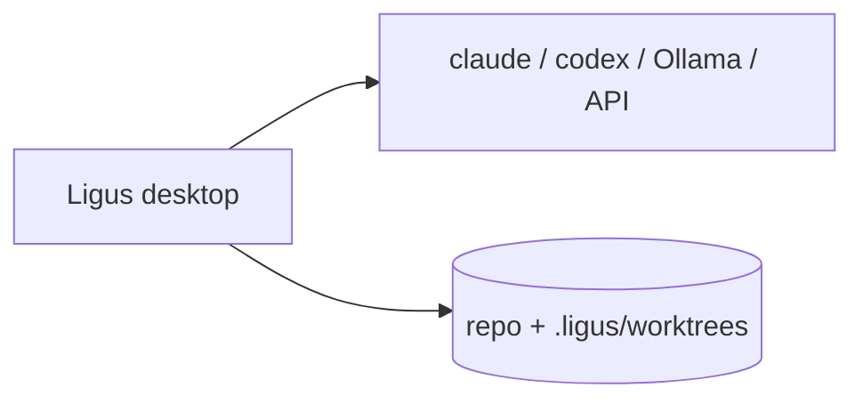

# Solo laptop

One person, one machine, no relay. Everything stays on the laptop except
what your model runtime sends to its provider.



## What you need

- macOS (Apple Silicon), Windows or Linux.
- A runtime: the Claude Code CLI signed in to your subscription (the
  default), Codex, a local Ollama, or an API key. See
  [Configuring a runtime](../../ligus/getting-started/configuring-a-runtime.md).
- A git repository to work in (agents edit isolated git worktrees).

## 1. Install

=== "macOS (Homebrew)"

    ```sh
    brew install --cask langstroth-ai/ligus/ligus-app
    ```

    If Homebrew refuses to load the tap: `brew trust --tap langstroth-ai/ligus`.

=== "Windows / Linux"

    Download the installer, `.AppImage`, `.deb` or `.rpm` from the
    [releases page](https://github.com/langstroth-ai/ligus/releases). These
    builds are unsigned; see [First launch](../../ligus/getting-started/first-launch.md#install).

Make sure your runtime works in a terminal first:

```sh
claude --version        # or: codex --version, ollama list
```

## 2. First launch

Open **Ligus**. The five-step wizard asks for a name (and shows your safety code),
the project folder, a runtime, an optional relay (**skip it**) and a theme.
See [First launch](../../ligus/getting-started/first-launch.md#wizard-steps).

Expected result: an empty workspace with your folder bound and the runtime
you picked as the chat's primary runtime. **Settings → Team sync** shows no
relay.

## 3. First chat

Click **+** next to **Chats**, type a request and press Enter. The reply
streams in. If the agent changes files, the changes arrive as a
**proposal** in the Review pane; nothing touches your working tree until you
click **Implement**. See [Your first chat](../../ligus/getting-started/first-chat.md)
and [Git integration](../../ligus/features/git.md).

## 4. Keep it safe

- **Permissions.** Settings → **Permissions** sets how far Claude Code may go
  (read-only, accept edits, run commands, bypass). Keep the default unless
  you trust the repository. Edits still land in an isolated worktree and come
  back as proposals.
- **Back up** the app data dir and your repositories. The data dir holds
  your keys and every chat; see
  [Backups and restore](../ops/operations.md#backups-and-restore).
- Private keys and tokens are in the OS secret store (a Ligus keychain on
  macOS); see [Key storage](../../ligus/concepts/identity.md#key-storage). Use
  full-disk encryption anyway.

## Where things live

| What | Where |
|---|---|
| Events, chats, proposals | `hive.db` in the app data dir |
| Identity and keys | `identity.json` in the app data dir; private keys in the OS secret store |
| Settings | `settings.json` in the app data dir (API keys and tokens in the OS secret store) |
| Per-chat worktrees, interrupted-turn patches | `<repo>/.ligus/` |
| Logs | the OS log dir for `ai.ligus.desktop`, file `ligus.log.<date>` |

App data dir: `~/Library/Application Support/ai.ligus.desktop` (macOS),
`%APPDATA%\ai.ligus.desktop` (Windows), `~/.local/share/ai.ligus.desktop`
(Linux).

## Growing out of it

- Want agents to keep working while the laptop sleeps, or Ligus on your
  phone? Go to [Personal fleet](personal-fleet.md).
- Want to share with others? Go to [Team on a relay](../ops/deployment.md).
  Your existing workspace can be connected to a relay later in
  **Settings → Team sync**.
