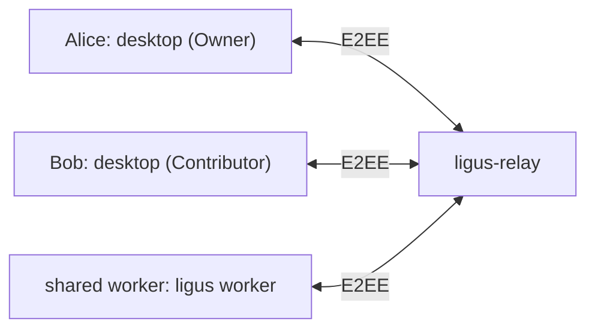

# Team on a relay

A team shares workspaces through one relay. Each member runs the desktop
app with their own runtime (their own Claude subscription, API key or local
model); optionally, shared worker boxes host agents that should stay online.
The relay stores and forwards only end-to-end encrypted events.



Time: about 20 minutes for the relay, 2 minutes per teammate.

## What you decide up front

| Decision | Options | Recommendation |
|---|---|---|
| Where the relay runs | Fly.io, a VM with Docker, Kubernetes (preview) | a small always-on machine with a volume or Postgres |
| Relay storage | Postgres, JSON snapshot on a volume, memory | snapshot for a small team; Postgres for more |
| Who may use the relay | open, static token list, signed tokens | signed tokens (`hrt1`) for anything on the internet |
| Relay-side membership | off, `LIGUS_RELAY_MEMBERSHIP=1` | off to start; see [Server-side membership](server-side-membership.md) |

## 1. Deploy the relay

Follow [Self-hosting a relay](../networking/self-host.md). The short
version on Fly.io:

```sh
git clone https://github.com/ligus-ai/relay && cd relay
fly launch --config deploy/fly.toml --copy-config --no-deploy
fly volumes create hive_data --size 1 --region <region>
fly deploy . --config deploy/fly.toml
curl -s https://<app>.fly.dev/v1/health
# ok
```

## 2. Gate it with signed tokens

On your own machine (not the relay), with the relay binary built
(`go build -o ligus-relay ./cmd/ligus-relay`):

```sh
./ligus-relay keygen
# private_key=…   # SECRET — keep on the issuer only (never on the relay)
# public_key=…
fly secrets set LIGUS_RELAY_TOKEN_PUBKEY=<public_key>
curl -s -o /dev/null -w '%{http_code}\n' https://<app>.fly.dev/v1/workspaces/x/envelopes
# 401
```

Mint one token per person (and per worker box):

```sh
./ligus-relay issue --key <private_key> --sub github:alice --exp-days 180
# hrt1.…
```

Store the private key in your password manager. Signed tokens can't be
revoked one at a time on the open-source relay, so give them an expiry; see
[Relay token compromised](../security/runbooks.md#relay-token).

## 3. Create the workspace (first Admin)

1. Install the desktop app ([Solo laptop](../deploy/solo.md#1-install)).
2. **Settings → Team sync**: **Relay URL** `https://<app>.fly.dev` and your
   **Relay access token**. Save.
3. Workspace rail **＋ → Add workspace → Create**. Ligus generates a random
   room id and workspace key; you are the Owner.

Expected result: the sync pill reads **live** and encrypted.

## 4. Bring teammates in

Each teammate installs the app and pastes **their own** relay token in
**Settings → Team sync**. Then either:

- **Invite by GitHub handle** (both signed in with GitHub): the workspace key
  is sealed to their devices; nothing secret is copy-pasted. Preferred.
- **Invite code**: send the `hivews1:…` code over a trusted channel (it
  contains the workspace key); they use **＋ → Add workspace → Join**.

See [Invites & joining](../features/invites.md). Then set roles in the
**People** pane: Owner, Admin, Contributor or Viewer. Roles limit what a
member can change, not what they can read. Keep Admins few.

Each teammate configures their own runtime; see
[Configuring a runtime](../getting-started/configuring-a-runtime.md).

## 5. Optional: a shared worker

A worker hosts agents for everyone, using **workspace** runtimes whose keys
live only on the worker:

```sh
brew install ligus-ai/ligus/ligus
ligus enroll 'hivews1:…' --token 'hrt1.…'
ligus sync
ligus register-worker --label team-worker      # prints the host id
```

Workspace runtimes carry credentials, so defining one needs **Admin**: every
device drops a runtime defined by a lower role. Either give the worker's
member Admin in the **People** pane for the setup and lower it afterwards, or
define the runtime and agent from an Admin's device. On the worker:

```sh
ligus add-runtime anthropic "Anthropic" anthropic claude-sonnet-4-6 --secret-ref anthropic
ligus add-agent reviewer anthropic
ligus set-agent-host reviewer <host id>
ligus sync
export LIGUS_WS_SECRET_anthropic=sk-ant-…       # matches --secret-ref; stays on this box
ligus worker --label team-worker
```

Run it under systemd (see `deploy/ligus-serve/` for a unit to adapt) and
consider:

- `LIGUS_MCP_MIN_ROLE` (default `admin` when the worker's tier can write,
  `contributor` when read-only): who can make the worker use tools;
- bubblewrap: agent processes run in the Linux sandbox; without `bwrap` (or
  where it can't create user namespaces) the worker uses the Landlock tier
  on Linux 6.7+, and refuses write-capable turns with neither (`ligus
  doctor`; see [The Linux agent sandbox](linux-sandbox.md));
- `LIGUS_WORKER_PERMISSION_MODE`: off (read-only) unless you want worker
  turns to propose edits;
- whoever administers the worker box can read the workspace.

See
[Headless agents](../concepts/headless-agents.md).

## 6. Security checklist

- [ ] TLS in front of the relay; `LIGUS_RELAY_TOKEN_PUBKEY` set and verified with a `401`
- [ ] issuer private key off the relay, in a password manager
- [ ] tokens issued with an expiry, one per person and box
- [ ] invites by GitHub handle where possible; invite codes only over trusted channels
- [ ] roles set; few Admins
- [ ] workspace runtimes use `--secret-ref`, not inline secrets
- [ ] everyone's sync pill reads **live**, encrypted
- [ ] relay backups scheduled ([Operations](operations.md))

## Offboarding and incidents

Use **People → Remove & revoke** (Admin) to remove someone and rotate the
workspace key for the remaining desktops; then revoke their relay token.
Workspaces with headless workers need more; follow
[Offboarding](../security/runbooks.md#offboarding).

## Costs

There's no shared inference bill: each member uses their own runtime, and
workers use the keys you give them. The relay is small: a `shared-cpu-1x`
machine with 256 to 512 MB handles a small team. See
[Pricing tiers](pricing.md) for hosted options.
