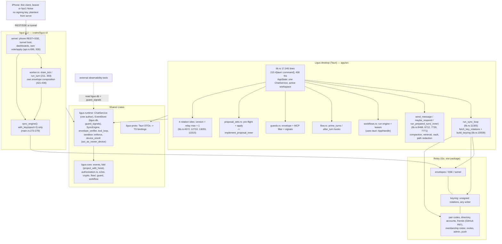
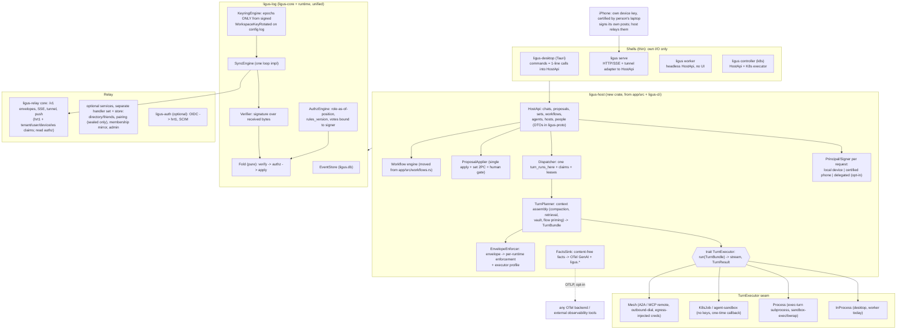
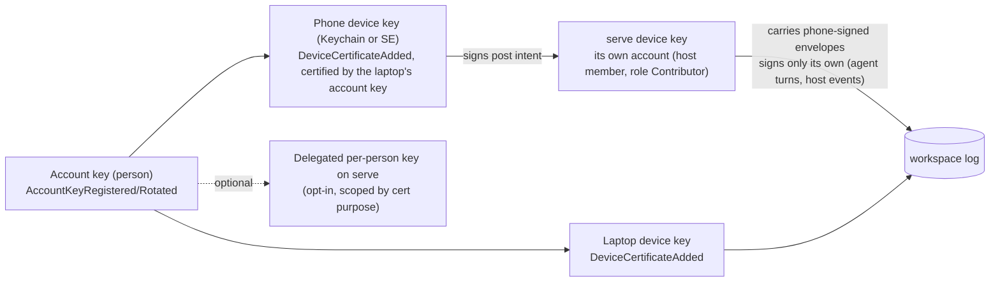
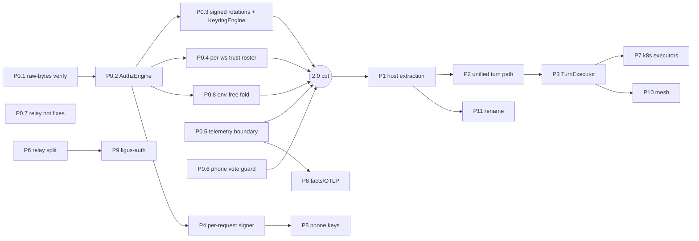

# Ligus 2.0 RC: architecture review and refactor plan

> Version note: "2.0" in this document means the Ligus 0.1.0 release (the version was reset before release).

Reviewer stance: adversarial. A claim counts only when an executable test can show it. Anything that is merely plausible is marked as an open risk.

Scope reviewed (read-only, 2026-11-13):

| Area | Location | Branch |
|---|---|---|
| Core, runtime, proto, CLI (serve, worker), desktop, web | this repo | `release/v0.1.0` @ `d7632c73` |
| Core security fixes (input) | this repo | `sec/core-hardening`, 13 commits on `d7632c73` |
| Relay (Go) and its chart | relay repo (`langstroth-ai/langstroth-relay`) | `sec/relay-hardening` |
| iOS | iOS app repo (private) | `rebrand/ligus` |
| Workspace chart (serve, worker, sandbox) | this repo, `deploy/helm/ligus` | `feat/k8s-phase1` |
| Vision | an internal deployments deck, and [`docs/design/kubernetes.md`](../kubernetes.md) | |

Unless a path says otherwise, citations are relative to the root of this repo on `release/v0.1.0`. Relay paths are prefixed `relay/` and refer to the relay repo. Line numbers are as of the review date (2026-11-13) and will have drifted since.

---

## 0. Decision: **Revise**

Not Reject. The cryptographic and data primitives are sound, and they already live in shared crates. They are:

- the signed envelope with its frozen `hive-envelope-v3` preimage (`crates/ligus-core/src/crypto.rs:100-127`);
- the epoch-aware `SyncEngine`, which seals at the highest epoch and opens each body at its own epoch (`crates/ligus-runtime/src/sync_engine.rs:97-260`);
- the canonical-order fold (`crates/ligus-core/src/events.rs:927-1005`);
- device certificates, the config-log roster, and `ChatService` in `ligus-runtime`.

None of the vision's six deployment shapes needs a new storage model or a new sync protocol.

Not Approve-with-risks either. Three defects become permanent once 2.0 devices exist in the wild:

- they fix how history is folded, how signatures verify across versions, and who can set the encryption key;
- a fold-rule or verification change after the cut makes 2.0 and 2.x devices **diverge on the same log**;
- so they are cheap now, while the owner is the only user, and expensive afterwards.

**Gate for cutting 2.0 (all required):**

1. **K1: key rotations are authenticated.** Today any caller the relay admits can inject a workspace-key epoch that every honest device then seals new traffic under. Section 4.1 gives the counterexample; this is new in this review.
2. **S7: verification survives unknown data.** Signatures must verify over the *received* payload bytes, not re-serialized typed structs. Otherwise any non-empty field added in 2.x is permanently lost on 2.0 devices, so the "skip when empty" rule protects only the empty case.
3. **One authorization engine for every fold-time check.** It evaluates the signer's role in the workspace roster *as of the event's causal position*. Votes are bound to the signer, with role capped and status recomputed (covers R1, R2, S1 and the missing-config-log case). The engine carries a **rules version**, so 2.x can change rules without splitting the fleet.
4. **One keyring engine shared by every host** (covers R4 / symptom 1), and **per-workspace trust rosters** (R3).
5. **The synced vs device-local telemetry boundary is fixed.** Every `FlowRecord` kind that 2.0 signs and syncs is permanent, so decide now which are coordination state and which are telemetry (Section 4.7).
6. **The bounds that keep a hostile keyholder from wedging peers** (S5 lockdowns, S6 flow state and glob blow-up, S4 workflow-run fencing). These are fold rules, so they belong to item 3.

Items 1-6 are mostly *small* changes inside existing crates. The big structural work can follow in 2.x without breaking wire compatibility:

- the `ligus-host` runtime that ends `app/src/lib.rs` as a 17k-line god module;
- the `TurnExecutor` seam;
- per-person phone keys;
- the relay split;
- the facts exporter.

Phase 0 has an explicit pre-2.0 / post-2.0 split. Section 6 explains why the plan is sequenced this way.

Re-review on: the Phase 0 PRs, with the property tests listed in Section 5 green.

---

## 1. Current architecture, as built

### How this diverges from the vision

| Vision requirement | Reality | Root cause |
|---|---|---|
| One product across solo, fleet, team, k8s and keyless cluster | Two host stacks: the desktop (`app/src`) and the CLI hosts (`ligus-cli`). They share primitives but not orchestration. | No host layer. Orchestration was written as Tauri commands. |
| Serve, worker and controller share the turn and workflow logic | The workflow engine (`app/src/workflows.rs:25` imports `tauri::{AppHandle, …}`), flow hooks, compaction, retrieval and the proposal-set apply are desktop-only. | Same. |
| One workspace-applied sandbox envelope for every runtime | Composed twice (`app/src/guards.rs:789` vs `crates/ligus-cli/src/worker.rs:421-436`). `isolate_writes` is enforced only on the desktop (`lib.rs:7953`). `protected_dirs` is never read: `builtin_tools.rs:433` hard-codes its own copy, and CLI runtimes are not covered. | The envelope is a data type, not an enforcement seam. |
| Phones post as their own person | The phone has no signing key. serve signs with its single `ChatService.author`, which is the owner when enrolled (`chat_service.rs:108-113`). Phone votes are recorded as the owner's (`serve/api.rs:696-700`). | Identity is process-wide, not per request. |
| Cluster holds no keys (shape 5) | serve and worker both get `LIGUS_WORKSPACE_KEY` (`deploy/helm/ligus/templates/_helpers.tpl:132-147` on `feat/k8s-phase1`). No executor, `exec-turn` or turn bundle exists. | No `TurnExecutor` seam; turn I/O is fused with `ChatService` writes (`worker.rs:359-520`). |
| Multi-tenant SSO | `hrt1` has no tenant, device or workspace claims. Reads are open under the open policy. Workspace ids are client-chosen (`relay/scope.go:70-79`, `token.go:24-37`). | The relay has no tenancy model yet. Expected: these are design-page "to build" items. |
| Content-free telemetry export | External tools read `ligus.db` and `guard_signals` directly. Telemetry and coordination state are mixed in the synced `FlowRecorded` log. | No facts interface. |

---

## 2. Root causes (verified)

Each symptom is traced to a root cause. **RC-n** are root causes; **Sym-n** are the brief's symptoms.

### RC-1: No host abstraction. The desktop *is* the reference host, and the CLI hosts are re-implementations. (Sym 1, 2, 3, 5)

- **Keyring.** The desktop builds an epoch keyring from the relay's rotations (`app/src/lib.rs:11368-11385`, `build_keyring` at `:10939`) and passes it with `with_keyring` (`:11424`). Every CLI host (sync, serve, worker) calls `sync_engine()` → `with_key(derive_workspace_key(pass))`, which inserts **only epoch 0** (`crates/ligus-cli/src/main.rs:273-279`, `sync_engine.rs:200-204`). No `ligus-cli` code calls `fetch_key_rotations` or `with_keyring`.
  - Consequence: after any rotation, serve, worker and the phone behind them stop reading new traffic. `NotYetOpenable` holds the cursor (`sync_engine.rs:240-243`).
  - Worse, they keep **sealing at epoch 0**. A removed member who knew the passphrase can read those events.
- **Turn path.** The desktop runs `send_message` → `maybe_respond` → `run_prepared_turn` → `run_prepared_turn_inner` (`lib.rs:8466, 8712, 7730, 7771`). The worker runs `drain_tick` → `run_turn` (`worker.rs:211, 359`). These are two prompt assemblers and two runtime-resolution paths, and only one of them has compaction, retrieval, the flow priming hooks and path redaction.
  - Feature counts by grep: `compaction` appears 27 times in the app and 0 in the CLI; `retriever` 4 vs 0; `prime_turns` 1 vs 0.
  - The same agent therefore answers differently depending on which host runs it.
- **Proposal apply exists three times.**
  - `implement_proposal_inner` (`lib.rs:5513`).
  - The proposal-set apply, through it (`app/src/proposal_sets.rs:851`).
  - serve's `apply_on_this_host` (`serve/api.rs:930`).
  - The open-set guard is also written twice: `proposal_sets::guarded_by_open_set` in `lib.rs:5503` vs an inline `set.is_open() && set.contains` in `serve/api.rs:713`.
- **`*_inner` wrappers.** The 2.0 features (flow, guards, proposal sets) were merged from three branches (`e5efbbe3`, `c992c808`, `797a98c6`) as wrappers and hooks around Tauri commands. For example, `run_prepared_turn` wraps `_inner` for flow facts (`lib.rs:7730-7769`), and `implement_proposal` wraps `_inner` for the set guard (`lib.rs:5490-5508`).
  - Coupling counts in `lib.rs`: `flow::` 43, `guards::` 32, `workflows::` 22, `proposal_sets::` 18.
  - The policy lives at the *command* boundary, so any other entry point (serve, a workflow stage, a future controller) silently bypasses it. That bypass already happened once and had to be patched in serve.

### RC-2: Authorization is a property of call sites, not of the log. (Sym 4; sec-core R1, R2, R5, S1, S5)

Checks live in at least five places:

- authoring: `ChatService` floors and the role that callers pass into `vote_on_proposal` (`serve/api.rs:699`);
- ingest: `envelope_verifier::build_roster` and `verdict_for` (`sync_engine.rs:553-610`);
- projection authz on the chat's own roster (`events.rs:975-987`);
- the hoisted check against the **current** config roster (`events.rs:988-997`, built from `cfg.members` at `chat_service.rs:1989`);
- lease signer checks (`events.rs:969`).

Their properties:

- **Hoisted checks use the final roster.** Demoting someone retroactively deletes their earlier valid events from every fold; promoting someone retroactively admits events that were refused (R2).
- **`hoist: None` skips the check** when the config log has not synced (`events.rs:921-925`). A device can fold, and *act on*, a Viewer's proposal-set events in that window.
- **Vote roles are self-declared payload** (R1). A vote that claims Admin meets an Admin floor.
- **`DeviceRevoked` is Admin-only on ingest** (`authorization.rs:285`), but self-revocation is offered in the UI (R5).
- **The relay keeps a second membership roster** (`members.go`), written by the desktop (`upsert_member` ×3, `list_members`, `create_invite` in `lib.rs`). That is two sources of truth for "who is a member."

### RC-3: Keys are managed outside the signed log. (new K1; R3, R4)

- `WorkspaceKeyRotation` is an unsigned `{version, sealed}` (`crates/ligus-core/src/e2ee.rs:142-146`), sealed with anonymous ECDH (`e2ee.rs:85-128`, which has no sender authentication).
- It is published to a relay side table that any admitted writer can append to (`relay/server.go:239, 709-726`; open by default).
- Each device accepts **every rotation it can open** and seals at the highest version (`lib.rs:10939-10962`, `sync_engine.rs:216-228`).
- The version is chosen as `relay max + 1` at four call sites, so it races. The relay also trims the keyring (`relay/memory.go:442-448`).

### RC-4: Identity is process-scoped. (Sym 5)

- `ChatService` has one `author`, and `act_as_owner_device` swaps it globally (`chat_service.rs:108-113`).
- `device_enroll::standing` returns a single `OwnerDevice(actor)` per device (`device_enroll.rs:157-245`).
- A multi-user host is therefore inexpressible: every phone paired to serve posts and votes as that one actor (`serve/api.rs:696-700`, confirmed in the iOS app, where the phone holds no event key).
- "actor id == this device" is also assumed by the dispatch gate. `turn_runs_here(.., local, owner, ..)` (`lib.rs:6264-6271`) is ambiguous when two devices both act as the owner.

### RC-5: Signatures cover a re-serialization. (sec-core S7)

- `envelope_preimage` re-serializes `env.payload` from the typed struct (`crypto.rs:117-121`).
- An unknown event kind deserializes to `SessionEvent::Unknown` (`events.rs:321-322`), and an unknown field in a known kind is dropped by serde. In both cases the preimage differs, verification fails, and the cursor moves past the event. The event is gone even after the device upgrades.
- The "new fields skip when empty" rule protects only the case where the new field is empty.

### RC-6: Telemetry, coordination state and audit share one channel. (Sym 7)

- `FlowRecord` (`crates/ligus-core/src/flow/mod.rs:265-294`) mixes several kinds of data in one synced, signed enum:
  - coordination state that peers must fold (`Zone`, `Mark`, `Handoff`, `Beacon`, `AgentProfile`);
  - measurements (`TurnTagged`, `RouteDecision`, `EdgeWait`, `RouteStop`, `Progress`, `Touch`).
- Guard decisions go to a device-local `guard_signals` table instead (`event_store.rs:150-159, 631-643`).
- External tools read both through the SQLite schema, so the schema is a de facto public API that has no version.
- S6: flow state is unbounded.

### RC-7: The relay has no internal boundary between transport and features. (Sym 6)

- One `Server` struct and one `Store` interface hold everything: envelopes, keyring, pairing, directory, accounts, friends, membership, users and tokens (`relay/server.go:80-124`, `store.go:210-296`).
- GitHub tokens are verified live, and `requireGitHub` falls back to the `Authorization` bearer (`server.go:1322-1327`). A client that omits `x-hive-github-token` therefore has its **relay token forwarded to api.github.com**.
- Pairing payloads are stored as cleartext. Old clients put the `hivews1:` invite *with the workspace key* in them; that was closed client-side as B3, and the stub `resolve_pairing` is still present at `relay_client.rs:626`.
- Workspace ids are client-chosen and reads are open by default.

### RC-8: Policy depends on environment variables, per device. (new)

- `IdentityMode::from_env` (`LIGUS_IDENTITY_MODE`, `crates/ligus-runtime/src/identity_verifier.rs:62-69`) changes which events a device projects (held vs applied).
- Nothing in the app or CLI populates the GitHub identity cache (grep finds no `identity_cache` wiring outside `sync_engine.rs`), so a device with the variable set holds identity-gated events forever.
- More generally, any per-device knob that changes the *fold* breaks convergence. The fold must depend only on the log.

### RC-9: Names (Sym 8)

- Crates are still `ligus-*` and the k8s branch reads `LIGUS_*` env vars (`crates/ligus-cli/src/main.rs:58,100` on `feat/k8s-phase1`), while its chart sets `LIGUS_*`.
- Cosmetic, except for the env mismatch, which is a real deploy bug (the chart only works with a release-branch image).
- Wire identifiers and domain-separation strings must keep the `ligus` spelling, and `compat.rs:1-30` already documents that.

---

## 3. Target architecture

Principle: **the smallest model that works.** That means one host runtime, one log engine (sync, keys, verification and authorization as a single pure fold), and one executor seam. Everything else is an adapter.

### 3.1 Components, why each exists, and what not to change

| Component | Justification against the vision | Smallest viable form | Do NOT |
|---|---|---|---|
| **ligus-host** crate | Shapes 2-6 need serve, worker and controller to behave exactly like the desktop. RC-1 is the root of symptoms 1, 2, 3 and 5. | Move code; do not redesign it. `HostApi` is a struct over `ChatService`, `GuardRuntime`, settings and an `Events` callback trait (replacing `AppHandle::emit`). Tauri commands become one-liners. | Do not invent a plugin system. Do not make the host async-actor-heavy; the existing `Mutex<ChatService>` is fine. |
| **KeyringEngine** | One epoch rule for every host (Sym 1); closes K1. | `fn keyring(config_log, my_ka) -> BTreeMap<u32, Key>` that accepts only rotations published as a **signed config-log event** by an Admin as of that position. The relay `keyring` route becomes a cache or transport, not an authority. | Do not change `seal_symmetric` or the `SealedEnvelope` format, and do not change `hive-workspace-key-seal-v1`. Do not adopt MLS for 2.0. |
| **AuthzEngine** | One answer to "was this event allowed **when it happened**" (Sym 4, R1, R2, S1). Needed for every deployment with more than one human. | The fold already orders events canonically. Keep a running workspace roster from the config log, and evaluate each chat event against the roster at the config-log *frontier the author had seen* (Section 4.3). | Do not add vector clocks globally; use the frontier reference only where cross-log authz is needed. |
| **Verifier over received bytes** | Forward compatibility for all of 2.x (RC-5). | Keep the payload as `Box<RawValue>` alongside the typed value. The preimage uses the raw bytes. `hive-envelope-v3` is unchanged, and the bytes are identical for any event a 2.0 device emits itself. | Do not bump the envelope version or change the domain string. |
| **Principal/Signer per request** | Phones post as their own person (shape 3, 4, 6). | `append_signed(.., signer: &dyn Signer)`. The phone is just another **device**, certified by its person's account key with the *existing* `DeviceCertificate` (`hive-device-cert-v1`). | Do not invent a new identity type. A Secure Enclave P-256 key needs a new cert algorithm, so keep it as an option (Section 3.3). |
| **TurnExecutor** | Shapes 4 and 5, PR tests, mesh interop. | `TurnBundle` in, deltas plus `TurnResult {reply, patch, facts}` out. The bundle carries the envelope verbatim. The executor never touches `ChatService`. | Do not move signing into executors. Executors hold no workspace or device key, ever. |
| **EnvelopeEnforcer** | "One sandbox envelope for every runtime." | One function that maps envelope + runtime to an enforcement plan (args, MCP set, worktree, protected dirs, egress profile, k8s NetworkPolicy fragment). | Do not claim confinement for runtimes that cannot be confined. Keep refusing them, as `record_egress_refusal` does. |
| **Relay split** | Shape 6. The relay is the "ciphertext only" trust anchor in shape 5. | Within the one Go module: `core/` (envelopes, SSE, tunnel, push, `hrt1`) and `services/` (directory, friends, pairing, membership mirror, admin), each with its own `Store` interface. A build tag or flag drops `services/` entirely. | Do not change `/v1` paths, `hrt1`, `hpc1`, `hive-tunnel/1` or the `X-Ligus-*` headers. |
| **FactsSink** | Stable, content-free export (Sym 7). | A trait emitting OTel GenAI spans and events with `ligus.*` attributes, plus an optional local OTLP or JSONL file. External tools consume OTLP and stop reading `ligus.db`. | Do not sync telemetry. Do not export prompts, messages, diffs or paths. Do not name any external product in public code. |
| **ligus-auth** (2.x) | Layer 3 (IdP, SCIM). | A separate service that mints `hrt1` with added claims. The relay only verifies. | Do not let the IdP grant workspace membership; layer 1 stays authoritative. |

### 3.2 Device and identity model

- **Phone posts.**
  1. serve builds the envelope (`sequence`, `lamport`, `event_id`, payload) and sends the phone the *preimage fields*.
  2. The phone checks that the payload is exactly the message or vote it requested, then signs the preimage.
  3. serve attaches the signature and appends.
  - Result: serve cannot forge a post, though it can still *withhold* one (accepted).
  - The phone already holds an Ed25519 key in the Keychain (the iOS app's tunnel store), so **an Ed25519 phone device key needs no new crypto anywhere**.
- **Secure Enclave keys are P-256 only.** They would need a new certificate algorithm (new field, skip when empty; new domain string such as `ligus-device-cert-p256-v1`) and a P-256 verifier in Rust and Go.
  - Recommendation: ship Ed25519-in-Keychain (`ThisDeviceOnly`, biometry-gated access control) first.
  - Add Secure Enclave P-256 later, only if the threat model needs non-exportability.
  - That is the smallest model; the deck's "recommended" option is still reachable.
- **The host's own identity.** serve is its own member (its own account, role Contributor or a "Host" role), not the owner.
  - `act_as_owner_device` stays only as a legacy single-user mode for shape 2, behind an explicit setting, and its events are stamped `delegated`.
  - Votes from the host's own identity never count toward human quorum.

### 3.3 TurnExecutor and mesh interop

- `TurnBundle` (versioned JSON, every new field skipped when empty) contains:
  - `turn_id`, `deadline`, `runtime` (resolved, credentials referenced not embedded), the prompt and context, the `envelope`, the tool grants, the MCP endpoint list, the repo slice (a git bundle ref), `trace_context`, and `callback {url, one_time_token}`.
- `TurnResult` contains: `reply_text`, `patch`, `tool_log_digest`, and `facts` (content-free).
- Implementations:
  - `InProcess`: today's code paths, unified.
  - `Process`: `ligus exec-turn` subprocess. This gives desktop and worker real OS isolation and is the same binary the k8s executor runs.
  - `K8sJob`: per `kubernetes.md` §3.3 Step 2.
  - `Mesh`: dial out to an A2A or MCP remote agent. Credentials are injected at egress by the mesh, and the bundle carries only a short-lived, key-bound token reference.
- Mesh is *an executor*, not a new host. This is how the vision's "optional layer, not a rewrite" is satisfied.
- Inbound A2A ("another mesh agent asks a Ligus agent") is a `HostApi` adapter that authenticates as a certified device of a Ligus member. Defer it until there is demand.

---

## 4. Invariants, hidden assumptions, counterexamples, required tests

Notation: `C:` is the config log, `X:` is a chat log, and `@n` is lamport. Every test named here should be a property test (proptest) over generated event sequences and permutations, unless it is marked as an integration test.

### 4.1 Workspace-key epochs (K1, R3, R4) — **blocker**

**Claimed invariant.**
- Only devices on the roster can read events sealed after their removal.
- New events are sealed under a key chosen by an Admin.

**Hidden assumptions.**
- Rotations come from Admins.
- Versions are unique.
- The relay keeps every rotation.
- CLI hosts get rotations.

**Counterexample K1 (injection).**
1. `C: MemberRemoved(M)`; the Admin publishes `rot{v2: sealed to A, B}`.
2. M is still admitted by the relay (open relay, or token not yet revoked) and knows B's X25519 public key. M has it from roster history; outsiders can get it from the relay directory's `ka_public`.
3. M POSTs `rot{v3: {B: seal(pk_B, K_m)}}` to `/v1/workspaces/{ws}/keyring`.
4. B's `build_keyring` inserts `3 → K_m` (`lib.rs:10949-10961`) and `encode` seals at the highest epoch (`sync_engine.rs:218`).
5. M decrypts all of B's new traffic.

The relay operator can do the same without M. This defeats "the key is never on the relay" in practice.

**Counterexample K2 (race).**
1. Admins A1 and A2 both read max=1 and publish `v2` with keys K and K′.
2. A1 seals events under K before its next keyring rebuild.
3. Peers whose ring holds `2 → K′` (last one wins in relay order) get an AEAD failure under a *held* epoch.
4. The verifier treats that as permanent (`sync_engine.rs:250-256`), and the event is lost.

**Counterexample K3 (trim).** The relay keeps only the newest `maxKeyringPerWS` rotations (`relay/memory.go:442-448`). A flood of junk rotations evicts the genuine ones, and a device that joins later cannot read history.

**Counterexample K4 (epoch 0 hosts).** After any rotation, serve keeps sealing at epoch 0 (`main.rs:276`). A removed member who holds the passphrase reads everything serve and the phones post.

**Fix (pre-2.0).**
- Add a new config-log event `WorkspaceKeyRotated { version, sealed, prev_version }`. It is signed and Admin-gated by AuthzEngine as of its position.
- Version must equal `prev + 1`. A tie at the same `prev` is broken by canonical key, and the loser is ignored; the loser's issuer re-rotates.
- The keyring is built **only** from the authorized rotation events.
- Relay keyring rows become a legacy read path, accepted only if an identical signed event exists.
- Sealing uses the highest *authorized* epoch.
- After a `MemberRemoved` folds, events from that member's devices are refused by authz regardless of epoch (closes R3 "old epochs accepted forever" for writes; reads of old epochs remain by design).
- Wire impact: a new event kind. 2.0 devices understand it from day one. There are no 1.x peers in the owner's fleet (the owner is the sole user), and older builds see `Unknown`.

**Tests.**
- `prop_keyring_only_from_authorized_rotations`: random logs plus random unsigned or foreign rotations → the ring equals the fold of authorized events.
- `prop_concurrent_rotations_converge`: any delivery order gives the same ring on every device.
- Integration: `cli_host_reads_and_seals_after_rotation` (serve and worker). Rotate, post from desktop, read on serve; post from serve, read on desktop at the new epoch.
- `removed_member_cannot_inject_epoch` (the relay accepts the POST; clients ignore it).

### 4.2 Signature verification over received bytes (S7) — **blocker**

**Claimed invariant.** An event a 2.x device signs is accepted by a 2.0 device whenever 2.0 would accept its *semantics*. At minimum, it is never discarded irreversibly.

**Hidden assumption.** `serde_json::to_vec(typed)` equals the bytes the signer serialized.

**Counterexample.**
1. A 2.1 device sends `MessageAppended{…, priority:"high"}`.
2. A 2.0 device drops `priority`, the preimage changes, verification fails, the cursor advances, and the event is lost forever.
3. The same happens for any new `SessionEvent` kind, which deserializes to `Unknown`.

**Fix (pre-2.0).**
- Deserialize the envelope with `payload_raw: Box<RawValue>`, and compute the preimage from `payload_raw` (and from raw `scope`, `timestamp` and `actor_stamp` too).
- Persist the raw envelope JSON in `ligus.db`. It may already be there as `envelope_json`; verify.
- A verified envelope with unknown content is kept and re-folded after upgrade, instead of being skipped.
- Also forbid `HashMap` in signed types (iteration order); use `BTreeMap`. Add a lint test.

**Tests.**
- `prop_verify_roundtrip_with_unknown_fields`: generate events, inject random extra fields and unknown kinds at signing time, then verify on a "2.0" decoder → verify OK, the fold treats them as no-ops, and the event is retained.
- `upgrade_refold_recovers_unknown_events`.
- Golden vectors: freeze 20 signed envelopes produced by today's code, and require them to verify byte-for-byte after the change.

### 4.3 Authorization as of causal position (R1, R2, S1, S5; Sym 4) — **blocker**

**Claimed invariants.**
- (a) Whether an event is authorized depends only on the log prefix the author could have seen, never on later events.
- (b) Every device with the same events folds the same state.
- (c) No vote counts with a role the signer did not hold.
- (d) Status is derived, never asserted.

**Hidden assumptions today.**
- The current roster equals the roster at authoring time.
- The config log is present.
- The role in a vote payload is honest.
- Proposal status in an upsert is honest.

**Counterexamples.**
- **R2 demotion.**
  1. `C@1 MemberAdded(V, Contributor)`
  2. `X@2 ProposalSetOpened by V`
  3. `C@3 RoleChanged(V, Viewer)`
  4. Today the hoisted check uses the final roster, and X@2 disappears on every refold. History is rewritten.
- **Missing config.** A device has `X@2` but no `C`. With `hoist=None` it folds the event. If it also applies the patch, a side effect becomes irreversible.
- **R1.** `X: ProposalVoteCast{voter: V, role: Admin}` from Viewer V meets an Admin floor.
- **S1.**
  1. `X@5 ProposalUpserted(P, patch=p1)`
  2. `X@6 Vote(P, approve)`
  3. A forger then emits `X@4 ProposalUpserted(P, patch=p2)` (lower lamport, from a contributor device).
  4. The canonical order makes the vote attach to whichever upsert folds last.
  5. The fix: votes must carry `diff_digest`, and a vote counts only for that digest.
- **Approved by assertion.** `ProposalUpserted{status: Approved}` from any device (R1, second half).

**Design.**
- Each chat event that needs workspace authz carries `cfg_frontier: (lamport, event_id)` of the newest config event the author had folded. This is a new field, skipped when empty.
- AuthzEngine evaluates against the config roster at `min(frontier, config head)`.
  - An event with a frontier *beyond* what the verifier holds is **held**, not decided. That replaces "skip when the config log is missing."
  - Legacy events with no frontier are evaluated against the config roster at the config event with the greatest lamport ≤ the event's lamport. This is deterministic, slightly permissive, and documented.
- Votes:
  - The payload role is ignored. Role is the signer's actor role, from the roster as of the frontier, and the cap is the hoisted roster.
  - A vote counts only for its `diff_digest`.
  - `status` is recomputed from folded votes, and an upsert can never set `Approved` or `Applied` except through derivation (`Applied` needs an `Applied` event from a role permitted to apply).
- `rules_version` lives on the config log (`WorkspaceRulesSet{version}`, Owner-only). The fold picks rules by position, so 2.x can tighten rules for new history without re-judging old history.
- Self-service device revocation: allow `DeviceRevoked` when the signer's account certified that device. Otherwise require Admin. Align the UI.
- Bounds as fold rules:
  - S5: lockdowns per actor, per window.
  - S6: caps on flow-state collections; globs compiled with a size and complexity limit (no backtracking matcher).
  - S4: `WorkflowRunUpserted` must carry a lease epoch, otherwise it is accepted only from the run's creator device.

**Tests.**
- `prop_authz_is_prefix_stable`: for any log L and any suffix S, the authorized set of L equals the authorized set of L·S restricted to L. This forbids retroactivity.
- `prop_fold_order_independent`: permutations of delivery produce the same state.
- `prop_vote_role_capped`: random self-declared roles never change outcomes.
- `prop_status_derived`: removing every `status` field from upserts leaves the fold unchanged.
- `held_until_config_frontier_arrives`.
- `self_revoke_allowed_other_revoke_needs_admin`.

### 4.4 One keyring, sync and fold engine for every host (R4, Sym 1)

**Invariant.** The desktop, serve, worker and controller produce byte-identical folds and keyrings from the same inputs.

**Test (integration).** `host_parity`: run the desktop host (headless `ligus-host` in a test) and a serve host against an in-memory relay, apply the same scripted actions, and compare the projected sessions, keyrings and authorized sets. This is a parity test, as the relay has with its Rust predecessor.

### 4.5 Per-workspace trust roster (R3)

**Counterexample.** Account A belongs to workspaces W1 and W2. A W1 Admin removes A. The trust roster is shared across workspaces, so A's devices become untrusted in W2 as well. A malicious W1 Admin can lock A out of an unrelated workspace.

**Fix.**
- Build the roster per `workspace_id` from that workspace's config and trust events only.
- Pin the founder: B2 still has no out-of-band pin.
- Build from *verified* events only, never from the unverified incoming batch (R3).

**Test.** `prop_removal_scoped_to_workspace`.

### 4.6 Phone attribution (Sym 5)

**Invariant.** An event says "Ana" only if Ana's account certified the signing device, or a delegation explicitly recorded as such signed it.

**Counterexample today.** The owner enrolls serve as an owner device. Ben's phone paired to serve approves P, and the vote is signed as the owner (`serve/api.rs:698-700`). The owner's vote counts toward quorum without the owner ever seeing P.

**Interim mitigation (pre-2.0, small).**
- serve refuses `approve` and `reject` from a phone while it acts as a delegated owner device, unless the pairing is flagged `owner_phone`.
- serve records `pid` in a content-free fact.

**Tests.** `phone_vote_attribution` (serve integration). `delegated_host_vote_not_counted_for_quorum` (a fold property).

### 4.7 Telemetry and facts boundary (Sym 7)

**Invariant.** Synced events are what peers must fold to agree. Measurements are device-local facts, exported through a stable interface.

**Decide before 2.0 (everything signed in 2.0 is permanent):**
- **Keep synced:** `Zone`, `ZoneRemoved`, `Mark`, `MarkCleared`, `Handoff`, `Beacon`, `AgentProfile`, `Recruit`, and `RouteDecision` (only if routing on other devices reads it; verify).
- **Stop emitting to the log:** `TurnTagged`, `Touch`, `Progress`, `EdgeWait`, `RouteStop`. These become `FactsSink` records, and folds of existing ones stay as no-op-safe.
  - If Flow scoring (`flow/score.rs`, `career.rs`) needs cross-device outcomes, sync a *compact, bounded* `AgentOutcomeSummary` per agent per window instead of a per-turn record. That also fixes S6.
- The facts schema is `ligus.facts.v1`:
  - OTel GenAI spans (`gen_ai.operation.name`, `gen_ai.request.model`, `gen_ai.usage.*`);
  - `ligus.*` attributes (`ligus.workspace.id_hash`, `ligus.chat.id`, `ligus.turn.id`, `ligus.agent.key`, `ligus.runtime.kind`, `ligus.host.kind`, `ligus.guard.decision`, `ligus.proposal.set.id`, `ligus.route.arm`, …);
  - ids, enums, numbers and timestamps only.
- `guard_signals` becomes the facts table's backing store.
- External observability tools read OTLP or `ligus facts export --jsonl`, never the internal schema.

**Tests.**
- `facts_are_content_free`: a property test that random turns with secret-looking content produce facts that contain none of the content bytes.
- `facts_schema_golden`.

### 4.8 Sandbox envelope enforcement

**Invariant.** For every runtime on every host and executor, the enforcement plan is a function of (envelope, runtime) only.

**Counterexamples today.**
- The worker passes no MCP entries for Claude Code (`worker.rs:424`), while the desktop passes the allowlist (`guards.rs:794-799`).
- `isolate_writes` is checked only at `lib.rs:7953`.
- `protected_dirs` is never read.

**Test.** `prop_enforcement_plan_host_independent`: generate envelope × runtime → the same plan from every host adapter. Also a table test that every `SandboxEnvelope` field is consumed (a compile-time exhaustive destructure).

### 4.9 Dispatch

**Invariant.** Each pending turn has at most one committed result across the fleet. (Exactly-once execution isn't achievable with devices that go offline; what must hold is that no turn's result is committed twice.)

**Status (code, 2026-11-16).** Not yet met for chat turns. `TurnClaimed` resolves deterministically (the first claim in canonical fold order wins, `ChatService::claim_turn`), and a device that has synced a competing claim backs off, but two devices that both claim within one sync round trip can both run and post; the streaming placeholder is the second-line guard.

**Status (code, 2026-11-18).** Met for committed results ([repos-and-checkouts](repos-and-checkouts.md) section 11). The dispatcher (`ligus_core::dispatch`) is keyed by **device id**: a claim is signed by the device it names and may carry an epoch, the holder it supersedes and signed coverage of the chat's repo; the answer (a reply whose verified origin is that device) is the commit, and every other answer to the turn is marked superseded in the fold. Both dispatch gates, the deferred claim, hand-offs, the worker, workflow stage offers and the desktop's revision and regenerate turns call `ChatService::dispatch_turn`. Tested by `prop_dispatch_converges_and_commits_at_most_once` (N devices, partitions, crashes, reorderings, a revoked device writing backdated claims, a hostile member's live device claiming, handing over and answering with backdated lamports and chosen times). The adversarial review (same day) added the hand-over time check, at most two holds per device, the prompt-answer rule, agent-key origins from the workspace roster and the live-but-silent hand-over (section 11.2 to 11.6). Executions are not exactly-once: a partition can still run a turn twice; only one result commits.

**Hidden assumptions.**
- Actor id identifies a device (broken by delegation).
- Only the desktop answers unbound agents.

**Counterexample.** The laptop and serve both act as owner O. An unbound agent owned by O sees `local == owner` on both, and the outcome depends on whether serve's worker also drains unbound turns. Verify against the claim fold (`TurnClaimed`).

**Fix.** A single `Dispatcher` in `ligus-host`. Ownership is by *device id* plus binding, and claims are always written.

**Test.** `prop_at_most_one_committed_result` across N simulated hosts with random delivery and crash points.

### 4.10 Relay

**Invariants.**
- The relay never receives a workspace key or a secret it does not need.
- In tenant mode, a token for tenant T cannot read workspace W of tenant U.

**Counterexamples.**
- The GitHub bearer fallback forwards relay tokens to GitHub (`server.go:1322-1327`).
- The pairing payload is cleartext.
- Reads are open, and ids are guessable.

**Tests (Go).**
- `TestGitHubRoutesNeverForwardAuthorization`.
- `TestPairingPayloadMustBeSealed`: reject payloads that do not parse as a sealed blob, behind a flag.
- `TestTenantClaimsConfineReadsAndWrites`.
- Fuzz the `/v1` handlers for `hrt1` byte-compatibility against frozen vectors.

---

## 5. Sequenced refactor plan

Rules for every phase:

- main stays shippable;
- each phase lands behind its own tests;
- no change to `hrt1`, `hpc1`, `hive-tunnel/1`, `hive/sync/1`, the `X-Ligus-*` headers, `/v1` paths, or any domain-separation string (`hive-envelope-v3`, `hive-device-cert-v1`, `hive-device-enroll-v1`, `hive-workspace-key-seal-v1`, `hive-workspace-key-argon2id`);
- new serialized fields use `skip_serializing_if` when empty;
- public code never names any external observability product.

### Before the 2.0 cut

| # | Phase | Scope | Files / crates | Size | Risk | Depends on |
|---|---|---|---|---|---|---|
| **P0.1** | Raw-bytes verification | Keep `RawValue` for signed fields; preimage from raw; retain verified-but-unknown events; no `HashMap` in signed types | `ligus-core/src/crypto.rs`, `events.rs` (envelope serde), `ligus-runtime/src/sync_engine.rs`, `event_store.rs` | M | Medium: touches every verify path. Golden vectors make it safe. | none |
| **P0.2** | AuthzEngine v1 | Extract every fold-time check into `ligus-core/src/authz/` (one `fn authorize(env, &RosterAt) -> Decision`); config-frontier field; hold instead of skip; votes bound to signer + `diff_digest`; derived status; `rules_version`; self-revoke rule; S4/S5/S6 bounds | `ligus-core/src/authorization.rs`, `events.rs:927-1005`, `proposals.rs`, `proposal_sets.rs`, `guard.rs`, `lease.rs`, `flow/`; `ligus-runtime/src/chat_service.rs:1975-2010`; drop `vote_on_proposal`'s role parameter (`serve/api.rs:699`) | L | High: semantic. Mitigated by the prefix-stability and order-independence properties, plus replaying the owner's real `ligus.db` before and after (diff the projected state; every difference must be explained). | P0.1 |
| **P0.3** | Signed key rotations + KeyringEngine | `WorkspaceKeyRotated` config event; `ligus-runtime/src/keyring.rs` used by the desktop and all CLI hosts; delete the four `max+1` sites; relay keyring becomes a legacy fallback | `ligus-core/src/e2ee.rs`, `events.rs`, `authorization.rs`; new `ligus-runtime/src/keyring.rs`; `app/src/lib.rs:4572, 10916-10962, 11368-11424, 12710, 13055, 13315`; `ligus-cli/src/main.rs:273-279`, `serve/mod.rs:978, 1072` | M | Medium | P0.2 |
| **P0.4** | Per-workspace trust roster | `build_roster(ws, verified_only)`; founder pin from first-sync (B2) | `ligus-runtime/src/envelope_verifier.rs:278+`, `device_enroll.rs:207-245`, `sync_engine.rs:553-610` | M | Medium | P0.2 |
| **P0.5** | Telemetry boundary | Stop emitting measurement `FlowRecord`s to the log; route them to `guard_signals` (renamed internally to facts); add a bounded `AgentOutcomeSummary` if scoring needs it | `ligus-core/src/flow/mod.rs`, `app/src/flow.rs`, `ligus-runtime/src/event_store.rs:150, 631` | S–M | Low | none |
| **P0.6** | Phone vote guard (interim) | Refuse phone approvals on a delegated host unless the pairing is the owner's; record `pid` | `ligus-cli/src/serve/api.rs:696-720` | S | Low | none |
| **P0.7** | Relay hot fixes (relay repo; independent of the 2.0 tag but ship now) | Remove the GitHub bearer fallback; require sealed pairing payloads (or delete `/v1/pair` writes); open-relay keyring POST stays open but is now harmless after P0.3 | `relay/server.go:1322-1327, 746-800` | S | Low | none |
| **P0.8** | Identity-mode env → workspace setting or removal | No fold behavior from env; remove `LIGUS_IDENTITY_MODE` or make it a signed workspace policy | `ligus-runtime/src/identity_verifier.rs:62`, `sync_engine.rs:180-197` | S | Low | P0.2 |

**Migration and rollback for P0.**

- **Migration.** The owner's existing data is the only data.
  1. Back up `ligus.db` and the data dirs.
  2. Run a one-off `ligus doctor refold` that re-projects with the new engine and prints a diff of dropped or admitted events.
  3. After P0.3, rotate the workspace key once from the desktop. This produces the first signed rotation; the previous unsigned epochs stay readable as legacy history.
- **Rollback.** All of P0 is code-only. The new event kinds deserialize as `Unknown` on older builds, which is acceptable because they are pre-release builds. Restore the backed-up `ligus.db` to roll back. Tag the RC before P0 so it can be re-cut.
- **Test strategy.** Each phase adds the property tests from Section 4. A replay harness (`crates/ligus-core/tests/replay_owner_db.rs`, gated on an env path) runs the owner's real log, before and after, in CI locally.

### 2.x, wire-compatible

| # | Phase | Scope | Size | Notes |
|---|---|---|---|---|
| **P1** | `ligus-host` extraction, step 1 | New crate `crates/ligus-host` (crate rename later). Move `workflows.rs`, `flow.rs`, `guards.rs` and `proposal_sets.rs` out of `app/src`, replacing `tauri::AppHandle` with an `Events` trait and `State<AppState>` with `&Host`. The Tauri app keeps thin command wrappers. | L | Mechanical. Risk: lock ordering; keep the same `Mutex` granularity. Test: the existing app tests move with the code; add `host_parity`. |
| **P2** | Unified turn path | `TurnPlanner` (context: compaction, retrieval, vault, flow priming, redaction) + `Dispatcher` (one `turn_runs_here`, claims) + `ProposalApplier` (single apply, set 2PC, human gate) + `EnvelopeEnforcer` in `ligus-host`. serve and worker call them; delete `worker::run_turn`'s duplicate assembly and `serve/api.rs::apply_on_this_host`. Removes the `*_inner` wrappers. | L | Depends on P1. Highest regression surface. Test: `prop_enforcement_plan_host_independent`, `prop_exactly_once_dispatch`, golden prompts per runtime. |
| **P3** | `TurnExecutor` seam | Trait + `InProcess`; `TurnBundle` v1; `ligus exec-turn` + `Process` executor. | M | Unlocks the k8s Phase 3. The bundle schema is versioned and skips empty fields. |
| **P4** | Per-request `Signer`, host as its own member | `append_signed(.., signer)`; serve gets its own account/role; `act_as_owner_device` behind an explicit legacy flag. | M | Depends on P0.2 (authz knows delegation). |
| **P5** | Phone device keys | Pairing ceremony: the laptop certifies the phone's Ed25519 key (existing `DeviceCertificate`); serve "prepare/sign/commit" endpoints; iOS signs. Optional later: P-256 SE cert type with a new domain string. | M (Rust) + M (iOS) | Phone posts become non-forgeable by the host. Remove the P0.6 interim guard after this. |
| **P6** | Relay split | Go packages `core/` and `services/`, separate stores; tenant claims in `hrt1` (additive JSON claims, same format); `LANGSTROTH_RELAY_WORKSPACE_SCOPE=strict` default in tenant mode; high-entropy workspace ids for new workspaces (old ids keep working). | M | `/v1` byte-compatible. Test: frozen vectors, tenant-isolation tests. |
| **P7** | k8s controller and executor | `K8sJob` executor, chart executor role with a one-time callback port (not the phone API port), envelope → NetworkPolicy; keyless chart mode (`serve.enabled=false`, an external controller dispatches); rebase `feat/k8s-phase1` onto `LIGUS_*` env names. | L | Depends on P3. |
| **P8** | FactsSink + OTLP | `ligus.facts.v1` OTel export; `ligus facts export`. External tools move off `ligus.db`. | M | Depends on P0.5. |
| **P9** | ligus-auth (OIDC→hrt1, SCIM) | Separate service. | L | Depends on P6. |
| **P10** | Mesh executor + optional A2A inbound | | M | Depends on P3. |
| **P11** | Crate and identifier rename | `ligus-*` → `ligus-*` crates and internal identifiers. Wire identifiers are frozen (pinned by tests in `crypto.rs:319+`, `e2ee.rs:305+`). | S–M | Do it last, or right after P1 to reduce churn on moved files. Pure rename; CI-guarded. |

**Why the extraction (P1-P2) is not a 2.0 blocker.** It changes no wire format and no fold rule, so it can land at any time. The symptoms it causes are covered for 2.0 by P0.3 (keyring parity, which is the only *security* effect of the host split) and P0.6. Doing P1 before the cut would put a large mechanical change on top of semantic changes, and would delay the semantic changes, which are the part that becomes irreversible.

**Why P0.2 is not deferred.** It is the only item whose wrong answer is written into every 2.0 device's understanding of history. With `rules_version` in place, later tightening is possible. Without it, every rule change is a fleet split.

---

## 6. What not to change

- The envelope v3 preimage *structure* and all domain strings. P0.1 changes only *which bytes* feed the same structure, and those bytes are identical for events a 2.0 device produced itself.
- Symmetric sealing, `SealedEnvelope`, the relay `/v1` routes, `hrt1`, `hpc1`, the Noise tunnel, `hive/sync/1` (iroh ALPN, `peer_iroh.rs:20`).
- The canonical-key fold order and the "hold, don't drop" cursor discipline in `SyncEngine`.
- One workspace per serve process, and one StatefulSet per workspace. The vision does not need multi-workspace serve before hundreds of workspaces.
- The phone stays a thin client that never holds the workspace key. Only a *signing* key is added.
- Argon2id passphrase base key at epoch 0 (keep it for solo and passphrase setups; rotations supersede it).
- The no-leader-election design for serve and worker.

## 7. Residual risks after the plan

1. **No forward secrecy within an epoch, and static-key sealing** (documented at `e2ee.rs:130-140`). A compromised device opens every epoch it was sealed. Accepted for 2.0; MLS is a 3.x question.
2. **The legacy authz rule for events without a frontier** is permissive at config/chat concurrency boundaries. Bounded, because it is deterministic, but a member demoted concurrently with their own post may keep that post.
3. **The host still decrypts for display.** Phone keys stop forgery, not reading. Shapes 3 and 4 trust the host with content by design.
4. **Executors see turn plaintext** (repo slice, prompt). "Keyless cluster" means no *log* access, not no *content*. Etcd and Secret bundles need encryption at rest (`kubernetes.md:507-513`).
5. **The relay operator sees metadata**: workspace ids, sizes, timing, device ids, GitHub logins (directory and friends). Splitting the services out lets a deployment drop it; content-free does not mean metadata-free.
6. **Rule changes after 2.0** split old and new devices *on new history only* (via `rules_version`). Old 2.0 devices keep folding new-history events with old rules until upgraded. Mitigation: warn on a `WorkspaceRulesSet` the device does not understand, and treat such events as read-only.
7. **The P1/P2 extraction** has a large regression surface on a codebase whose desktop paths are tested mostly through the app. Mitigated only by `host_parity` and golden prompts, which do not exist yet.
8. **Unverified in this review.**
   - Whether `RouteDecision` must be synced for routing on other devices.
   - Whether serve's worker thread also drains *unbound* turns (relevant to double-answering under delegation).
   - Whether the `envelope_json` column (`event_store.rs:11, 107`) holds the *received* bytes or a re-serialization. If it holds the received bytes, P0.1 is closer to S than M.
   - These must be checked at the start of the relevant phase.
9. **K1 is reachable by outsiders, not only by former members.** The relay's directory publishes each registered device's X25519 key-agreement public key (`relay/store.go:48`, `server.go:879` `ka_public`). Anyone who can read the directory and post to an open relay's keyring can mount K1 against a directory-registered device. Treat K1 as critical.
