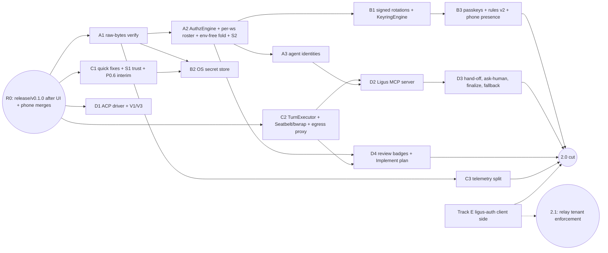

# Ligus 2.0 Phase 0: implementation specs

> Version note: "2.0" in this document means the Ligus 0.1.0 release (the version was reset before release).

Ligus is short for *ligustica*, the Italian honeybee.

**Inputs:**
- [`architecture-review.md`](architecture-review.md) (decision: Revise; gate items 1-6);
- the security reviews' open items, which the owner summarized: R1-R4, K1, S7, host S1-S3, P0.5, P0.6, and the review UI;
- the owner's binding decisions (ACP, the runtime matrix, sandbox, passkeys, the Ligus MCP server, ligus-auth, no patch releases).

**Code read (read-only), 2026-11-13:**

| Repo | Location | Branch / commit |
|---|---|---|
| Core, app and CLI | this repo | `release/v0.1.0` @ `534c8d0b`. sec/core-, host- and chart-hardening are merged (a79ac18e, 45c84abe, 7548ec42). The UI and phone-endpoint merges are in progress. |
| Relay | relay repo (`langstroth-ai/langstroth-relay`) | `release/v0.2.0` @ `3c22559` |
| iOS | iOS app repo (private) | `feat/ligus-2.0` @ `aaa679c` |

Unless a path says otherwise, citations are relative to the root of this repo. Relay paths are prefixed `relay/` and refer to the relay repo. Line numbers are as of `534c8d0b`. Re-anchor them when you rebase, because the in-flight merges will shift lines in `app/src/lib.rs`.


**Contents:** 0 ground rules and the added wire ids. Tracks A-E (one section each, each implementable in its own worktree). 7 dependency order and merge queue. 8 in 2.0 vs can follow. 10 proof-test ledger. (Section 9, migration and rollback of the owner's data, was deleted on 2026-11-16: 2.0 starts fresh, with no data migration.)

---

## 0. Ground rules for every track

1. **Frozen wire.** The bytes and meaning of these never change; additions are allowed only as rules 2 and 3 and section 0.1 allow:
   - the domain strings `hive-envelope-v3\0`, `hive-device-cert-v1\0`, `hive-device-enroll-v1\0` (and the `hivedev1:` code prefix), and the E2EE constants `hive-workspace-key-seal-v1` (HKDF info) and `hive-workspace-key-argon2id` (Argon2 salt), which have no `\0`;
   - `hrt1`, `hpc1`, `hive-tunnel/1` (and the WebSocket subprotocol `hive-tunnel.1`), `hive/sync/1`, `X-Ligus-*`;
   - the relay `/v1` paths and bodies: what exists stays byte-compatible, and only additive changes (new routes, new optional fields) are allowed;
   - the UUIDv5 namespaces of the config log and the relay room (`crates/ligus-core/src/channel.rs`), and the retired 1.x account and DM namespaces, kept unused so nobody reuses them (`crates/ligus-runtime/src/frozen_ns.rs`);
   - every string in section 0.1, once released.

   The tests that pin them as hex stay green: `signature_contexts_are_frozen` (`crates/ligus-core/src/crypto.rs`), `crypto_constants_are_frozen` (`e2ee.rs`), `enroll_constants_are_frozen` (`crates/ligus-runtime/src/device_enroll.rs`), `tunnel_identifiers_are_frozen` (`crates/ligus-cli/src/serve/tunnel/tests.rs`), and the per-string pins of section 0.1 (`link_namespace_is_frozen`, `context_is_frozen` for the invite signature, and the others next to each constant).
2. **New strings.** New domain-separation strings use the `ligus-` spelling and end in `\0`. Section 0.1 lists every one Phase 0 adds; nothing else may be added without amending this document.
3. **New serialized fields** are `#[serde(default, skip_serializing_if = …)]`. New `SessionEvent` kinds get a camelCase tag and must fold as a no-op on an older decoder (`SessionEvent::Unknown`, `events.rs:321-322`).
4. **No env-dependent fold.** Nothing that changes which events fold, or how, may read an env var or a device-local setting (review RC-8).
5. **Public code never names the private observability product.** Use "external observability tools".
6. **One release.** There are no patch releases for shipped versions, and everything here lands in 2.0 unless it is marked **[2.0.x-follow]** or **[2.x]**. Track E's client side is in 2.0 (see Track E).
7. **Tests.** Every property test runs with `proptest` as a dev-dependency (add it to `deny.toml` if needed). If the owner objects to the dependency, use the deterministic `Rng` already in `crates/ligus-core/src/sec_tests.rs:11-24`. Default case count is 256; nightly runs 4096.
8. **Release gate.** Every Phase 0 PR runs the full test suite and the proof-test ledger (section 10). 2.0 starts fresh, so there is no owner database to replay (A.7).

### 0.1 Domain strings and wire ids ADDED by Phase 0 (complete list)

| String | Track | Purpose |
|---|---|---|
| `ligus-presence-v1\0` | B | WebAuthn challenge = SHA-256 over this tag and the event digest fields (B.4.3) |
| `ligus-proposal-digest-v1\0` | A | `diff_digest`: the apply-content digest that votes bind to (A.2.2, rule 5) |
| `ligus-workspace-key-commit-v1\0` | B | Key commitment carried in `WorkspaceKeyRotated` and in `SealedEnvelope.kid` (B.1.2) |
| `ligus-agent-cert-v1\0` | A | Host device certifies an agent signing key (A.3.2) |
| `ligus-recovery-v1\0` | B | Offline recovery-key signature over the presence challenge (B.4.6) |
| `ligus-mcp-turn-cred-v1\0` | D | HMAC tag of the per-turn MCP credential (device-local, never synced) |
| `ligus.facts.v1` | C | Facts schema id (device-local export) |
| `ligus-auth-device-proof-v1\0` | E | Device proof on every ligus-auth token request: Ed25519 over this tag and tenant, grant type, nonce, device id and SHA-256(credential), NUL-separated (`crates/ligus-runtime/src/ligus_auth.rs`). Added 2026-11-13 when the owner moved Track E's client side into 2.0 |
| `ligus-invite-v1\0` | F | The founder's device signature over a workspace or DM invite: Ed25519 over this tag, the invite's name, relay, room, DM account, founder account, `fk` and invite id (each NUL-terminated), SHA-256 of the workspace key, SHA-256 of the delivered epoch keys and the signing time; the invite carries the device certificate and account key ([identity-and-forges](identity-and-forges.md) §4). No existing context binds invite fields, and reusing `hive-envelope-v3` would need a new event kind. Added 2026-11-14 (review item R1) |
| `ligus-identity-link-v1@ligus.ai` (SSHSIG namespace; no `\0` by format: SSHSIG carries the namespace as a length-prefixed string passed on the `ssh-keygen -Y sign -n` command line) | F | Forge-key SSHSIG over an identity-link statement ([identity-and-forges](identity-and-forges.md) §2.4). Added 2026-11-14 (owner decision D1) |
| `ligus-gateway-attribution-v1\0` | C | HMAC-SHA256 message prefix for the pseudonymous `X-Ligus-Workspace` / `X-Ligus-Agent` ids sent to an operator-listed model gateway when its attribution is on ([model-gateways](model-gateways.md) §10). Device-local, never on the sync wire. Added 2026-11-17 (owner approval of model gateways) |

New `SessionEvent` kinds (tags):

`workspaceRulesSet`, `workspaceKeyRotated`, `deviceKeyAgreementPublished`, `passkeyRegistered`, `passkeyRemoved`, `agentKeyCertified`, `proposalApplied`, `identityLinkPublished`, `identityLinkRemoved` (the last two added 2026-11-14, owner decision D2; [identity-and-forges](identity-and-forges.md) §2.2).

Phase C (2026-11-18) adds the additive kind `workspaceSandboxSet` (config log; golden vector `workspaceSandboxSet` in `golden/envelopes_v3.jsonl`). It adds no domain string.

New `FlowRecord` kinds:

`humanAsk`, `humanAnswered`, `turnToolSummary`, `agentOutcomeSummary`; and, with workspace memory (section 0.2), `memoryWritten`, `memoryRemoved`, `memoryProposed`, `memoryProposalDecided`, `taskState`.

Phase A (2026-11-16) adds these `SessionEvent` kinds: `proposalApplyRequested`, `workspaceRepoAdded`, `workspaceRepoUpdated`, `workspaceRepoRemoved`, `chatRepoSet`, `chatBasePinned`. It adds **no** domain string. `ligus-proposal-digest-v1\0` is redefined before its first release (section 0.2). A P-256 device certificate appends `\0alg=p256` to the frozen `hive-device-cert-v1` preimage; that is an algorithm tag inside the existing context, not a new context, and the Ed25519 preimage is unchanged. `LIGUS_REPO_NS` (`crates/ligus-core/src/workspace_repo.rs`) is a UUIDv5 namespace for repo ids, not a domain string, and joins the frozen namespaces of rule 1.

Repos v2 (2026-11-18, [repos-and-checkouts](repos-and-checkouts.md) sections 11 and 12) adds the `SessionEvent` kinds `workspaceRepoAliasesSet` and `workspaceHostAliasSet` (config log; Admin with presence under rules v2; never an agent or a phone) and three optional fields on `turnClaimed`: `epoch`, `supersedes` and `repo_id` (absent on a plain first claim, which then folds exactly as before). `ChatMessage.superseded` is fold state, never read from an author. It adds no domain string and no namespace; golden vectors `turnClaimed/dispatch`, `workspaceRepoAliasesSet`, `workspaceHostAliasSet` and `workspaceHostAliasSet/clear` pin the shapes. The dispatcher's fold reads each claim's and answer's signed envelope timestamp (a hand-over less than 15 s after the claim it displaces is ignored unless that holder is gone at its position; a displaced holder's answer signed before its hand-over still commits) and the workspace roster at an answer's position for an agent key's host; no wire change. The presence beat (not a log event; nothing had shipped with coverage) gains `coverageSig` (base64 Ed25519 by the host's device key, left out when empty) over the new frozen domain string **`ligus-coverage-v1\0`**: `"ligus-coverage-v1\0" ‖ workspace_id(16) ‖ device_id(16) ‖ u64le(seq) ‖ u32le(count) ‖ count × (repo_id(16) ‖ u32le(len(state)) ‖ state ‖ u32le(len(code)) ‖ code ‖ via_fork(1 byte))`. A reader uses a beat's coverage only when it verifies against the device its `hostId` names (certified, not revoked, not a phone, acting for a current member); unsigned or wrongly signed coverage is ignored. Golden vector `coverage_signature_golden_vector` in `crates/ligus-core/tests/coverage_sig.rs` (preimage hex and signature for a fixed seed).

### 0.2 The 2.0 wire freeze (Phase A, 2026-11-16)

Everything that changes signed or wire semantics before 2.0 landed in Phase A (branch `phaseA/protocol`). From here, the 2.0 wire is frozen: rule 1 applies to every kind, field and preimage below, and later changes are additive only (rule 3).

**Pinned by tests.**
- `golden/envelopes_v3.jsonl`: a signed vector for **every** `SessionEvent` kind, and the Phase A field shapes. `golden_coverage.rs` fails the build when a variant has no tag (an exhaustive match) and the tests when a known kind has no vector; `raw_bytes.rs` checks every line verifies byte for byte.
- `golden/p256_cryptokit.jsonl`: phone signatures from Apple CryptoKit `P256.Signing` (`scripts/p256-vectors/sign.swift`), verified over the exact envelope preimage.
- `digest_vector` (the proposal digest, cross-checked with an independent Python computation), `host_beat_wire_is_frozen`, the presence vectors, and the relay's `TestContactRoutesMatchGolden` (`testdata/golden_v03_contacts.json`, relay repo, next to the `/v1` route goldens).

**What Phase A froze.**

| Area | Wire | Fold rule |
|---|---|---|
| Rules (item 1) | Every workspace is on rules v2 from its seed; `ensure_workspace_config` writes `WorkspaceRulesSet { version: 2, presence }` at genesis | No rules v1. The genesis rules set is the only one without presence. Only the Owner changes the RP or the version. The seed grants the founder one first-credential registration; there is no TOFU |
| Relying party (item 5) | `WorkspaceRulesSet.presence: { rpId, origins }` | Presence verifies under the workspace's RP (default `ligus.ai`); a change needs presence under the old RP |
| Watermarks (item 2) | `ActorStamp.prev` (the signer's previous event on the log); `watermark: [{signer, log, heads, gaps}]` (`gaps`, left out when empty: `prev` ids the author didn't hold; coverage never enters one, so a `prev` a member names but withholds is not a slot they can fill after the cut; an entry with more than 8 gaps is left out) on `MemberRemoved`, `MemberRoleChanged`, `DeviceRevoked` | An event a cut concerns that isn't reachable back from its heads (without entering a gap or an equivocated id) is judged at max(its frontier, the cut); a revoked device's never folds; on the config log such events before the cut are denied (self-validating publications excepted, and for a demotion the member's `ChatLockdownRaised`: a demotion never lifts a lockdown). Cuts go strictly down the ranks (the founder outranks other Owners; nobody cuts the founder); a cut is judged without its subject's uncovered earlier events; leaving, self-demotion and a device revoking itself are not cuts |
| Vote digest (item 3) | `diff_digest` preimage adds proposal id, repo id, base commit (length-prefixed, empty when absent) | `repo_id` derived from the chat's repo at creation and sticky; a base change clears votes |
| Turn claims (item 4) | (no change) | A `TurnClaimed` counts only from the device it names |
| Repos (item 6) | `WorkspaceRepoAdded/Updated/Removed`, `ChatRepoSet`, `ChatBasePinned`, `ActionProposal.{repoId, baseCommit, baseRef, producedOn}`, host beat `seq` and `coverage` | Admin (+presence for add/remove); normal-form canonical and derived id; a chat repo must be live; never an agent's or a runtime's choice |
| Apply (item 6) | `ProposalApplyRequested { request }`; `ProposalApplied.{repoId, appliedOn, baseCommit, appliedTreeHash, requestId}` | A person asks through their own device for an Approved proposal at its digest; only the named host fulfils it, on the base the person saw; a direct apply is a human member's, through their own device; never an agent |
| Phones (item 6) | `DeviceCertificate.alg` (`p256`), `ActorStamp.sigAlg` | ECDSA-SHA256, fixed 64-byte low-S signatures; an Ed25519 certificate names a 32-byte key; a P-256 device is a phone, capped to the phone tier, enrolled only by a trusted device of its person with that person's presence. Revocation's other parts are wired in **Phase B** (review P-A6): every pairing is bound to its phone's device at enrollment (a required `device` claim, P-256 over `ctx("device-bind", hid, static)`; no unbound pairings); serve re-checks the roster within 0.5 s of any store change (any path, the phone's own revocation included), cuts the pairing locally at once, tells the relay (`POST /v1/tunnel/revoke`, host-signed; it drops the tunnel pairing and the push token) and ends a langstroth-auth session when it has operator access, with per-step status (`docs/relay-tunnel.md` §13.2); revoking a phone device also rotates `serve.token` (the remaining phones fetch it with `GET /v1/tunnel/direct`). New frozen contexts: `ligus-revocation-report-v1\0` (a box's signed status report) and `ligus-revocation-retry-v1\0` (a member device's signed retry request), both Ed25519 over the blob's JSON without its signature. A pairing without a valid claim, one that claims a revoked or unknown device, or one that reuses a revoked pairing's keys, is refused |
| Service members (item 6) | `ActorKind::Service` | At most Contributor; no passkey, no presence, no set decisions; applies only on request; never a human approval; its stamp must say Service |
| Equivocation (review P-A2c; narrowed 2026-11-18, see **Forged copies** below) | (no change) | The **same signer** signing two different envelopes (signer, signature or signed preimage differ) under one event id on one log: every copy of that signer under the id is denied, in any arrival order (`ligus_core::copies`). A copy no certified key verifies, or one signed by another signer, never displaces or invalidates a verified event. The store keeps every other copy beside the first (`equivocations` table, never pushed) |

**Phase B additions (2026-11-17, branch `phaseB/service-members`; review additions 2026-11-18).** Additive only; the new kind and domain strings are listed below with their golden vectors:
- `JoinApproved.admission` (`{kind, expiresMs, accountId?}`, left out when absent; golden vector `joinApprovedAdmission`): a **box admission**. Fold rules (`ligus_core::admission`): issued on the config log for a fresh `invite:<id>` subject by an Admin with presence (a phone may sign one with its own key; the phone tier allows nothing else about membership); `kind` must be `service`; expiry after issue and within 7 days of the issuer's timestamp; one admission per invite, and a person invite's id can't become one (or the reverse). Redemption: a self-add whose `actor.kind` is `service`, at most Contributor, signed no later than `expiresMs` (the redeemer's signed timestamp: a residual), by the bound account when one is named; a `service` self-add needs a box admission; an existing member re-adding itself can't spend one.
- **Review additions (R1, R2, R5 to R8).** `Admission.redeemKey` (32-byte Ed25519 public key, required for a redemption to count) and `Admission.deviceKey` (32-byte Ed25519 key of the box whose join request it answers; left out for a bearer admission). `MemberAdded.proof` (64-byte Ed25519 signature by the redeem key; left out when absent) over the **redemption preimage** `"ligus-box-admission-redeem-v1\0" ‖ workspace_id(16) ‖ invite(16) ‖ u32le(len(member_id)) ‖ member_id ‖ signer_device_id(16)` (only the member id is variable, and it is length-prefixed; golden vector `redemption_proof_golden_vector` in `crates/ligus-core/tests/admission_second_review.rs`, envelope goldens `joinApprovedAdmission/redeemKey` and `memberAdded/redemption`). A redemption counts only with a proof that verifies under the admission's redeem key, on time, signed by the device key the admission names (when it names one), as a new member whose `actor.accountId` is the stamp's own account (bound or bearer) and whose `actor.id` is its member id. New kind **`AdmissionClosed {invite, redeemed?}`** (golden vector `admissionClosed`): config log, Admin+, no presence, of an admission issued there; the fold denies, after the cuts, every redemption of that invite that an allowed closure doesn't name, wherever it sorts (two closures that name different redemptions admit neither). The allowed closures are read from the fold the denials so far leave (a cut can refuse a closure, and can also let one stand, by denying an earlier event that spent the invite), and the closure denials grow to a fixed point over the cuts' denials: the fold adds what the allowed closures deny until that adds nothing, keeping every denial once made (fail closed), so the result is a function of the event set alone. An Admin can therefore deny a legitimate box by closing its admission (the entrance policy is theirs, as issuing is); a closure that names nothing real admits no one through that invite and touches nothing else. A service member's self re-add never changes its kind, account (never filled in later) or actor id. Device-local: the redeem key seed rides only in the admission code (`ak`, 64 hex digits inside the `hivews1:` JSON) and the box forgets it once its redemption is written. Join requests (`ligusjoin1:`, base64url JSON `{v: 1, accountId, deviceId, devicePublicKey, kaPublic, label}`), sealed admission codes (`ligusadmit1:`, a `SealedBlob` to `kaPublic`), and the request fingerprint: the first 10 bytes of `SHA-256("ligus-box-join-v1\0" ‖ account(16) ‖ device(16) ‖ u32le(32) ‖ devicePublicKey ‖ u32le(32) ‖ kaPublic)` as `XXXX-XXXX-XXXX-XXXX-XXXX` (golden vector `join_request_fingerprint_golden_vector`, `crates/ligus-runtime/src/box_admission.rs`). The phone checks a box-drafted preimage before signing it (`check_phone_admission_preimage`): exactly a `hive-envelope-v3` preimage, no trailing bytes, of a `joinApproved` box admission on this workspace's config log, stamped for this phone (P-256) with presence, whose stamp and payload carry no field this build doesn't read, whose presence digest is the challenge the passkey signed, and bound to exactly the device key of the join request the phone holds.
- Service members also never cut (remove, demote, revoke another account's device) and never admit (`MemberAdded` of another, `JoinApproved`), on top of the Phase A rules.
- Boxes (`ligus serve`, `ligus worker`) are always service members; they sync first and never found a workspace. `ligus serve enroll` and `LIGUS_SERVE_OWNER` are removed; the delegated-device fold rules stay (frozen wire) but no 0.1 client produces a delegated host.
- **Phone actions and apply on host (2026-11-18, branch `phaseB/phone-actions`).** Additive kinds **`proposalApplyFailed {requestId, proposalId, reason}`** (`reason` at most 500 characters) and **`proposalApplyWithdrawn {requestId, proposalId}`**, chat log, Contributor floor, no presence; golden vectors `proposalApplyFailed` and `proposalApplyWithdrawn` in `crates/ligus-core/tests/golden/envelopes_v3.jsonl`. Fold rules (`authz::authorize`, workspace position): a proposal has at most one **open** apply request (one not closed by an allowed `proposalApplied` naming it, `proposalApplyFailed` or `proposalApplyWithdrawn`; first in canonical order wins), so a second `proposalApplyRequested` is refused while one is open; `proposalApplied` with a `requestId` is allowed only from the host the request names and only while it is open (a retry or another host is refused); `proposalApplied` without a request is refused while a request is open; `proposalApplyFailed` only from the named host while open, never a runtime effect; `proposalApplyWithdrawn` by the request's signed requester or an Admin, a human member through their own device, while open. Folded state: `ChatSession.applyOutcomes` (request id → `{state: applied, commit?} | {state: failed, reason} | {state: withdrawn}`, skipped when empty) and the device-local `AuthzState.apply_requesters`. **Votes:** a `proposalVoteCast` counts only when signed by a device certified for the voter's account at its position and not revoked (`voter_signed`; a delegated host still also needs the owner's presence), on top of ingest's impersonation quarantine. **Phone tier:** adds `chatLockdownCleared` (presence always, by the presence table) and `proposalApplyWithdrawn`. **Phone actions wire** (`ligus_core::phone_action::PhoneAction`, request body of `POST /v1/phone-actions/prepare`): `{"kind": "post" | "vote" | "answer" | "clearLockdown" | "requestApply" | "withdrawApply", …camelCase fields}`, unknown kinds and fields refused; the phone signs only after `check_phone_action_preimage` (shared strict parser `parse_phone_preimage`, also used by `check_phone_admission_preimage`, which now also requires a human stamp, no runtime effect and the event's own scope). Golden vectors for the phone check: `crates/ligus-core/tests/golden/phone_actions_v1.jsonl`, one line per case: `label`, `workspaceId`, `phoneDeviceId`, `accountId`, `action` (the `PhoneAction` JSON), optional `challenge` (base64url) and `assertion`, `preimage` (base64url), `publicKey` (SEC1 uncompressed, hex), `signature` (base64url, P-256 low-S over the preimage) and `expect` (`"ok"` or the refusal string). Device-local: the `apply_attempts` table (`request_id`, `started_ms`, `finished`; never synced) a host claims a request in before any git work, and the commit trailer `Ligus-Apply-Request: <request uuid>` by which a restarted host finds the commit it made. Auto-apply on approval (`LIGUS_SERVE_APPLY_ON_APPROVE`, chart `serve.applyOnApprove`) is removed. `authz::member_action_refusal` exposes the fold's own removal and role-change rules to the desktop UI (parity property test `tests/member_action_parity.rs`).

**Lamport bounds (2026-11-18, branch `fix/lamport-bounds`).** No new kind and no domain string; the new fields are left out when empty. Nothing had shipped, so the rule applies to every event from the first.
- **Wire.** `ActorStamp.logHead` (`{l, e}`, the canonical key of the newest event of the event's own log its author held when signing; left out on a log's first event). It is inside the stamp, so the signature covers it; the presence digest is unchanged (it already binds the lamport). Golden vector `messageAppended/logHead` in `golden/envelopes_v3.jsonl`.
- **Fold rule** (`ligus_core::lamport`, judged in `events::fold` over every envelope of the log, equivocated copies and lamport witnesses included; structural: ids and lamports only, never signatures or roles). An event is **within bounds** when its lamport is `logHead.l + 1` (`1` with no `logHead`), the log holds `logHead.e` at lamport `logHead.l` and that event is within bounds, and its `prev`, when the log holds it, has a lower lamport; together, lamport = 1 + max(lamport(head), lamport(prev)). Out of bounds (a head held under another lamport, a lamport more or less than one past it, no head but not 1, a newer `prev`): **denied**, and no position (not a base candidate, not a config-timeline position a frontier can name, not a witness for a later event). A head the log doesn't hold yet: **held** (`HoldReason::LogHeadAhead`), unless it claims more than 4096 past the newest event within bounds, then refused like an A-14 frontier; either is re-decided as the log grows. So a lamport is never more than one past a real event, a forged lamport-0 seed is no base, and an event withheld after drafting sorts where it was drafted.
- **Honest authoring.** Every path that signs (desktop, serve, worker, CLI through `ChatService::draft_signed`; agent keys; phone drafts; the presence-capture and test paths) names `EventStore::lamport_head` (the newest event within bounds over the stored log, its equivocations and witnesses; cached per log and moved without a rescan by an event appended after it) and takes the lamport one past it; `prev` is the signer's newest stored event below that lamport. Device-local supports, never synced: the `lamport_witnesses` table (every event refused at ingest, on the relay and peer paths and for any reason, since a refusal depends on the device's roster, and every pruned chunk keep their id, lamport, `logHead` and `prev`, unique by that whole structure; every witness counts for the bounds whether or not its id is stored, and the fold leaves witnesses out, `lamport::is_witness`, so one never reads as an equivocation), an envelope's verdict is its own copy's (matched by lamport, head and `prev`), the authoring head is the newest plausible event the device holds as itself (never a witness), and the trust roster folds the whole config log (and a sync batch's config events as inert witnesses).
- **Lockdown clears.** `ChatLockdownCleared.raises` (event ids of the `ChatLockdownRaised` events it lifts; left out when empty, but a clear naming none, more than 16, or one twice is refused). The fold sets each active lockdown's `ChatLockdown.raiseEventId` from its raise's own event id (a raise carrying one is refused) and a clear removes exactly the named raises active when it folds: one it doesn't name, or one sorting after it, stays. Golden vector `chatLockdownCleared/raises`. `GET /v1/guards` signals carry `raiseEventId`; the `clearLockdown` phone action is `{chatId, raises}`; `check_phone_action_preimage` requires the payload's `raises` to equal the action's and every phone preimage's lamport to be one past its `logHead` (1 without). `golden/phone_actions_v1.jsonl` regenerated once (every stamp now names its log head) with three new refusals: `clearLockdown-other-raises`, `lamport-past-head`, `clearLockdown-names-none`.
- **Votes.** Between one voter's votes on one proposal at the same lamport (concurrent: two of their devices), a rejection wins whatever the event ids; a vote at a higher lamport still supersedes.
- **Tests.** `tests/lamport_bounds.rs`: `prop_no_honest_history_is_denied` (2 to 4 devices writing concurrently with partial, out-of-order sync), `prop_an_inflated_lamport_changes_nothing_else` (every verdict, the folded state and the head unchanged), `prop_devices_refusing_different_events_judge_alike` (devices with different ingest-refusal sets, forged witness copies of real ids, any arrival order), and the withheld vote, withheld clear and concurrent-vote cases; `lockdown_tests.rs` for clears by raise.

**Forged copies (2026-11-18, branch `fix/forged-equivocation`).** No wire change, no new kind or domain string. Review finding (pre-existing): anyone holding the workspace key could erase any event by publishing an unsigned or unverifiable envelope under its id, since every pair of different copies under one id was an equivocation and both were denied (a `MemberRemoved`, a reject vote, a lockdown raise, the config seed).
- **Fold rule** (`ligus_core::copies`, applied in `events::fold` after the lamport bounds and after leaving witnesses out). A copy is **attested** when its signature verifies under the key a certificate on the log binds to its `signerDeviceId` (a device id is derived from its key, see **Device ids** below, so there is one), or under an agent key a certified host bound to that key id for the agent the stamp names. Account keys, device certificates and agent-key certificates are self-validating, so the **signer directory** (`copies::SignerDirectory`) takes every one on the log whatever their verdicts; a chat fold uses its config log's directory (`ConfigTimeline::signers`, part of the timeline's fingerprint) plus the chat's own. The **signer** of an attested copy is its device id with the key that verifies it. For an id held under more than one different copy: (1) if any copy is attested, every other copy is left out; (2) a signer with two or more attested copies under the id has equivocated, and all of that signer's copies are left out; (3) every other signer's attested copy is kept, one each, and two or more kept copies are separate events folding side by side (canonical order, then `CopyRef`), with every fold structure keyed by copy: cut and closure denials, watermark coverage (`(signer, event id)`; `watermark::Chains` keeps every signer's link under an id), cut identity (`Cut.copy`), the config timeline's held lamports (every kept copy's), and verdicts; (4) with no attested copy, one signed copy is kept over unsigned ones, and two or more candidates of the best kind are all left out until a certificate tells them apart. A reference by event id that two kept copies share resolves to every copy, except where that would grant: an `AdmissionClosed` naming an id under which more than one redemption of its invite is kept names none of them (all denied, fail closed; the Admin issues a new admission), so a holder of the code who copies the box's redemption id is never admitted (only redemptions whose proof verifies, for the account on their own stamp, count there). A copy's identity uses the typed preimage when its received bytes mean exactly the typed value (`crypto::canonical_preimage`), so a re-encoded genuine envelope is that envelope, not its signer's second one. Coverage: an id held under more than one copy for the watermark's signer is never covered and the walk stops there; only the device can sign under its id, so a device's chain is every event signed under it (`watermark::heads_of`, `Chains::of`). Cost: the directory takes at most 64 keys per account in canonical order, checks each (key, rotation) pair once and each (device, account) certificate once, and checks a copy against its device id's one key. The id's verdict (`fold_decisions`) is `Allowed` when any kept copy is; `fold_copy_decisions` gives each envelope its own (a copy left out is `Denied`), which is what the trust roster and admission closing read.
- **Ingest.** An unsigned envelope is quarantined in every identity mode (it was accepted when it carried no stamp): every write is signed, so none is honest, and it is kept only as a lamport witness. The store keeps every different copy under a stored id (whichever arrived first; an unsigned copy of a signed event is refused there too, as a witness), and the readers that must not be blinded by a copy that arrived first read them all (`EventStore::list_copies`: founder verification and the founded-at time, the author-role chain; the contact lookup; `envelope_verifier::founder_seed` takes the first snapshot that verifies, not the first that claims the founder).
- **Device ids** (owner decision 2026-11-18: refuse device-id squatting by construction). New frozen domain string `ligus-device-id-v1\0`. A device id is `UUIDv8(SHA-256("ligus-device-id-v1\0" ‖ alg ‖ "\0" ‖ publicKey)[0..16])`: the first 16 bytes of the digest with the version nibble set to 8 and the RFC 9562 variant bits to `10`, where `alg` is the key's wire name (`ed25519` or `p256`, ASCII) and `publicKey` the certified bytes (32 for Ed25519, the 65-byte SEC1 uncompressed point for P-256) (`ligus_core::crypto::device_id_for`). Every device kind derives its id from its first signing key: desktop and CLI (`IdentityStore::bootstrap`; an install whose stored id doesn't derive is replaced with a new device), `ChatService::new` (from the key it signs with), serve and worker boxes (the same identity store; a join request `ligusjoin1:` or enrollment code `hivedev1:` naming another id is refused), and phones (the Secure Enclave key; `certify_phone` refuses another id). A new key is a new device: Ligus has no in-place device-key rotation (`rotate_device` makes a new id), and if one is added it must be signed by the current key. Agent key ids were already derived (`AgentKeyCertificate::key_id_for`, UUIDv5 of the agent id and key) and are unchanged. No wire field changes. Golden vectors: `crates/ligus-core/tests/golden/device_id_v1.jsonl` (`label`, `alg`, `publicKey` hex, `deviceId`; computed independently with Python `hashlib`), checked by `tests/device_id_vectors.rs` with the frozen context. The wire goldens in `envelopes_v3.jsonl` keep their synthetic ids (wire shape only).
- **Device-id squatting** (a sibling of forged copies, pre-existing). Device ids were chosen by the device, so a member could certify another member's device id (or one that would be theirs) under their own account with a key of their own, and a backdated copy sorted first: every event of the victim's device failed its signature, and the squatter could sign as the victim, or certify a key for an agent hosted there, through the victim's id. Now a certificate whose device id isn't the one its key derives never verifies (`DeviceCertificate::verify`, `CryptoError::DeviceIdMismatch`): the fold denies it (`authz::authorize`), the signer directory, the fold's roster and the trust roster ignore it, and ingest's roster never certifies it, wherever it sorts. Each device id therefore names one key (`DeviceState::public_key`), and only the device signs under it. What remains possible is certifying someone else's real device key for your own account (an **adoption**): it signs nothing, and who **holds** a device is read from the whole log, never a position (`DeviceState::holders`): when more than one account certified an Ed25519 device, the accounts the device itself vouched for (a certificate of itself it published, or any config event it signed stamped for that account, `RosterTracker::vouched`); otherwise every account that certified it. Revoking a device is self-service (R5) for an account that owns it (`RosterState::account_owns_device`: it holds it, and either the device vouched for it or no other current member holds it, so an adopter of a phone or of a box that never signed on the config log can't revoke it as theirs, and its person needs someone who outranks the adopter, or the adopter gone); another member's revocation of a device certified there needs it held by someone other than its author and goes down the ranks over the holders (a device nobody certified there, a phone known only by its pairing, stays an Admin's to revoke, so an Admin who knows a device's key can revoke it on a workspace before it is certified there: a residual); an unbound agent runs only on a device its owner holds. At ingest, an event a certified device signed for an account that hasn't certified it here is held for that certificate, never refused for good: any account can certify a device's key at any time (a device may act for more than one account), so whether the device signs for the stamped account depends on which certificates arrived first, and a quarantine (for good) would make devices diverge (final review: the earlier "quarantined when the device vouched for another account" rule did, `a_vouched_devices_event_for_an_account_whose_certificate_comes_later_is_held_not_refused`). An account key registration or certificate signed by a device certified only for someone else is judged as one from an unknown device (accepted; the roster verifies it under the account's key), so an adoption made before a person joins never locks them out (`an_adoption_before_a_person_joins_never_locks_them_out`). Only a disputed account key refuses for good. Property test: `convergence::quarantine_never_depends_on_arrival`. The previous workarounds (per-account bindings, `keys_for`, `phone_for`, `first_key`, a device-level key emptied on disagreement, chains limited to holding accounts, `heads_on`, `MAX_BINDING_KEYS`) are gone. Tests: `crates/ligus-core/tests/device_id_squatting.rs`, `crates/ligus-core/tests/device_id_vectors.rs`, `crates/ligus-runtime/tests/device_id_squatting_ingest.rs`, `crates/ligus-core/tests/forged_copies_cuts.rs` (the review's second-key and squat attacks, now refused).
- **Tests.** `crates/ligus-core/tests/forged_copies.rs`: the reviewer's probe as a fold (an honest title change, an Owner's removal, the config seed, a frontier named by later chat events, a phone-signed event, against each forgery: unsigned with and without a stamp, the real signer's device id under another key, a self-certified stranger, another member), same-signer equivocation still denied with forged copies around, and `prop_forged_copies_never_erase_honest_events` (2 to 4 devices, each with every honest event, the same signer's twins and its own forged copies, in its own order: every honest copy's verdict and the roster, title and honest messages are those of the fold without forgeries; every twin is denied; the same events in another order fold identically). `crates/ligus-runtime/tests/forged_copies_store.rs`: the probe through the relay ingest path and the store in both arrival orders, a forged seed copy delivered first, and a property over 2 to 4 devices with their own forged copies, arrival orders and batches.

**Held events and account-key disputes (2026-11-19, branch `fix/held-and-dispute`).** Two denial-of-service findings, both pre-existing. Wire: additive only, from the adversarial review (below): the field **`JoinApproved.redeemKey`** and the signing context **`ligus-person-invite-redeem-v1\0`**; no new kind.

- **Held events no longer stall the sync cursor.** Ingest holds an event it can't judge yet (`IngestAction::Hold`: a device not certified for the account it claims, an account not admitted here yet, a dearth-mode approval pending, a disputed account key). The relay cursor used to stop just before it so it was re-fetched, so one event whose certificate or admission never comes (a forged room founder, a member signing as an account that never certifies them, a removed member never re-admitted) stopped the device from syncing anything after it, for good.
  - **Design.** A held event goes to a device-local table `held_events` (`ligus.db`; `event_store/held.rs`: workspace, a SHA-256 of the exact envelope text, event id, signer, reason, the envelope, its sealed epoch, size, time held) and the cursor moves past it. Nothing about it is synced, pushed or folded.
  - **Released by the same gate.** Held events are judged again by the one path fetched events go through (`SyncEngine::judge`): together with any fetched batch that carries a trust or config event (one roster build; the batch fixpoint sees both), whenever the workspace's trust rows changed since the last look (`EventStore::trust_rows_sig`: anything stored here or fetched), and every 10 minutes (`HELD_RETRY_EVERY`). An event applied from the table is stored like any other, so the fold (a function of the stored set) is the one it would have been had the event arrived after what it waited for.
  - **A held event is a lamport witness** meanwhile (`note_lamport_witness`), as a refused one is: another device may have applied it and counted from it, and those later events must not wait on it in this device's fold.
  - **Bounds.** At most 1,000 per signing device per workspace, 10,000 and 32 MiB per workspace, 50,000 and 128 MiB on the device, none older than 30 days. Past a cap the heaviest signer's newest event makes room, only for a signer that would then hold fewer; otherwise the new one is dropped (first come stays: a flood arriving later can't push out what already waits). Dropped and expired events are counted.
  - **Diagnostics.** `ligus doctor` prints the held count, signers, dropped and expired, and the reasons; the desktop's `sync_status` carries `heldEvents`, `heldSigners` and `heldDropped`, shown under Settings > Team sync. The P2P path (`PeerSync::apply`) holds into the same table.
  - **Any account claim from an uncertified device is held**, known account or not (it was accepted while the account wasn't known yet). The convergence property found the gap: a device that met a fresh device's event stamped as a member before that member's key folded it as that member, while one that knew the member held it. Holding costs nothing now. Account keys and certificates are still accepted from any device (stored inert, judged by the account-key rules), including from a device certified only to an account not admitted yet (they were held, so what a device stored depended on arrival order).
- **The account-key dispute DoS.** A member could publish `AccountKeyRegistered { account_id: <victim>, key: <theirs> }` from a fresh device: two keys made the account disputed and every event its owner signed was quarantined, on every device. A forged `AccountKeyRotated` did the same. One shared rule set now decides every account key (`ligus_core::account_keys::KeyBook`), used by the ingest roster (`envelope_verifier::build_roster_pinned`), the config fold's roster (`authz::RosterTracker`) and the signer directory (`copies::SignerDirectory`), so they agree:
  1. **Self-evidence.** A registration of key `K` for account `A` counts only when its signer published its *own* certificate for `A` under `K` and the registration verifies under that device's key. Anything else is refused wherever it sorts, attributed to its signer (`WorkspaceRoster::refused_keys`, an `account_key_refused` guard signal) and disputes nothing.
  2. **Anchor.** The device that signed the account's first word fixes its key: for the founder, the base seed's signer; for anyone else, the signer of the allowed self-enrollment that made the account a member (an invite or a box admission redeemed through that device). The anchored key is the earliest self-evident registration whose key certified that device in a certificate the device published itself; nobody else can sign one, so certifying the anchor device's key under a key of your own gains nothing. Every other key is judged against that lineage wherever it sorts: a forgery backdated before the account's own registration, or before its admission, is refused.
  3. **Lineage.** With a key in place, a registration of another key counts only when the account's own device signed it (one that published its own certificate under the current key); that is a **genuine dispute** (the account's own key material asserts two keys) and fails closed. Everyone else's is refused.
  4. **Rotation.** A rotation the current key signed moves the account on. One signed by a key the account already rotated away from is a fork (that key designated two successors): a genuine dispute. Anything else (no key yet, a signature no key of the account made, a rotation rules v2 didn't allow) is refused or ignored, never a dispute.
  5. **Unanchored accounts** (a member an Admin added directly, who never self-enrolled; a log with no allowed admission of the account): the earliest self-evident registration pins the key, and a later self-evident one from outside its lineage disputes the account (fail closed, as before), because nothing tells the genuine one apart. Refusing it instead would hand the account to whoever backdates a self-certified registration before the owner's.
  - **A dispute holds, never refuses** (`QuarantineReason::DisputedAccountKey` is now `Unverifiable`): whether an account is disputed can change as events arrive (an unanchored conflict resolves when the account's own admission arrives), so a refusal would depend on arrival order. A self-enrollment or founding seed signed by a device that vouches for the account itself (its own certificate under a key it registered) joins the batch fixpoint even while the account is disputed: it is what anchors the key.
  - **Order.** The config fold meets an account's admission partway through the log; anchoring replays the account's key events with the anchor, so the fold's head and the ingest roster (which knows the anchor from the start) agree (`account_keys::tests::prop_a_late_anchor_ends_where_an_early_one_does`).
  - **Cost.** Certificates are checked only for the (account, device) pairs a rule asks about, once each, at most 16 own certificates per pair; the signer directory checks a certificate only against the keys its own device or its publisher registered and the account's rotations, so a flood of keys under one account stays linear.
- **Tests.** `crates/ligus-core/tests/account_key_disputes.rs` (a member's registration of someone else's account from a fresh device or their own, with and without certifying it, late, before the victim's registration and before their admission, all refused with the victim's events folding; the founder's forged registration before the founder's own; the account's own second key and a rotation fork as genuine disputes; a forged rotation refused; the unanchored residual; `prop_forgeries_never_dispute_or_take_a_self_enrolled_account` over any mix and order); `account_keys::tests`; `event_store::held::tests` (re-delivery, per-signer and per-workspace caps with first come staying, the device cap across workspaces, 30-day expiry, the sealed epoch); `crates/ligus-runtime/tests/held_events_and_disputes.rs` through the real ingest gate (never-certified signers and a removed member don't stall the cursor; an event held before its certificate folds as if it came after; a member can't silence another in either order, each refusal attributed; a flood is capped and what follows still syncs; `prop_devices_converge_whatever_arrives_first`: 2–3 devices, any order and batching, identical config, roster, chat and held set); `envelope_verifier` and `roster_props` updated (`a_registration_someone_else_published_is_refused_not_disputed`, `a_rotation_the_current_key_did_not_sign_is_refused_not_disputed`, `the_accounts_own_device_registering_a_second_key_is_a_genuine_dispute`, `a_fork_of_the_accounts_own_rotations_is_a_genuine_dispute`); `forged_copies_store` now also asserts the cursor reaches the head and that only a stranger's forgeries stay held.
- **Adversarial review (same branch, prove-then-fix: each item below has a test that failed before its fix, in `crates/ligus-runtime/tests/held_dispute_review.rs` unless named).**
  - **A competing founding seed took the founder's account** (introduced here). The batch fixpoint let a founding seed join when its signer "vouched for" the founder's account itself, and any device can vouch for any account id that way (its own certificate under a key it registered). A member publishing a self-evident identity for the founder's account plus a seed stamped as the founder at lamport 1 with a smaller event id made that seed the roster's base: without a founder pin the founder's account was anchored to the member's device (they signed as the Owner); with a pin the founder had no key and the whole workspace was held on a fresh device. Now a seed joins only when its signer vouches under the pin's key (`fk`), or chains under the account's roster key (`envelope_verifier::signed_as`); a self-enrollment keeps the relaxation (it must still be allowed by the fold). Test: `a_competing_founding_seed_never_anchors_the_founder_to_someone_else` (pinned in both orders; unpinned with the attack first is the B2 residual: a device without a founder pin takes the first self-consistent seed it can verify, and every device pins its founder).
  - **A replayed rotation disputed the account.** An account that rotated twice (K0 → K1 → K2) has K0's signature over K1 on the log; anyone could publish that rotation again, stamped as the account, and the fork rule read it as K0 designating a second successor. Now a rotation to a key the lineage already held is `Same` (`account_keys::judge`; `account_keys::tests::a_replayed_rotation_is_the_same_step_not_a_fork`). It reached ingest because the ingest roster counted rotations the config fold denies: under rules v2 every rotation needs its account's presence, but `rotation_gated` only gated accounts holding a passkey, so a box's rotation (or one off the config log) moved the ingest roster and not the fold. Now under rules v2 only a rotation the config log allowed counts at ingest, as in the fold. Test: `a_replayed_rotation_never_disputes_the_account`.
  - **The anchor without its key.** An anchored account whose anchor device's own certificate wasn't on the log yet (it follows the admission; or it sits on a chat log the config fold doesn't read) took the earliest self-evident registration as its key: one someone made in advance. The config fold then held that member's key for the victim's account. Now an anchored account has no key until the anchor device's own certificate is there (`KeyBook`: "the account's anchor device published no key of its own here yet"). Test: `an_anchor_whose_key_has_not_arrived_pins_nothing_else`.
  - **A flood lost honest held events for good.** Fresh device ids cost nothing, so a member filling the workspace's held table with one event each from 10,000 devices made every later honest hold (a chat event that reached a device before the admission it waited for, a dearth-mode wait) drop, and that device never applied it while others did. Now an event that came from the relay and leaves the table (dropped or evicted) keeps a bodyless row in `held_refetch` (relay sequence, signer, the account it claims; at most 100,000 per workspace); when the roster changes, a row whose signer now signs for that account (`envelope_verifier::may_judge_now`) is marked due, and `SyncEngine::refetch_dropped` (each `pull_round`, at most 256 per round, contiguous sequences in one page) fetches it again and judges it through the same gate, at most 3 times (`HELD_REFETCH_TRIES`). A flood from devices nobody certifies is never fetched again. `HeldStats` gains `refetch` and `lost`; `ligus doctor` prints them; `heldDropped` in `sync_status` now counts only what was given up (lost or expired). Test: `a_flood_never_loses_an_honest_held_event` (10,000 sybil signers).
  - **Person invites carry a redeem key** (residual (a) below, closed for every invite issued from now on). `JoinApproved { subject: "invite:<id>", redeemKey }` (32-byte Ed25519 public key, left out when absent; refused beside `admission`, off the config log, on a subject that isn't an invite, or malformed: `admission::issuance_refusal`); the fold keeps the first key per invite (`GuardState.inviteKeys`). A self-enrollment through such an invite needs `MemberAdded.proof`: the key's signature over `person_redemption_message` (`ligus-person-invite-redeem-v1\0` ‖ workspace ‖ invite ‖ member id length (u32 LE) ‖ member id ‖ redeeming device), and the redeeming device must really have signed (checked when it is already certified, as for box admissions). The seed rides only in the invite code (`"ak"`, outside the signed claims, `box_admission::with_redeem_key`); the issuing device keeps it in `issued_invite_keys` until the code is built (a passkey confirmation can come between, `POST /v1/presence/commit`). Joiners store it with the invite (`EventStore::set_join_redeem`): the desktop's join, DM join and accepted pending invites, `ligus enroll`, and the serve box's DM join; codes are built with it by the desktop's workspace and DM invites, co-member invites, the serve box's `POST /v1/invites` and presence-confirmed invites, and its DM invites. Golden vectors `joinApproved/redeemKey` and `memberAdded/personRedemption` (generator `person_invite_goldens`). Tests: `crates/ligus-core/tests/person_invite_redeem_key.rs` (no proof, another key's proof, or the invitee's own proof replayed from another device: refused wherever it sorts, and the invitee's redemption anchors her account to her device; a keyed invite without a proof admits no one; a keyless invite still redeems as before).
  - **The readers of account keys disagreed** (found by the agreement property). (1) A registration or certificate whose account was disputed in the batch roster (a forgery that arrived first) was held, so a device stored only the forgery and an unanchored account took the forger's key there, while a device that met them in the other order disputed it: now an account key event or certificate that can't be judged yet is never held, it is stored inert and judged by the rules in every roster and fold (`envelope_verifier::verdict_for`). (2) The config fold never reached a registration sorting before the base seed (backdated to lamport 1), while the ingest roster judged it: now the fold's book judges those too, plausible ones only (`RosterTracker::register_key_before_base`). (3) A signer's two different copies of a key event under one id are left out by every fold, but the ingest roster read both: now the account-key index leaves them out for every reader (`KeyIndex::is_equivocated`). Test: `prop_the_readers_of_account_keys_agree` (the ingest roster, the config fold and the signer directory hold the same key for every account, whatever arrives first and whatever subset of the forgeries is on the log; the founder and a self-enrolled member keep their own key; an Admin-added account is at worst disputed, never given another key).
  - **Not defects (checked).** A held, never-released event is a lamport witness: the rule is structural (one past a real event, `ligus_core::lamport`), so a forged chain of held witnesses adds one step per event, as accepted or refused events of the same author could, never makes an honest event implausible (plausibility reads only the event's own head and chain), and a witness is never the head an honest author counts from. Judging held events again costs about 90 ms per batch that carries a trust or config event with 10,000 held (release build, M-series Mac); holding them costs about 0.5 ms each.
- **Residuals.** (a) An invite issued before redeem keys (no `redeemKey`) is still redeemed by whoever's redemption sorts first, so a member who backdates one takes that admission and the account's anchor there; issue a new invite. (b) Admin-added accounts are unanchored (rule 5): a member who also forges a self-certificate can still dispute them, fail closed. No Ligus client adds an account directly (the desktop's Add member writes an account-less placeholder; every account enters through its own admission or founds the workspace), so they exist only in older logs and test fixtures. (c) A held event is given up on a device past 100,000 refetch rows per workspace, after 3 refetches, after 30 days, or when it arrived only over P2P and was dropped (no relay sequence; it reaches the device again from the relay); `lost` counts them. (d) What a device refuses at ingest still depends on what it held when an event arrived (a removed member's identity arriving with the removal is refused, so their later events are held there and refused elsewhere); either way they never fold. (e) The config fold reads only the config log, so an account whose own identity is only on a chat log has no key in the fold (fail safe) while the ingest roster has it.

**Chat base re-pins (2026-11-18, branch `feat/repos-v2-rest-v2`; repos review residual 3).** Additive kind **`chatBaseRepinned {repo_id, commit, previous}`** (chat log; `commit` and `previous` 40 or 64 hex, different), golden vector `chatBaseRepinned` in `crates/ligus-core/tests/golden/envelopes_v3.jsonl`; no domain string. Authz (`authz::authorize`, workspace position): the chat's current repo, live; `previous` is the pin in force; the author is a human member signing through their own device, never a runtime effect, and is an Admin or the chat's creator (`creatorActorId`; Contributor floor in the role table); passkey presence under rules v2 (`authz::rules`, always). Fold: `chatBasePinned` is now **first pin wins** per repo (a later one, from any host or member, changes nothing); a re-pin appends to the folded `ChatSession.repoBases` (repo id to every pinned base, oldest first, at most 64; skipped when empty) only when `previous` is its last entry, so two racing re-pins land once; `chatRepoSet` restores the repo's last pin instead of clearing it, so switching a chat's repo away and back never re-pins. Hosts: a chat branch cut from an earlier pin of the chat is rebuilt on the new pin by replaying the chat's ledger there (each entry through the scratch-index apply, the branch moved by compare-and-swap), or the turn is refused visibly (a commit on the branch that isn't a ledger entry, local changes, or a ledger entry that doesn't apply on the new base). Property tests (`tests/repos_fold.rs`, 4096 cases in release): `prop_first_pin_wins` and `prop_repin_is_a_compare_and_swap`.

**Agent access controls (2026-11-20, branch `feat/agent-access`).** Additive only: no new `SessionEvent` kind, no domain string, no namespace. Three optional fields on `WorkspaceAgent` (in `agentUpserted` and `agentRosterUpdated`), each left out when unset so an agent without them serializes byte for byte as before: **`access`** (`"owner"` or `"everyone"`; absent = `"owner"` for an agent with an owner and `"everyone"` for an unowned one; any other value is read as `"owner"`, so a later member list never opens an agent on an older device), **`limits`** `{memberTurnsPerDay?, usdCentsPerDay?}` (left out when both are absent; `memberTurnsPerDay` absent = 50 on a personal agent and no limit on a shared one, `0` = no limit; `usdCentsPerDay` absent = no cap) and **`notifyOnUse`** (left out when false). Golden vector `agentUpserted/access` in `golden/envelopes_v3.jsonl` (generator `agent_access_goldens` in `golden_coverage.rs`). Fold rule (`authz::agent_policy_refusal`, beside the S2 floor `agent_change_floor`): a change to those three settings (compared as one `AgentPolicy`) is allowed only from the agent's owner as recorded before the change, whatever anyone else's role, and on an unowned agent only from an Admin; a new agent may carry non-default settings only from its owner (unowned: an Admin); an edit that leaves them as they were is not judged here; on a chat log an agent the chat doesn't define yet is judged against the workspace roster's agent of that id (`AgentState.policy`), so a chat-level copy can't open up the workspace's agent; `agentRosterUpdated` is judged per agent. No presence (a device-key holder can already post as the owner). Property test `tests/agent_access_fold.rs` (`prop_only_the_owner_or_an_admin_for_shared_changes_access`: verdicts match a reference model and the reversed log folds the same; 4096 cases in release). Enforcement is device-local (`ligus_runtime::agent_access`): the device or worker that would run an agent requires every person behind the turn (`ChatService::trigger_people`, the author gate's chain walk) to be allowed, then the daily budgets, before claiming and again in `turn_engine::run` before any model call; a refusal is a completed assistant reply in the agent's name answering the trigger. Counts live in the device-local table `agent_usage` (`day` UTC `YYYY-MM-DD`, `workspace_id`, `agent_id`, `member`, `turns`, `cost_micros`, `uncosted`; never synced, pruned after 400 days). Model gateway attribution adds the header `X-Ligus-Member` under the existing `ligus-gateway-attribution-v1\0` context with kind byte `m` over the member id's UTF-8 bytes ([model-gateways](model-gateways.md) §10). Serve: `GET /v1/agents` adds `available`, `unavailableReason` and `access`; new `GET /v1/agents/{id}/usage` (owner only).

**Workspace memory and live task state (2026-11-18, branch `feat/workspace-memory`; design [workspace-memory.md](workspace-memory.md)).** Additive only: no new `SessionEvent` kind, no domain string, no namespace. New `FlowRecord` types inside `flowRecorded`: **`memoryWritten`** `{entryId, base?, title, body, tags?, source?, resolves?}`, **`memoryRemoved`** `{entryId, base, source?, resolves?}`, **`memoryProposed`** `{proposalId, op: {op: create|edit|remove, …}, proposer?, source?, rationale?}` and **`memoryProposalDecided`** `{proposalId, accepted, note?, resolves?}` (config log, workspace scope), and **`taskState`** `{taskId, agentKey, turnId, status, summary, progress?, openQuestions?, partialResults?, ttlMs?}` (chat log). `source` is `{chatId?, messageId?, turnId?, egress?}` (`egress`: the source chat's `EgressPolicy` when not open, at most 32 allow-listed ids of 128 characters; an entry folds the strictest of its revisions', and Ligus MCP reads show an entry only to a turn whose egress is at least as strict, `memory::egress_allows`). Golden vectors `flowRecorded/memoryWritten`, `flowRecorded/memoryRemoved`, `flowRecorded/memoryProposed`, `flowRecorded/memoryProposalDecided` and `flowRecorded/taskState` in `golden/envelopes_v3.jsonl` (generator `memory_goldens` in `golden_coverage.rs`). Fold rules (`ligus_core::memory`, folded with the envelope's provenance by `memory::apply_enveloped`; judged by `memory::validate` everywhere, the device-local workspace included, and by `authz::authorize`): a revision's id is its event id; a create's `entryId` and a proposal's `proposalId` are the id of the event that carries them (`memory::bound_event_id`, set by `SessionEventEnvelope::new`; checked by `memory::id_binding_ok`), so a backdated record can't claim an id an honest one used (a second record under it is an equivocation); a create needs an id never used (tombstones keep ids forever) and at most 2000 ids per person ever (`MAX_ENTRY_IDS_PER_AUTHOR`, counted for the writer or the accepting decider); a create proposal's `entryId` is its `proposalId`, so an accepted create can't be pre-empted; an edit or removal names a remembered revision (`base`, the newest 32), becomes the head when `base` is the head and a **conflict** otherwise (at most 4 per entry; `resolves` clears named conflicts: from the head it must name existing ones, and a change from an older base that names some is still kept as a conflict, settling the named ones it finds); a removal at the head leaves a content-free tombstone; an edit of a removed entry from a remembered revision is kept on the tombstone as `editedAfterRemoval` (who, when, base; never the text; at most 4), never applied or refused silently. `memoryWritten`, `memoryRemoved` and `memoryProposalDecided` need a human stamp, no runtime effect, a non-phone device and Contributor; changing an entry is its creator's or an Admin's (an accepted proposal is judged as the decider's own write); a service member is refused. `memoryProposed` is in the Agent tier (`proposer` = the agent's own id), the runtime tier (`proposer` = `primary` or an agent bound to the signing device, the host's fallback for an agent without a key; never empty or free text) and the phone tier (`proposer` empty); a person's or service member's names no agent. Proposals are decided once; the per-proposer bound counts open proposals per signer (device or agent key). `taskState`: an agent key writes `agentKey` = itself, a runtime effect writes `primary`, a host-signed event writes only an agent bound to the signing device; a slot is `(taskId, agentKey)` per signer: each signer's updates replace only its own slot (no signer can take another's, backdated or not), at most 8 slots per signer per chat (a new one past it replaces that signer's least recently updated slot). Bounds: title 1 to 120 characters on one line with no invisible or direction-changing characters, body 1 to 4000, at most 8 tags of `a-z 0-9 - _ . :` (32 characters), 1000 live entries, 10 000 ids, 256 open proposals (32 per signer), 512 decided kept, rationale and note 500; task summary 400, 8 questions (300) and 8 results (600), 64 slots per chat (a new one evicts the oldest finished one, else it is refused), `ttlMs` at most 24 h (default 2 h; expiry is read-time only, and a slot signed more than 5 minutes ahead of the reader's clock is stale). **Phone action** `proposeMemory` `{chatId, op, rationale?}` (config log, never presence; `check_phone_action_preimage` requires the payload's `op` and `rationale` as asked, except that a create's `entryId` is the proposal id, `proposer` empty and `source` naming exactly `{chatId}`, with any `egress` the box records); and the proposal id is the event id; golden lines `proposeMemory`, `refuse/proposeMemory-other-body`, `refuse/proposeMemory-as-agent`, `refuse/proposeMemory-on-chat-log`, `refuse/proposeMemory-unbound-id`, `refuse/proposeMemory-unbound-entry`, `proposeMemory-closed-egress` in `golden/phone_actions_v1.jsonl` (generator `phone_memory_goldens`; the branch's own lines, regenerated when the create binding landed). **Ligus MCP tools** `ligus_memory_search`, `ligus_memory_read`, `ligus_memory_propose`, `ligus_task_update`, `ligus_task_state` (budget `maxMemoryProposals`, default 4), and the folded `ligus_propose` kind `memory`, `ligus_flow` op `taskUpdate`, `ligus_read` `memory | memoryEntry | taskState`; `tool_schemas_golden` updated. Facts: `memory` and `taskState` state facts, counts only. Tests: `tests/memory_props.rs` (`prop_memory_writes_are_people_and_nothing_is_lost`, `prop_task_slots_are_single_writer`), `memory::tests`, `ligus_mcp::tests::mcp_memory_search_read_and_propose`, `mcp_task_update_is_live_for_other_agents`, `the_phone_reads_memory_and_task_state_and_proposes_a_note`.

**Deliberately additive later.** Repo aliases and `WorkspaceHostAliasesSet` (repos review R2: a new kind with presence and disjointness; an older client ignores it and matches less). A non-Secure-Enclave phone key type or another certificate algorithm (a new `SigAlg` value; an older client then doesn't trust that device, which fails closed). The ligus-auth side of phone revocation (Phase D: the signed `DeviceRevoked` is the notice it honours).

---

## Track A: protocol and authorization

**Size:** L in total, split into three PRs: A1 = P0.1 (M), A2 = P0.2 + P0.4 + P0.8 + S2 (L), A3 = agent identities (M).
**Owner of:** `crates/ligus-core`, plus the verify/ingest/roster parts of `crates/ligus-runtime`.
**Must land first.** Every other track rebases on A1, and B depends on A2.

### A.1 Goal

1. Verification is computed over the bytes that were received. Unknown fields and unknown kinds survive storage and re-sync, and refold after an upgrade.
2. One pure `AuthzEngine` answers "was this event allowed when it happened", at the event's causal position:
   - votes are bound to the signer and to a diff digest;
   - status is derived, never asserted;
   - rules are versioned;
   - self-revoke is allowed;
   - S4, S5 and S6 hold as fold rules.
3. Trust rosters are per workspace, built only from verified events, with the founder pinned.
4. No env var influences the fold.
5. Agents get their own signing identity and a capped tier.
6. Rebinding an agent to a host or runtime is an Admin action (S2).

### A.2 Scope

#### A.2.1 P0.1: signatures over received bytes (A1)

Today's facts:
- `envelope_preimage` re-serializes the typed `scope`, `timestamp`, `actor_stamp` and `payload` (`crypto.rs:100-127`).
- Ingest parses into typed structs (`sync_engine.rs:246`, `serde_json::from_slice(&plain)`).
- `EventStore::ingest` stores `serde_json::to_string(env)`, which is a re-serialization, not the received bytes (`event_store.rs:391-410`; the same at `:200` and `:246`).

So the review's open question (residual 8) is answered: `envelope_json` holds a re-serialization, and P0.1 is a real M.

Change:

```rust
// crates/ligus-core/src/events.rs
pub struct SessionEventEnvelope {
    // ... all existing fields unchanged (events.rs:427-452) ...
    /// Exact bytes of the signed JSON fields as received (None for envelopes
    /// authored on this device before first serialization). Never serialized
    /// as its own key: the custom Serialize writes these bytes back in place
    /// of the typed field.
    #[serde(skip)]
    pub raw: Option<RawSigned>,
    /// Top-level envelope keys this build does not know (e.g. a 2.x field).
    /// Preserved and re-emitted verbatim.
    #[serde(skip)]
    pub extra: BTreeMap<String, Box<RawValue>>,
}

#[derive(Debug, Clone)]
pub struct RawSigned {
    pub scope: Option<Box<RawValue>>,       // None = key absent on the wire
    pub timestamp: Option<Box<RawValue>>,
    pub actor_stamp: Option<Box<RawValue>>,
    pub payload: Box<RawValue>,
}
```

- **Deserialize.** A hand-written `Deserialize` reads a `WireEnvelope` with the four signed fields as `Box<RawValue>` and `#[serde(flatten)] extra: BTreeMap<String, Box<RawValue>>`.
  - It then parses the typed values from the raw ones.
  - An unparseable known kind becomes `SessionEvent::Unknown`; this already happens for unknown tags.
  - Enable the `raw_value` feature on `serde_json` in the workspace `Cargo.toml:22`, next to `float_roundtrip`.
- **Serialize** writes the raw bytes when `raw` is `Some`, otherwise the typed value, and re-emits `extra`.
  - `serde_json::to_string(env)` is therefore byte-preserving for received envelopes, and `envelope_json` holds the received bytes from now on.
- **`envelope_preimage`** (`crypto.rs:100`) uses `raw.*` when present.
  - An absent key keeps today's behaviour, the serialization of the defaulted value. This is required, because legacy envelopes without `timestamp` were signed over the default.
  - The tag, the field order and the length prefixes are unchanged.
- **Verified unknowns are retained.** `verdict_for` (`envelope_verifier.rs:540`) runs on the raw preimage. A verified envelope whose payload is `Unknown`, or that carries unknown fields, is ingested and stored.
  - The fold treats `Unknown` as a no-op (`events.rs:791`).
  - After an upgrade, `EventStore` re-parses the stored raw JSON, so the event folds with its real meaning (`upgrade_refold_recovers_unknown_events`).
- **No `HashMap` in signed types.** Add a lint test, `crates/ligus-core/tests/no_hashmap_in_signed.rs`, that scans `crates/ligus-core/src/**/*.rs` for `HashMap<`/`HashSet<` inside items deriving `Serialize`.
  - Today's offender is `device_link.rs:42` `DeviceLinks(HashMap<…>)`. Confirm that it is never inside a `SessionEvent`; if it is, switch it to `BTreeMap`.
- **Golden vectors.** Before changing any code, generate `crates/ligus-core/tests/golden/envelopes_v3.jsonl` from `534c8d0b`: 24 signed envelopes covering every `SessionEvent` kind that has a payload, plus legacy shapes (missing `timestamp`, missing `scope`, `lamport` 0, a float-bearing flow record). Commit the vectors in the first commit of A1.

#### A.2.2 P0.2: AuthzEngine (A2)

**Today the checks are scattered:**

| Check | Location |
|---|---|
| Projection authz on the chat roster | `events.rs:996-1008` |
| Hoisted check against the **current** config roster | `events.rs:1010-1018`; built at `chat_service.rs:1989-1992` |
| Skipped when `hoist: None` | `events.rs:943-948` |
| Lease checks | `authorization.rs:137-155` |
| Vote verification | `guard.rs:220-233` |
| Authoring floor | `chat_service.rs:439-447` |

**Target.** A new module `crates/ligus-core/src/authz/`, containing `mod.rs`, `timeline.rs`, `rules.rs`, `votes.rs`, `bounds.rs` and `agent.rs`:

```rust
pub struct RulesVersion(pub u32);            // 1 = 2.0 base, 2 = 2.0 + human presence (Track B)
pub const RULES_SUPPORTED: u32 = 2;

pub enum Decision { Allow, Deny(DenyReason), Hold(HoldReason) }
pub enum HoldReason { ConfigFrontierAhead, NoConfigLog, SignerUnknownYet }

/// Folded once per config log; one entry per config event in canonical order.
pub struct ConfigTimeline { /* Vec<(CanonicalKey, Arc<RosterState>)> */ }
pub struct RosterState {
    pub members: BTreeMap<String, MemberState>,        // id -> role, account_id, kind
    pub agents: BTreeMap<Uuid, AgentState>,            // binding (host_id, runtime_id), owner, agent keys
    pub devices: BTreeMap<Uuid, DeviceState>,          // device -> account, revoked, ka_public
    pub passkeys: BTreeMap<Uuid, Vec<PasskeyCredential>>, // account -> credentials (Track B)
    pub dearth: bool,
    pub rules: RulesVersion,
    pub keys: KeyEpochs,                               // authorized epochs (Track B)
}
impl ConfigTimeline {
    pub fn at(&self, frontier: Option<CfgFrontier>, legacy_lamport: u64) -> Result<&RosterState, HoldReason>;
}

/// The only fold-time authorization entry point.
pub fn authorize(env: &SessionEventEnvelope, signer: &Signer, at: &RosterState,
                 fold_so_far: &ChatSession) -> Decision;
pub enum Signer { HumanDevice { device: Uuid, account: Uuid }, Agent { agent_id: Uuid, key_id: Uuid }, Unsigned }
```

**Rules:**

1. **Causal position.** `ActorStamp` gains a frontier field. `ActorStamp` (`identity.rs:122-126`) is inside the v3 preimage, so the field is signed.

    ```rust
    #[serde(default, skip_serializing_if = "Option::is_none")]
    pub cfg_frontier: Option<CfgFrontier>,   // {"l": u64 lamport, "e": Uuid event_id} of the newest config event the author had folded
    ```

   - `ChatService::append_signed` (`chat_service.rs:418-470`) stamps it on every event it authors.
   - It is set on chat-log and config-log events alike. On the config log it equals the previous config head, which gives the config log a causal chain too.
   - Evaluation uses the roster at `min(frontier, config head held)`.
   - A frontier beyond what the device holds gives `Hold(ConfigFrontierAhead)`.
   - A chat event that needs workspace authz, on a device without that workspace's config log, gives `Hold(NoConfigLog)`. This replaces "`hoist: None` skips" (`events.rs:943-948`).
   - The device-local workspace (`trusted_workspace`, `events.rs:926-939`) keeps its exemption.
2. **Legacy events (no frontier).** Evaluate against the roster at the config event with the greatest lamport ≤ the event's lamport. Lamports are per-log (`chat_service.rs:459`), so this is deterministic but approximate; that is review residual 2.
   - (2.0 starts fresh, so no pre-2.0 history is replayed; A.6, A.7.)
3. **Hold is not drop.** The fold leaves held events out of the projected state, and records `session.authz.held: Vec<(Uuid, HoldReason)>`. That field is device-local and never serialized into events.
   - Any side effect is refused for a proposal or set that has a held dependency: Implement, pre-flight, apply-on-approve, workflow stage start.
   - The next refold re-decides. The store already retains the event, and `ChatService::load` refolds from the whole set (`chat_service.rs:1965`).
4. **Votes are bound to the signer.**
   - `ProposalApproval.role` (`proposals.rs:34-41`) is **ignored** by the fold. The counted role is the signer's role in `RosterState` at the vote's position, capped by the hoisted roster.
   - The vote counts only if `approval.actor_id == signed author`. Today that check exists only for `verified_approvals` (`guard.rs:220-233`); extend it to quorum.
   - This flips `a_viewers_self_declared_admin_vote_does_not_meet_an_admin_floor` (`crates/ligus-core/tests/proposal_sets_hoisted_authz.rs:239`).
5. **Diff digest.**

    ```rust
    // ProposalApproval (proposals.rs:34)
    #[serde(default, skip_serializing_if = "Option::is_none")]
    pub diff_digest: Option<String>,   // lowercase hex SHA-256
    ```

   - `diff_digest = SHA-256("ligus-proposal-digest-v1\0" || u32le(len) || kind_tag || u32le(len) || diff || u32le(len) || changed_files_json || u32le(len) || workflow_json || u32le(len) || command_json)`. Here `command_json` is the new structured command field from Track D (empty when absent).
   - A vote counts only for the proposal content whose digest it names.
   - A legacy vote without a digest counts for the content in force at the vote's canonical position. A later `ProposalUpserted` that changes the content clears the counted approvals for the new content; this extends `events.rs:579-592`, which today clears only `verified_approvals`.
6. **Derived status.**
   - `ProposalUpserted.status` is ignored except `Open`. Approved and Rejected are recomputed from counted votes (`proposals.rs:221-266`).
   - `Applied` comes only from the new event below. Under rules v1, a legacy upsert with `status: Applied` counts as `ProposalApplied` only if its author was a human Contributor+ and the proposal was derived-Approved at that position.

    ```rust
    ProposalApplied { proposal_id: Uuid, diff_digest: String,
                      #[serde(default, skip_serializing_if = "Option::is_none")] commit: Option<String>,
                      at: Timestamp }
    ```

   - The authz floor is a human Contributor+ (never the Agent tier); the digest must match; the proposal must be derived-Approved with its human gate satisfied.
   - Callers write `ProposalApplied` instead of setting `status: Applied` on an upsert: `implement_proposal_inner` (`app/src/lib.rs:5540-5662`), `proposal_sets.rs:851`, and `serve/api.rs:997`.
7. **Rules version.**
   - New event on the config log: `WorkspaceRulesSet { version: u32 }`. It is Owner-only; under v2 it also needs presence (Track B).
   - The fold selects rules by config position.
   - A version greater than `RULES_SUPPORTED` makes the workspace read-only on that device, with a UI banner "update Ligus". The device keeps folding with its highest known rules (review residual 6).
   - Workspaces with no `WorkspaceRulesSet` are v1.
8. **R5 self-revoke.** `DeviceRevoked { device_id }` is allowed when the signer's account certified that device: the cert in `RosterState.devices` names that account. Otherwise it needs Admin (`authorization.rs:285`). Align the UI so it offers self-revoke only for the person's own devices.
9. **S4.**
   - `WorkflowRun` gains `#[serde(default, skip_serializing_if="Option::is_none")] creator_device_id: Option<Uuid>`, set in `new_run` (`workflow.rs:200`).
   - `lease_signer_ok` (`authorization.rs:142-151`): an upsert without a `lease_epoch` is accepted only when it is signed by `creator_device_id`. A legacy run without the field is accepted only when the signer's stamped actor equals `initiator_actor_id`.
   - This replaces `let Some(epoch) = run.lease_epoch else { return true };`.
10. **S5 lockdown bounds.** At most 3 *active* lockdowns per raiser per chat, and 16 active per chat; excess `ChatLockdownRaised` folds as a no-op. Today the field is an unbounded `BTreeMap<Uuid, Vec<ChatLockdown>>` (`guard.rs:121`).
11. **S6 flow bounds.**

    | Item | Bound |
    |---|---|
    | Zones per workspace | ≤ 256 |
    | Marks per chat (active) | ≤ 512 |
    | Agent profiles | ≤ 256 |
    | Recruit per proposal | ≤ 16 |
    | Zone pattern | length ≤ 256 bytes, ≤ 16 segments, ≤ 4 `**` |

    - `glob_match` (`flow/zones.rs:45`) is rewritten as a non-backtracking segment matcher with an O(len(pattern)·len(path)) DP, plus a property test bounding work.
    - The existing `MAX_KEPT = 2000` (`flow/mod.rs:347`) stays for high-volume records.
12. **One call site.** `project_with_hoist` (`events.rs:949-1031`) becomes `project_authorized(envelopes, &ConfigTimeline, trusted_founder, trusted_workspace)`.
    - It calls `authz::authorize` for every event except the base seed.
    - `requires_projection_authz`, `requires_hoisted_authz`, `HoistedRoster` and `lease_signer_ok` move into `authz/` as private helpers.
    - Authoring (`chat_service.rs:439-447`) calls the same `authorize`, with the device's current head as the frontier, so authoring and folding cannot disagree.
    - Delete `vote_on_proposal`'s `role` parameter (`chat_service.rs:1779-1786`) and its callers' role arguments (`serve/api.rs:763`, desktop vote commands).
13. **Hoisted authz is no longer retroactive.** Chat events are judged against `ConfigTimeline::at(frontier)`, not `cfg.members`. This flips `hoisted_authorization_is_not_retroactive` (`proposal_sets_hoisted_authz.rs:272`).

#### A.2.3 P0.4: per-workspace trust roster with founder pin (A2)

Today:
- `build_roster` folds every workspace's trust events into one roster (`envelope_verifier.rs:308-505`). Removal "wins, as the roster is shared by workspaces" (`:420-422`).
- It is built from the store **plus the unverified incoming batch** (`sync_engine.rs:575-577`).
- `Unverifiable` events are accepted (`envelope_verifier.rs:511-525`).

Change:
- `build_rosters(store) -> BTreeMap<Uuid, WorkspaceRoster>`, keyed by `workspace_id`. Each roster is built only from that workspace's config-log trust events (`EventStore::trust_envelopes(ws)`, `event_store.rs:292`).
  - `verdict_for(rosters.get(env.workspace_id), env)`.
  - Membership removal in W1 has no effect in W2. Test: `prop_removal_scoped_to_workspace`.
- **Batch fixpoint.** Trust events in an incoming batch are admitted to the roster only after their own verdict is `Valid` against the roster-so-far:
  1. iterate in canonical order;
  2. repeat until no change, bounded by the batch length;
  3. the rest are classified against the final roster.
  - An `AccountKeyRegistered` or `DeviceCertificateAdded` from the batch is self-validating by construction: the cert is signed by the account key, and a registration counts only under the account-key rules (`ligus_core::account_keys`; see **Held events and account-key disputes** above).
  - Membership events from the batch count only once they verify.
- **Founder pin (B2).**
  - The invite gains `fk`: hex of the first 16 bytes of SHA-256 of the founder's account signing key. Skip it when empty. Today the invite carries `founder_actor_id` (`app/src/lib.rs:706-770`).
  - On join the device stores `(workspace_id, founder_actor_id, fk)` in a new device-local table `workspace_pins` in `ligus.db`.
  - In `build_rosters`, an `AccountKeyRegistered` for the founder account whose key does not match `fk` is refused for that workspace (it disputes nothing).
  - Workspaces joined before 2.0 get their pin from the first verified founder registration, recorded on upgrade (TOFU, documented).
- **Agent-signed events** are verified against `AgentKeyCertified` (A.5) in the same roster.

#### A.2.4 P0.8: no env-dependent fold (A2)

- Delete `IdentityMode::from_env` (`crates/ligus-runtime/src/identity_verifier.rs:62-69`) and the `identity_mode` default on `SyncEngine::new` (`sync_engine.rs:148`).
  - `gate_ingest` always uses `Relay` semantics.
  - Keep the `GithubSigningKeys` code only behind `#[cfg(test)]`, or delete it; no app code populates the identity cache (review RC-8).
  - If `LIGUS_IDENTITY_MODE` is set, log one warning and ignore it.
  - **[2.x]** Reintroduce it, if wanted, as a `rules_version` policy on the config log.
- Add a test, `fold_ignores_env`, that runs the fold with every `LIGUS_*` variable the code reads set to non-default values. It asserts identical projections.
  - It enumerates `compat::var` call sites in ligus-core and ligus-runtime, through a `const FOLD_ENV_DENYLIST` reviewed by hand.

#### A.2.5 S2: agent host and runtime binding is Admin (A2)

- Today `AgentUpserted` and `AgentRosterUpdated` are Contributor (`authorization.rs:303-305`), so any Contributor can point an agent at a worker box (`WorkspaceAgent.host_id`, `agent.rs:31-34`) or change its `runtime_id`.
- New rule: an `AgentUpserted` that creates an agent with a non-empty `host_id`, or that changes `host_id` or `runtime_id`, needs Admin. Under rules v2 it also needs presence.
  - Name, role text and avatar edits stay Contributor, and only by the agent's `owner_actor_id` or Admin.
  - The whole-list `AgentRosterUpdated` is judged as a diff against the current list, mirroring `hosts_changed` (`authorization.rs:430-440`).
- The `WorkspaceRuntime*` events are already Admin (`authorization.rs:280-282`). Unchanged.

### A.3 Agent identities (A3)

#### A.3.1 Today

Agent turns are stamped and signed as the host's author:
- `begin_assistant_message` stamps `self.author` (`chat_service.rs:627-650`);
- `ActorKind::Agent` exists (`identity.rs:14-19`) but is used only for directive reactions (`app/src/lib.rs:7595`);
- there is no agent key.

#### A.3.2 Model

1. Each agent has a signing key: Ed25519, held in the **host's** key vault (B.3) under `agent:<agent_id>:<host_device_id>`.
2. The host device certifies it with a new config-log event:

    ```rust
    AgentKeyCertified { cert: AgentKeyCertificate }
    pub struct AgentKeyCertificate {
        pub agent_id: Uuid,
        pub key_id: Uuid,                    // used as envelope.signer_device_id for agent-signed events
        pub signing_public_key: Vec<u8>,     // 32 bytes
        pub host_device_id: Uuid,
        pub issued_at: Timestamp,
        pub signature: Vec<u8>,              // host device key over "ligus-agent-cert-v1\0" || agent_id || key_id || pk || host_device_id || issued_at(i64 le millis)
    }
    ```

   The certificate is valid at a position iff:
   - the host device is certified and not revoked;
   - the agent's current binding (`host_id`) is that host's id;
   - for an unbound agent (`host_id` empty), the host device belongs to the agent's `owner_actor_id`.

   A binding change invalidates the old key from that position on. Agent keys need no presence, because the binding change that scopes them already required Admin and presence.
3. **Agent-signed events.**
   - `actor_stamp.actor = ActorIdentity { id: agent_id.to_string(), kind: Agent, account_id: None, device_id: Some(key_id) … }`.
   - `signer_device_id = key_id`.
   - `verdict_for` resolves `key_id` through the agent certs.
4. **Agent tier** (`authz/agent.rs`). This is a capability allow-list, not a `WorkspaceRole` variant. That keeps `WorkspaceRole` (`identity.rs:81-86`) and its Swift mirror unchanged. It is capped by the owner's role: an agent of a Viewer can do only what a Viewer can.

   | Allowed (Agent tier) | Always denied |
   |---|---|
   | `MessageAppended/ChunkReceived/Completed` (own message only), `MessageReactionAdded/Removed`, `ProposalUpserted` (author = self, status `Open`, no `approvals`), `ProposalRefined`, `ProposalSetOpened`, `ProposalSetAlternativeAdded`, `ScoutAssessmentPosted`, `FlowRecorded{Mark, MarkCleared, Handoff, AgentProfile (self), Recruit, RouteDecision, HumanAsk, TurnToolSummary}`, `ChatLockdownRaised`, `TurnClaimed` (own host only) | Every admin or governance kind (A.2.2 list, B.4.4 list), `ProposalVoteCast` on any proposal with a human gate or a human-floor set, `ProposalApplied`, `ProposalSetDecided/Tuned/QuorumReached/PreflightRecorded`, `ChatLockdownCleared`, `WorkflowDefinitionsUpdated`, `WorkspaceKeyRotated`, `HumanAnswered` |

5. **Transition.** Until a host has certified a key for an agent, the host keeps signing agent output as today: host author, `actor.kind = Agent` in the message only.
   - Under rules v2, events from a human device whose payload is agent-authored are judged with the Agent tier. These are messages whose `author` is an agent, and proposals with `producing_agent_id`.
   - This closes the "agents assert as the host" gap without waiting for every host to upgrade.

### A.4 Data model and wire summary (Track A)

| Change | Shape | Skip rule |
|---|---|---|
| `ActorStamp.cfg_frontier` | `{"l":u64,"e":"uuid"}` | `Option::is_none` |
| `ProposalApproval.diff_digest` | hex string | `Option::is_none` |
| `WorkflowRun.creator_device_id` | uuid | `Option::is_none` |
| `SessionEvent::WorkspaceRulesSet` | `{"kind":"workspaceRulesSet","version":2}` | new kind |
| `SessionEvent::ProposalApplied` | `{"kind":"proposalApplied","proposalId":…,"diffDigest":…,"commit"?:…,"at":…}` | new kind |
| `SessionEvent::AgentKeyCertified` | `{"kind":"agentKeyCertified","cert":{…}}` | new kind |
| Invite `fk` | hex(16 bytes) | empty |
| Envelope `raw` / `extra` | not serialized as keys; they preserve bytes | n/a |

`min_role_for` (`authorization.rs:272-366`) gets entries for the new kinds:
- `WorkspaceRulesSet`: Owner;
- `AgentKeyCertified`: Contributor plus a self-validated cert check;
- `ProposalApplied`: Contributor, human.

### A.5 Files touched

- `crates/ligus-core/src/`:
  - `crypto.rs:100-141`;
  - `events.rs:55-322` (new kinds), `:427-470` (envelope serde), `:579-602` (proposal fold), `:913-1040` (projection);
  - `authorization.rs`: moved into `authz/`; keep a re-export shim for one release cycle inside 2.0 only;
  - `identity.rs:122-126`;
  - `proposals.rs:31-41, 221-266`;
  - `proposal_sets.rs:750-775`;
  - `guard.rs:200-235`;
  - `lease.rs`;
  - `workflow.rs:169-210`;
  - `flow/mod.rs:337-405`;
  - `flow/zones.rs:45-100`;
  - `agent.rs`;
  - new `authz/*`;
  - `sec_tests.rs`.
- `crates/ligus-core/tests/`: `proposal_sets_hoisted_authz.rs:232-290` (remove `#[ignore]`), and new `authz_props.rs`, `raw_bytes.rs`, `no_hashmap_in_signed.rs`, `golden/`.
- `crates/ligus-runtime/src/`:
  - `sync_engine.rs:129-150, 232-262, 553-640`;
  - `event_store.rs:100-120` (schema: add `workspace_pins`), `:200, 246, 391-410`;
  - `envelope_verifier.rs:149-505, 540-600`;
  - `identity_verifier.rs:62-69`;
  - `chat_service.rs:418-470, 627-650, 1779-1800, 1965-2010`;
  - `device_enroll.rs:157-245`: standing by workspace.
- `crates/ligus-cli/src/serve/api.rs:763` (vote role argument removed).
- `app/src/lib.rs`: vote and implement call sites, `:5540-5662`, `:706-770` (invite `fk`).
- `app/src/proposal_sets.rs:851`.

### A.6 Migration of the owner's data

Superseded (2026-11-16): 2.0 starts fresh, with no data migration. New ingests store raw bytes (A.1), `workspace_pins` is filled as workspaces are founded or joined, and rules stay v1 until an Owner sets v2.

### A.7 Replay harness (shared by all tracks)

Not built: it existed to replay the owner's pre-2.0 database, and 2.0 starts fresh. The property tests (`crates/ligus-core/tests/authz_props.rs`) and the golden envelopes (`raw_bytes.rs`) cover fold stability instead. The original plan, for the record:

- `crates/ligus-core/tests/replay_owner_db.rs` (`#[ignore]`, env `LIGUS_REPLAY_DB=/path/to/ligus.db`).
- `ligus doctor refold --db <path> --json` folds every session twice:
  - once with the `534c8d0b` engine, vendored as `legacy_fold` behind `cfg(feature = "replay")` and copied verbatim;
  - once with the new engine.
- It prints per-session differences: events newly denied, admitted or held; proposal status changes; set phase or winner changes; roster role changes; revoked devices.
- Exit code 0 only if every difference is in an `--accept` file that the owner reviews.

### A.8 Required tests

Unit and property tests in `crates/ligus-core/tests/authz_props.rs` and `raw_bytes.rs`.

**Flip from ignored to passing:**
- `a_viewers_self_declared_admin_vote_does_not_meet_an_admin_floor` (`proposal_sets_hoisted_authz.rs:239`), R1;
- `hoisted_authorization_is_not_retroactive` (`proposal_sets_hoisted_authz.rs:272`), R2.

**Property tests (review §4.2, §4.3, §4.5):**
- `prop_verify_roundtrip_with_unknown_fields`: inject random extra fields at every JSON depth, plus unknown kinds; sign; a decoder without them verifies OK, retains the event and folds it as a no-op.
- `upgrade_refold_recovers_unknown_events`.
- `golden_envelopes_verify_byte_for_byte` (all 24 vectors).
- `prop_authz_is_prefix_stable`: for any L and suffix S, `authorized(L) == authorized(L·S) ∩ L`.
- `prop_fold_order_independent`: random delivery permutations give an identical projection.
- `prop_vote_role_capped`: random self-declared roles never change outcomes.
- `prop_status_derived`: under rules v2, removing every `status` from upserts leaves the fold unchanged.
- `prop_vote_binds_digest`: a vote for digest d never counts for content d′ ≠ d (covers S1's lower-lamport forged upsert).
- `held_until_config_frontier_arrives`; `held_when_no_config_log` (and no side effect is allowed while held).
- `self_revoke_allowed_other_revoke_needs_admin`.
- `prop_removal_scoped_to_workspace`.
- `roster_ignores_unverified_batch_membership`.
- `founder_pin_disputes_forged_founder_key`.
- `fold_ignores_env`.
- `lockdown_bounds_s5`; `flow_bounds_s6`; `prop_glob_linear_time` (pattern and path ≤ 4 KiB complete within a step budget).
- `workflow_run_without_epoch_only_from_creator_device` (S4).
- `contributor_cannot_rebind_agent_host_or_runtime` (S2).
- `agent_tier_never_votes_on_human_gate`; `agent_tier_never_applies`; `agent_tier_cannot_emit_admin_events`; `agent_cert_invalid_after_rebind`; `agent_of_viewer_capped_at_viewer`.
- `unknown_rules_version_makes_workspace_read_only`.
- Keep green: every existing `sec_tests.rs` test (`:31, 91, 110, 149, 201, 232`), `proposal_sets_fold.rs`, and `signature_contexts_are_frozen`.

### A.9 Acceptance criteria

- The two ignored proof tests pass with `#[ignore]` removed.
- All the property tests above pass at 4096 cases.
- `grep -n "hoist: None\|IdentityMode::from_env" crates` is empty.
- A 2.0 build ingests an envelope produced by a test "2.1 encoder" (extra field and new kind), stores it byte-identically, and re-emits it byte-identically on re-push.

### A.10 Risks

- **Semantic regressions in the fold.** Mitigated by prefix-stability, order-independence and the replay diff.
- **The legacy no-frontier rule is approximate** (review residual 2).
- **Performance.** `ConfigTimeline` is O(config events); cache it keyed by config head (the existing `HoistedRoster::fingerprint` pattern, `authorization.rs:219`).
- **Raw-bytes serde is hand-written.** Fuzz it with `cargo fuzz` (target `envelope_roundtrip`) for one hour before merge.

---
## Track B: keys and human presence

**Size:** L in total, in three PRs: B1 = signed rotations and KeyringEngine (M), B2 = OS secret store (M), B3 = passkeys (L, with iOS and site work).
**Depends on:** A1, and A2's `ConfigTimeline` and `RosterState.keys`. B2 can start right after A1.

### B.1 P0.3: signed `WorkspaceKeyRotated` and one KeyringEngine (B1)

#### B.1.1 Today

- **Unsigned rotations.** `WorkspaceKeyRotation { version, sealed }` is unsigned (`crates/ligus-core/src/e2ee.rs:140-146`) and sealed by anonymous ECDH (`e2ee.rs:87-128`).
- **Version races.** It is published to the relay keyring (`relay_client.rs:641-660`; relay `server.go:731-763`) with `version = relay max + 1`, at four sites in `app/src/lib.rs`:

  | Function | Line |
  |---|---|
  | `remove_and_revoke` | `:4592-4606` |
  | `invite_by_handle` | `:12695-12740` |
  | `workspace_remove_member` | `:13076-13090` |
  | `friend_open_dm` | `:13340-13345` |

- **Accept anything openable.** The desktop accepts every rotation it can open (`build_keyring`, `lib.rs:10971-10995`, used at `:11407-11452`).
- **Epoch 0 only on CLI hosts.** Every CLI host uses epoch 0 only (`crates/ligus-cli/src/main.rs:274-280`; `serve/mod.rs:988`), which is R4 and K4.
- **K3 is now refusal, not eviction.** Relay v0.2.0 refuses rotations past its caps (relay repo 79886f7; `memory.go:435-462`, 507 `ErrKeyringFull`). It still accepts any well-sized body from any admitted writer, so junk can **fill** the caps (2000 rows/ws, `hardening.go:46-52`) and block real publishes.

#### B.1.2 Wire

```rust
// config-log event, signed, Admin (+ presence under rules v2)
WorkspaceKeyRotated { rotation: SignedRotation }
pub struct SignedRotation {
    pub version: u32,                 // must equal prev_version + 1
    pub prev_version: u32,
    pub sealed: BTreeMap<String, SealedBlob>,   // device_id -> blob (same as today)
    pub key_commitment: String,       // hex SHA-256("ligus-workspace-key-commit-v1\0" || workspace_id || u32le(version) || key)
}
// config-log event, self-signed by the device it names (signer_device_id == device_id)
DeviceKeyAgreementPublished { device_id: Uuid, ka_public: Vec<u8> }

// e2ee.rs SealedEnvelope (relay body) gains:
#[serde(default, skip_serializing_if = "Option::is_none")]
pub kid: Option<String>,   // first 8 bytes (16 hex) of key_commitment
```

#### B.1.3 Rules

- **Valid rotation.** A rotation is valid at its config position iff:
  - the signer is Admin+ there (A2);
  - presence is attached, under rules v2;
  - `version == authorized_head.version + 1`;
  - `prev_version == authorized_head.version`.
- **Ties.** Two valid-looking rotations with the same `prev_version`: the lower canonical key wins, and the loser is ignored. The loser's issuer sees `lost_rotation` and re-rotates automatically.
  - Events already sealed under the loser's key stay readable: readers keep every **openable** key by `(version, kid)`, and `decode` picks the key by `kid`.
  - This closes K2, where today the AEAD failure is classified `Malformed` and skipped forever (`sync_engine.rs:250-256`).
- **Recipients** are every non-revoked certified device of a current member's account with a `DeviceKeyAgreementPublished` (`RosterState::rotation_recipients`). A serve or worker box gets the key only as a device of a member (its owner's enrolled device, or its own service member's device); a host an agent is merely bound to is **not** a recipient, or a removed member's box still hosting an agent would get every later key. Regression tests: `rotations_seal_only_to_current_members_devices` (core) and `removed_members_device_is_not_a_recipient_through_an_agent_host` (keyring).
  - Recipients are no longer looked up in the relay directory `ka_public`, which was the K1 outsider vector (review §7.9).
  - `DeviceKeyAgreementPublished` is emitted once per device on first 2.0 launch, and by `ligus serve` and `ligus worker` on startup (each its own service member since Phase B). CLI hosts get their own X25519 keypair in the vault (B.2).
- **Sealing epoch.** Sealing uses `seal_epoch = highest authorized version`. If there is none, sealing falls back as follows:
  1. the pinned legacy epoch (B.1.5);
  2. then epoch 0 (passphrase).
  Sealing never uses an epoch that is merely openable.
- **Read ring.** It contains every openable key from:
  - (a) authorized rotations;
  - (b) signed-rotation envelopes fetched from the relay keyring route (newcomer bootstrap; see below);
  - (c) legacy unsigned relay rows.

  Reading with an unauthorized key is harmless: you can only read what that key's holder sealed, and every event inside is still signature- and authz-checked.
- **Newcomer bootstrap.** The issuer also POSTs the whole signed `WorkspaceKeyRotated` *envelope*, in plaintext, to the relay keyring route. That body contains only sealed blobs and public data, and it is the same `/v1` route and body type: opaque JSON. A joining device then:
  1. opens it provisionally;
  2. decrypts the config log;
  3. re-validates.

  A key whose rotation turns out to be unauthorized is removed from the read ring. Events decrypted only through it are re-classified on the next fold; their signatures and authz still apply.
- **Old-epoch policy (S2 / R3).**
  - *Reads:* old epochs stay readable forever, by design.
  - *Writes:* an event sealed at epoch `e` is accepted only if `e ≥ seal_epoch(at the event's cfg_frontier)`. An author who had seen a rotation must have used it.
  - *Removed members:* events from a removed member's devices are refused by authz at any epoch.
  - The sealed epoch is recorded device-locally at ingest, in a new column `events.sealed_epoch`. It is not signed. A re-seal by an old-key holder only produces a duplicate `event_id`, and the first one wins.

#### B.1.4 KeyringEngine

`crates/ligus-runtime/src/keyring.rs` (new):

```rust
pub struct KeyringEngine { /* read: BTreeMap<(u32, kid), [u8;32]>, seal: (u32, kid, [u8;32]) */ }
impl KeyringEngine {
    pub fn build(cfg: &ConfigTimeline, ka: Option<&KeyAgreementKeypair>, passphrase: Option<[u8;32]>,
                 relay_rows: &[serde_json::Value], legacy_pins: &[LegacyPin]) -> Self;
    pub async fn rotate(&self, svc: &mut ChatService, relay: &RelayClient, presence: Option<PresenceAssertion>) -> Result<u32>;
}
```

- `SyncEngine::with_keyring` (`sync_engine.rs:207`) takes `KeyringEngine`; `with_key` (`:201`) stays only for the passphrase-only solo case.
- `encode` (`:217-229`) uses `seal`; `decode` (`:232-262`) looks up `(version, kid)`, falling back to every candidate for `version` when `kid` is absent.
- The four desktop rotation sites call `KeyringEngine::rotate`, and the `max+1` logic is deleted. `build_keyring` and `latest_openable_key` (`lib.rs:10944-10995`) are deleted.
- `run_sync_loop` (`lib.rs:11333-11452`), `ligus-cli/src/main.rs:274-280` (`sync_engine`), `serve/mod.rs:988` and the worker all build the engine the same way. That is the single keyring engine.

#### B.1.5 Legacy epoch pin (migration)

Superseded (2026-11-16): 2.0 starts fresh, so there are no legacy relay epochs to pin and no `legacy_epochs` table. A device seals only under an authorized signed rotation, or the passphrase key before the first one.

#### B.1.6 Tests

- `prop_keyring_only_from_authorized_rotations`: random logs plus unsigned, foreign or Contributor-signed rotations; `seal == fold(authorized)`.
- `prop_concurrent_rotations_converge`: any delivery order gives the same `seal` and read ring on every device, and the loser's events stay readable (K2).
- `removed_member_cannot_inject_epoch` (K1): the relay accepts the POST; clients never seal under it.
- `outsider_with_directory_ka_cannot_inject_epoch` (review §7.9).
- `junk_relay_rotations_never_seal` (K3).
- `stale_epoch_write_refused_after_frontier` (S2 / R3).
- `legacy_pin_only_pre_upgrade_rows`.
- Integration `cli_host_reads_and_seals_after_rotation`: serve and worker over `test_relay.rs`; rotate on the desktop, post on the desktop, read on serve; post from serve, read on the desktop at the new epoch (R4 / K4).
- `host_parity_keyring`: the desktop engine and the serve engine over the same inputs give byte-identical rings.

#### B.1.7 Relay (relay repo, release/v0.2.x line, optional but recommended)

- **No `/v1` change.** Add a server-side dedupe of identical keyring bodies, and document that strict workspace scope (`scope.go:10-46`) should be on wherever the relay is shared.
- **The K3 cap-filling DoS** is reduced to "newcomers can't bootstrap via relay". Mitigation: the invite and pairing flow can carry the current rotation envelope as a `sealed1:` pairing payload (`pairing_policy.go:35-59`), which needs no relay change.

### B.2 OS secret store (B2)

#### B.2.1 Today

- **Seeds** are files in a 0700 `keys/` dir, mode 0600 (`crates/ligus-runtime/src/identity_store.rs:38-95`; `FileKeyVault::new` at `:48`; callers `app/src/lib.rs:10669`, `ligus-cli/src/main.rs:193, 217, 319`, `serve/mod.rs:275`).
- **`settings.json`** holds every secret in the clear (`app/src/lib.rs:239-450`) and is written with plain `std::fs::write` (`:866-870`), so its mode follows the umask, usually 0644. The secrets are: `relay_access_token`, `workspace_passphrase`, `relay_issuer_key`, `api_key`, `p2p_secret`, `ka_secret`, `github_token`, `provider_keys`, `mcp_oauth`, `mcp_bearer_tokens`, and the OAuth `refresh_token`/`client_secret`.
- **`serve.token`** is 0600 (`serve/pair.rs:39-47`).
- Agents running as the same OS user can read all of it.

#### B.2.2 Design

`crates/ligus-runtime/src/secret_store.rs`:

```rust
pub trait SecretStore: Send + Sync {
    fn get(&self, id: &SecretId) -> Result<Option<Zeroizing<Vec<u8>>>>;
    fn put(&self, id: &SecretId, value: &[u8]) -> Result<()>;
    fn delete(&self, id: &SecretId) -> Result<()>;
}
pub struct SecretId { pub scope: &'static str /* "seed"|"settings"|"cli" */, pub name: String }
```

`KeyVault` (`identity_store.rs:38`) becomes a thin adapter over `SecretStore`. Implementations:

| Backend | Where | Notes |
|---|---|---|
| `MacKeychain` | macOS desktop and CLI | A **dedicated keychain file inside the data dir** (`secrets/ligus.keychain-db`), never the login keychain and never on the user's keychain search list. Generic passwords, service `ai.ligus.secrets`, account `<scope>:<name>`. The file is unlocked with a random password kept as a login-keychain item whose access list trusts only the Ligus binary: a release app by its designated requirement (Apple anchor, bundle id `ai.ligus.desktop`, team id), a development build or the CLI by its code hash. Subscription CLIs keep login-keychain access (Track C), but every agent sandbox denies `file-read*` of the data dir, so they can't open the keychain file. If the keychain can't be used, macOS refuses to save secrets rather than fall back to files. |
| `SecretService` | Linux desktop | The session's Secret Service through `secret-tool` (libsecret), values base64 under service `ai.ligus.secrets`. Track C's bwrap profile does not bind the session bus, and `DBUS_SESSION_BUS_ADDRESS` is outside the child env allow-list, so sandboxed agents cannot reach it. |
| `SystemdCreds` | headless Linux (serve and worker) | `systemd-creds encrypt --with-key=auto` (TPM2 when present, else the host key), files under `$CREDENTIALS_DIRECTORY` or the data dir with mode 0600. |
| `K8sSecretFile` | chart | Read-only mounted Secret files (operator input: workspace key, relay token) layered over `File0600` in the data dir: what a box derives at runtime (identity seeds, key agreement, epoch keys from its admission) is written 0600 to its own volume; re-saving a mounted item's own value is a no-op, a different value is refused. |
| `File0600` | fallback | Owner-only files under the data dir, with a warning in Settings and `ligus doctor`. On macOS only when chosen explicitly (`LIGUS_SECRET_BACKEND=file`). |
| Windows Credential Manager | [2.x] | Behind the same trait. |

Backend selection is device-local (`LIGUS_SECRET_BACKEND`: `keychain`, `secret-service`, `systemd-creds`, `k8s` or `file`; else the OS default). It never affects the fold. Code: `crates/ligus-runtime/src/secret_store.rs`.

#### B.2.3 Settings secrets

- `LiveSettings` secret fields become `SecretRef` and serialize as `{"set": true}`; they never hold the value.
- `save_settings` writes atomically with mode 0600: temp file, `fsync`, rename. That fixes the umask issue even for non-secret settings.

#### B.2.4 Migration

Superseded (2026-11-16): 2.0 starts fresh, so there is nothing to move out of `settings.json` or `keys/`. Secrets go to the store from the first write.

#### B.2.5 Tests

- `settings_file_is_0600`;
- `no_secret_values_in_settings_json` (a property test over random secret values);
- `vault_roundtrip_each_backend` (CI: File0600 and SystemdCreds in a container; the macOS Keychain runs on the macOS runner);

### B.3 Workspace rules v2

**Phase A (item 1): every workspace is on rules v2 from its seed.** 2.0 starts fresh, so rules v1 (governance without presence, trust-on-first-use passkeys) was deleted rather than kept behind a switch.

- The roster tracker seeds `rules = 2` from the base snapshot (`authz::RULES_GENESIS`). A `WorkspaceRulesSet` below 2 never folds; one above `RULES_SUPPORTED` makes this build read-only (unchanged).
- `ensure_workspace_config` writes the **genesis rules set** `WorkspaceRulesSet { version: 2, presence: <deployment RP> }` right after the seed and the founder's identity. It is the only rules set that needs no presence: version 2, no credential exists in the workspace yet, and no rules set is on the log yet (`RosterState.rules_written`), so a second presence-free one can't re-point the RP before the founder secures the workspace. Every other rules set needs presence.
- Ranks (review P-A2d, owner decision P-A2b, `authz::rank_rules`): no one grants a role above their own or changes the role of a member above them. A **cut** (a removal, a demotion, a revocation of another member's device) goes strictly **down** the ranks: an Admin cuts only roles below Admin; only an Owner cuts an Admin; with several Owners the **founder** (the config seed's creator, `RosterState.founder`) outranks the others and is the only one who cuts an Owner; nobody cuts the founder. Leaving or demoting yourself and revoking your own device stay open, and are not cuts (no watermark semantics: their watermark would be the subject's own word, and an empty one would retroactively deny everything they did). Ranks are judged at each cut's own position, so a cut's subject never cuts its author on the roster the cut was judged on, and a removed member can't undo the removal with a backdated counter-cut. A subject whose rank an allowed role change later raises (the founder promoting a demoted member to Owner) may cut the earlier author after that change: a sequence, not a mutual cut (`prop_no_mutual_cuts` checks every allowed cut against the roster just before it).
- A cut is judged without its subject's uncovered earlier events (`config_denials_with_rejudged_cuts`): by the watermark those are after the cut, so a backdated event of the subject (a relying-party change that voids the remover's passkey presence, for example) can't decide it. On the config log an uncovered event of a cut subject is denied, except self-validating publications (account keys, certificates, passkeys; for a revocation, the device's own certificate), which stand as they would after the cut. A demoted member's uncovered `ChatLockdownRaised` stands too: they stay a member, every role may raise a lockdown, and denying it would let a demotion whose watermark is stale or empty (its author hadn't synced the raise) lift a lockdown without a `ChatLockdownCleared`, a human Contributor or presence. A removal or revocation still denies an uncovered raise (a removed member or a stolen device could otherwise backdate lockdowns onto every chat). Property: `prop_a_demotion_never_lifts_a_lockdown`. An uncovered account-key registration that stands this way never registers another key for an account that has one without it: a revoked (stolen) device's key could otherwise register a key of the thief's, backdated before its account's own, dispute the account, un-certify the device that revoked it and so undo the revocation (`a_revoked_anchor_device_cannot_re_anchor_its_account`). A lockdown is known by the event that raised it, never by the id in its payload: a raise reusing another raise's lockdown id is a lockdown of its own, so it can't hide that raise or have a clear naming only itself lift it (`a_reused_lockdown_id_never_hides_or_lifts_another_raise`). Every fold also refuses an event whose stamp names an account that isn't its author's member account, or that a device certified here for other accounts only signed (defense in depth over ingest; `a_member_device_never_signs_as_another_member`).
- Who may write it: only the **Owner** changes the relying party or the version (`authz::authorize`). The RP decides which page every member's desktop opens for each passkey ceremony (`<first https origin>/presence`) and what a re-registration under it binds, so it is not an Admin's call (review P-A5).
- **Creating a workspace requires a passkey and a recovery key.** The desktop's Add workspace flow registers the founder's passkey and then shows a recovery key before it shows the invite. The fold enforces the consequence rather than the ceremony: until the founder holds a credential nobody can be admitted (every `MemberAdded` of someone else, and every invite approval, needs the founder's presence) and nothing can be governed.
- **CLI-created workspaces** (decision): allowed, because `ligus new` and serve's first touch found the config log lazily, but they stay *unsecured* and the CLI says so: a single-member workspace that can't admit anyone or change governance until the founder registers a passkey and a recovery key from the desktop app (any of the founder's own, non-delegated devices; the seed's grant is per account). A delegated serve box can never register its owner's passkeys. Phase B's phone device key adds the phone as a place to do it.

### B.4 Passkeys: human presence for admin events (B3)

#### B.4.1 Decision recap

- Credentials are WebAuthn passkeys under the **workspace's** RP ID (Phase A, item 5). The genesis `WorkspaceRulesSet { version: 2, presence: { rpId, origins } }` names it, the fold keeps it in `RosterState.presence_policy`, and every presence check verifies against it (never a device setting). A workspace whose log names none uses `ligus.ai` / `https://ligus.ai`, the owner's deployment. The Owner may change the policy, with presence verified under the policy in force before the change (the **old** RP); a new RP id leaves the workspace's passkeys unverifiable until they are registered again (recovery keys don't depend on the RP, so one of them confirms the new registrations). The desktop writes its deployment's policy (`settings.json` `passkey_policy`, default `ligus.ai`) into the genesis rules set; the fold never reads that setting. The desktop hand-off page is `<first https origin>/presence`, and serve's `presence/prepare` returns `rpId` and `origins` to the phone. Any authenticator works: iCloud Keychain on Mac and iPhone, Windows Hello, Android/Google Password Manager, YubiKey or other FIDO2 keys, and hybrid (QR) passkeys.
- Supported algorithms: ES256 (COSE -7) and EdDSA (COSE -8).
- Secure Enclave-only keys are **not** required.
- Verification is offline on every peer, inside the fold.

#### B.4.2 Wire

```rust
// config log
PasskeyRegistered { credential: PasskeyCredential }
PasskeyRemoved { account_id: Uuid, credential_id: String }

pub struct PasskeyCredential {
    pub account_id: Uuid,
    pub credential_id: String,       // base64url, ≤ 1023 bytes decoded
    pub alg: i32,                    // -7 or -8
    pub public_key: Vec<u8>,         // ES256: SEC1 uncompressed 65 bytes; EdDSA: 32 bytes (extracted from COSE at registration)
    #[serde(default, skip_serializing_if = "String::is_empty")]
    pub label: String,               // "MacBook Touch ID", "YubiKey 5C" (≤ 64 chars)
    #[serde(default, skip_serializing_if = "std::ops::Not::not")]
    pub recovery: bool,              // an offline recovery key (B.4.6), alg -8, no WebAuthn wrapper
    pub registered_at: Timestamp,
}

// ActorStamp gains (inside the v3 preimage, so covered by the device signature):
#[serde(default, skip_serializing_if = "Option::is_none")]
pub presence: Option<PresenceAssertion>,

pub struct PresenceAssertion {
    pub credential_id: String,        // base64url
    pub authenticator_data: String,   // base64url
    pub client_data_json: String,     // base64url (absent semantics for recovery keys: empty string)
    pub signature: String,            // base64url (ES256: DER; EdDSA: 64 bytes)
}
```

Size cap: the serialized `presence` is ≤ 4 KiB, or the event is denied.

There is no attestation field on the wire. Ligus asks for `attestation: "none"`; the `attestationObject` from `navigator.credentials.create` is used only on the registering device to read the new credential's id and key (`presence::verify_create`, which checks the RP id hash, flags and challenge and never the attestation statement). The `PasskeyRegistered` event carries an ordinary `webauthn.get` assertion (B.4.5).

#### B.4.3 Challenge (the event digest)

```
challenge = SHA-256( "ligus-presence-v1\0"
                     || workspace_id(16) || session_id(16) || event_id(16)
                     || u64le(lamport)
                     || u32le(len) || payload_bytes        // the exact payload JSON (raw bytes per A1)
                     || u32le(len) || cfg_frontier_json    // "" when absent
                     || signer_account_id(16) )
```

- The digest excludes `actor_stamp`, which is what lets the assertion live inside the stamp without circularity.
- The stamp, and therefore the assertion, is covered by the device signature. A keyholder cannot strip or move it without breaking the signature.

**Verification** (`crates/ligus-core/src/presence.rs`, pure; uses `p256` (RustCrypto, ECDSA verify) and `ed25519-dalek`, which is already a dependency). Accept iff every check holds:

1. `credential_id` is registered to the stamped `account_id` in `RosterState.passkeys` at the event's position.
2. `authenticator_data[0..32] == SHA-256("ligus.ai")`.
3. Flags: UP (0x01) **and** UV (0x04) are set.
4. `client_data_json` parses with:
   - `type == "webauthn.get"` (`"webauthn.create"` only on the registration event);
   - `challenge == base64url(challenge)`;
   - `origin ∈ RulesState.presence_origins`. The default is `["https://ligus.ai"]`; Android app origins (`android:apk-key-hash:…`) are added by a `WorkspaceRulesSet` extension field when an Android app ships.
5. The signature verifies over `authenticator_data || SHA-256(client_data_json)`.

`signCount` is **not** enforced: synced passkeys report 0, so a monotonic counter would brick them. Document this.

#### B.4.4 Events that require presence (rules v2; enforced by `authz::authorize`)

| Category | `SessionEvent` / record |
|---|---|
| Membership and roles | `MemberAdded` (except the bootstrap self-enroll, `authorization.rs:395-420`), `MemberRemoved`, `MemberRoleChanged`, `JoinApproved` |
| Devices | `DeviceRevoked` (self-revoke included; any passkey of that account) |
| Keys | `WorkspaceKeyRotated`, `PasskeyRegistered` (an account's first proves itself, B.4.5; every later one needs an existing credential of the account), `PasskeyRemoved`, `AccountKeyRotated` |
| Guards | `DearthModeChanged`, `ChatLockdownCleared` |
| Zones | `FlowRecorded{Zone, ZoneRemoved, Beacon}` (the governance set, `flow/mod.rs:337-342`) |
| Workflows | `WorkflowDefinitionsUpdated`; an approval vote on a proposal that carries `workflow` |
| Agents and runtimes | `AgentUpserted`/`AgentRosterUpdated` that change `host_id` or `runtime_id` (A.2.5); `AgentRemoved`; `WorkspaceRuntimesUpdated/Upserted/Removed`; `WorkspaceHost*` that touch a host owned by someone else |
| Gates and quorum | `ProposalSetTuned`; `ProposalUpserted` that **lowers** `required_approvals` or `approval_role_floor` relative to the in-force content; `WorkspaceRulesSet` |
| Human-gated decisions | `ProposalVoteCast` on any proposal where `human_gate_reason` (`guard.rs:254`) applies, or whose set floor is human; `ProposalSetDecided` by a human; `ProposalApplied` of a human-gated proposal |

The table is code, a single `fn requires_presence(&SessionEvent, &RosterState, &ChatSession) -> bool` in `authz/rules.rs`, with a table test that enumerates every `SessionEvent` variant through an exhaustive `match`.

- **Missing presence.** An event that requires presence and lacks a valid assertion is **denied**. It is not held, because it can never become valid.
- **Agents** can never satisfy presence: the Agent tier is denied first.

#### B.4.5 Registration and UX

**First passkey** (code: `crates/ligus-core/src/authz/passkeys.rs` `registration_ok`).
- Two browser ceremonies. `navigator.credentials.create` (attestation `"none"`, a random challenge that binds only that ceremony) makes the key; the desktop reads its id and COSE key from the `attestationObject` (B.4.2). Then `PasskeyRegistered`, signed by the member's certified device (not a delegated host), carries a `webauthn.get` assertion **by the new credential itself** over the B.4.3 digest of the registration event. A `webauthn.create` can't sign that digest, because the new key is part of it.
- There is no trust on first use. The first registration for an account needs a grant (`RosterState::passkey_grants`), good for one registration: the **founder's**, from the seed; or an Admin's presence-confirmed act: being added as a new member, or a re-grant (`MemberRoleChanged`) after the account's credentials were removed. An account that kept its recovery key registers a new passkey with the recovery key's presence instead. An outsider who only published an identity can't register a credential.
- Every later registration needs presence from an existing credential of the same account.

**Desktop: browser hand-off (all OSes, one code path).**
1. The desktop starts a loopback listener on `127.0.0.1:<random>` with a one-time nonce.
2. It opens `https://ligus.ai/presence#c=<challenge>&p=<port>&n=<nonce>&op=get|create&cred=<allowCredentials>`.
3. The static page (served from the ligus.ai site repo, strict CSP, no third-party script) calls `navigator.credentials.get/create` with `rpId: "ligus.ai"` and `userVerification: "required"`.
4. It POSTs the result to the loopback.
5. The desktop checks that the returned challenge equals its own before attaching the assertion.

This works on Windows (Hello), Linux (security keys and hybrid) and macOS.

**Desktop native (Phase D, implemented: `app/src/passkey_native/`).** macOS uses `ASAuthorizationPlatformPublicKeyCredentialProvider` through `objc2` for an RP listed in `app/Ligus.entitlements` whose policy accepts origin `https://<rp>`; Windows uses `webauthn.dll` (loaded at run time, the app builds `clientDataJSON` with the page origin) for any RP; Linux keeps the hand-off, which is also the fallback everywhere. Results map onto the same `PresenceAssertion` (`ligus_core::presence::native`) and are verified unchanged. Operator docs: docs-site `operate/security/native-passkeys.md`. The macOS path needs:
- the entitlement `com.apple.developer.associated-domains = ["webcredentials:ligus.ai"]` on `ai.ligus.desktop` (`app/tauri.conf.json:6`);
- the app signed with the team id (H5H3NNR456) **and** a Developer ID provisioning profile with Associated Domains embedded (the entitlement is restricted); the release signs it only through `app/tauri.passkeys.conf.json` when the profile secret is present.

**iPhone.** `ASAuthorizationPlatformPublicKeyCredentialProvider` with `ASAuthorizationSecurityKeyPublicKeyCredentialProvider` for YubiKey NFC or Lightning.
- iOS builds `clientDataJSON` itself with origin `https://ligus.ai`.
- New: a presence authorizer in the iOS app, plus entitlement `webcredentials:ligus.ai` on `<ios-bundle-id>` and `<ios-lab-bundle-id>` (today no iOS entitlement file has associated domains).

**Site.** `https://ligus.ai/.well-known/apple-app-site-association`:

```json
{"webcredentials":{"apps":["<TEAM>.<ios-bundle-id>","<TEAM>.<ios-lab-bundle-id>","<TEAM>.ai.ligus.desktop"]}}
```

- The site also serves `/presence`.
- `/.well-known/assetlinks.json` is [2.x], with the Android app.
- **The relay needs nothing.** It has no `.well-known` routes today and should not gain them.

**Serve and phone flow.** This is also the real fix for P0.6; C.7 is the interim. New serve endpoints:
- `POST v1/presence/prepare {action, target}` → `{prepare_id, challenge, preview}`. The preview is content for the human: kind, chat title, proposal title, `diff_digest`, config-impact badges.
- `POST v1/presence/commit {prepare_id, assertion}`. serve builds the envelope with the digest fields frozen at prepare time, attaches the assertion inside the stamp, signs with its device key and appends.

The counted human is the **account that owns the credential**, which must equal the vote's `actor_id`. The vote's signing device is serve (delegated). So a phone vote counts as Ana's only if Ana's passkey signed it, even though serve signs the envelope.

**UI.**
- A "Confirm with passkey" sheet shows exactly what is being authorized: kind, target, and digest short id. One gesture per event.
- Batched governance (for example, removing a member plus rotating the key) shows one sheet per event, combined into a single browser hand-off page that runs sequential `get()` calls.
- The page offers "register another passkey" until the account has at least two.

#### B.4.6 Recovery

- **Several credentials per account.** The UI requires at least 2 before an account can hold Admin under rules v2; it warns, it does not block the fold.
- **Recovery key.** An offline Ed25519 key, shown once as 24 BIP-39 words and registered as `PasskeyCredential { recovery: true, alg: -8 }`.
  - A recovery assertion has an empty `authenticator_data` and `client_data_json`, and `signature = Ed25519(sk, "ligus-recovery-v1\0" || challenge)`.
  - It is accepted wherever presence is.
- **Lost all credentials.** Another Owner or Admin with presence can `PasskeyRemoved` and authorize a new first registration for that account, through a `MemberRoleChanged` re-grant.
- **Sole Owner who lost everything.** Restore from the recovery key. Without it, presence-gated governance is impossible by design. Document this prominently, and require the recovery key at the moment rules v2 is enabled.

#### B.4.7 Tests

- `presence_vectors_es256` and `presence_vectors_eddsa`: golden assertions captured from Safari, Chrome and a YubiKey, stored under `crates/ligus-core/tests/golden/presence/`.
- `prop_presence_bound_to_event`: changing any digest input invalidates the assertion.
- Reject paths: `presence_rejects_wrong_rpid`, `presence_requires_uv`, `presence_rejects_unregistered_credential`, `presence_rejects_other_accounts_credential`.
- `requires_presence_exhaustive` (table test over every variant).
- `rules_v1_needs_no_presence_v2_does` (prefix-stable across the `WorkspaceRulesSet`).
- `phone_presence_vote_counts_as_credential_owner_not_serve`.
- `recovery_key_assertion_accepted`.
- `second_passkey_needs_existing_presence`.
- iOS: `PresenceAuthorizerTests` (challenge encoding, origin), plus a UI test on the demo host.

#### B.4.8 Risks

- **Compromised `ligus.ai/presence` page.** It cannot mint device signatures, but it could trick a user into signing a different challenge during a legitimate gesture. Mitigations:
  - the desktop compares challenges;
  - the static page has SRI, CSP and a published hash;
  - native macOS and iOS paths bypass the page.
- **Lockout** for a sole Owner without a recovery key.
- **Platform quirks.** WebAuthn in Tauri webviews is unreliable, which is why the browser hand-off exists. Hybrid flows need Bluetooth.
- **Apple review** for associated domains; it needs the domain live first.
- **Unsecured workspaces.** A workspace founded where no passkey ceremony runs (the CLI) is on rules v2 but can't admit anyone until its founder adds a passkey from the desktop; the founder's one-use grant stays open until then, so a thief of the founder's device key in that window can register a passkey first. The window closes at the first registration, and the desktop's create flow leaves none.

---
## Track C: host, sandbox and agents

**Size:** L in total, in four PRs: C1 = quick fixes (S), C2 = TurnExecutor seam plus the process sandboxes and egress proxy (L), C3 = telemetry split P0.5 (S-M), C4 = optional executors [2.0.x-follow].
**Depends on:** C1 and C3 can start immediately after A1. C2 is independent of A and B. C.7's final form uses B.4.

### C.1 Goal

No agent process can:
- read Ligus keys, settings, `serve.token` or the data dir;
- write outside its worktree;
- reach the network except through a per-chat allow-list;
- get a provider key it was not explicitly given.

On top of that:
- the same enforcement holds on the desktop, serve and the worker;
- repo-supplied commands never run without a device-local trust decision;
- phone and serve approvals count as human only when a human proved presence;
- telemetry leaves the signed log.

The sandbox is one control among several. The others are authz (A), presence (B), the MCP role gate and the human gate.

### C.2 C1: quick fixes (land first; each is one small commit)

1. **`settings.json` 0600, written atomically.** `app/src/lib.rs:866-870` uses plain `fs::write`. B2 also touches this; land it here first and B2 rebases on it.
2. **cwd and HOME.**
   - The worker falls back to `current_dir()` when a turn has no worktree (`crates/ligus-cli/src/worker.rs` ~`:500`). It must use a fresh per-turn scratch dir under `$TMPDIR/ligus-turn-<id>`, never the data dir or `$HOME`.
   - The desktop already uses the worktree or root (`lib.rs:7987-7993`). Assert that `cwd ∉ {data_dir, $HOME, /}` at every spawn site and refuse otherwise.
3. **Env allow-list instead of scrub.**
   - Today `scrub_ligus_secrets` removes only `LIGUS_*`/`LIGUS_*` secret-named vars (`crates/ligus-core/src/process_util.rs:55-77`). Spawn sites: `claude_code.rs:239-256`, `cli_agent.rs:189-202`, `codex.rs:70-83`, `subprocess.rs:91-105`, `mcp.rs:410, 461`, `proposal_preflight.rs:171`.
   - Provider keys (`ANTHROPIC_API_KEY`, `OPENAI_API_KEY`, `OPENROUTER_API_KEY`, …) still pass.
   - Replace this with `process_util::child_env(runtime, plan) -> Vec<(OsString, OsString)>` and `env_clear()` at every site. `builtin_tools.rs:913-915` is already the model.

   | Env var | When it passes |
   |---|---|
   | `PATH`, `HOME`, `USER`, `LOGNAME`, `SHELL`, `LANG`, `LC_*`, `TZ`, `TERM`, `TMPDIR` | Always |
   | `SSL_CERT_FILE`, `SSL_CERT_DIR`, `NODE_EXTRA_CA_CERTS` | Always |
   | `XDG_CONFIG_HOME`, `XDG_DATA_HOME`, `XDG_CACHE_HOME` | Linux |
   | `CLAUDE_CONFIG_DIR`, `CODEX_HOME`, `COPILOT_*` config dirs | If set by the user |
   | `HTTPS_PROXY`, `HTTP_PROXY`, `NO_PROXY` | Set by Ligus to the egress proxy |
   | `GIT_AUTHOR_*`, `GIT_COMMITTER_*` | `lib.rs:7872` |
   | `LIGUS_TURN_CRED`, `LIGUS_MCP_SOCKET` | Track D |
   | The **one** provider key the runtime needs | Only when the user configured that runtime with an API key in Ligus. It is never inherited from the parent env. |

   - `api_key_for` (`lib.rs:2811`) stops reading the parent env for spawned children.
   - The parent env is still honored for Ligus's *own* in-process API calls.
4. **Redact Ligus secrets.** Turn transcripts, tool outputs, proposal bodies and facts pass through `redact_ligus_secrets(text, &SecretStore)`. It replaces exact matches of every value in the secret store with `[ligus-secret]`, using Aho-Corasick over the values, which are loaded once. This is in addition to the existing `redact_secrets` heuristics (`ligus-core/src/sandbox.rs:94`).
5. **H1 author gate for CLI runtimes everywhere.**
   - Today the author-role gate exists in the worker (`worker.rs:411-441`, `gate_subprocess_tools` `:118-130`).
   - `ligus agent` gates only the tool loop and runs CLI runtimes with unchanged args (`crates/ligus-cli/src/main.rs:825-838`, `reply.rs:81-90`).
   - The desktop has no author gate at all.
   - Move the gate into `crates/ligus-runtime/src/author_gate.rs`: `fn gate(runtime, author_role_at_position, min_role) -> GatePlan {Full, ReadOnly, Refuse}`.
     - The author role is the role **as of the triggering message's position** (A2 `ConfigTimeline`).
     - Call it from `run_prepared_turn_inner` (`lib.rs:7798`), `worker.rs:411`, `main.rs:825` and serve.
     - The plan feeds `sandbox::enforce` (`ligus-runtime/src/sandbox.rs:40`).
6. **S3: default floor.**
   - `parse_min_role` defaults to Contributor (`crates/ligus-cli/src/reply.rs:43-50`).
   - New default: **Admin** when the worker's permission tier is write-capable (`LIGUS_WORKER_PERMISSION_MODE` ∈ {acceptEdits, runCommands, bypassPermissions}, `worker.rs:84-110`), and Contributor for read-only.
   - An explicit `LIGUS_MCP_MIN_ROLE` lower than the default logs a warning at startup.
7. **`protected_dirs` enforced.**
   - Delete the duplicate `WRITE_PROTECTED_DIRS` (`builtin_tools.rs:433-437`) and read `envelope.protected_dirs` (`ligus-core/src/sandbox.rs:91, 103`). Root files `ligus.config.toml` and `.envrc` stay protected.
   - The sandbox profiles (C.4) mount these read-only inside the worktree.
   - Add `prop_every_envelope_field_consumed`: an exhaustive destructure of `SandboxEnvelope` in `EnvelopeEnforcer`, so a new field fails to compile until it is handled.
8. **Fix `clear_lockdown`.** `my_standing` (`crates/ligus-cli/src/serve/api.rs:646`) checks only `is_human_member`, but its doc says Contributor+. Check the role too.

### C.3 S1: trust this workspace

**Today:**
- `load_workspace_catalogs` (`app/src/lib.rs:2106-2145`) loads `runtimes` and stdio `mcp_servers{command,args}` from the repo's `ligus.config.toml`, `.ligus/runtimes.json` and `.ligus/mcp-servers.json`.
- It runs on every workspace open or bind (`:2904`, callers `:4744, 4748, 4845, 4859, 4927, 6078, 6124`).
- Stdio MCP commands spawn on use (`:2851`).
- The pre-flight command comes from the env or `git config ligus.preflightTest`, which can be set in the repo's `.git/config` (`crates/ligus-runtime/src/proposal_preflight.rs:26-51`), and runs `sh -c` (`:151-167`).
- There is no trust prompt.

**Design:**
- A device-local table `workspace_trust(root_id TEXT, item_kind TEXT, item_digest TEXT, enabled_at, enabled_by_device)` in the data-dir database. It is never synced and never in the repo.
  - `root_id = SHA-256(canonical root path || repo first-commit id)`.
  - `item_digest = SHA-256(kind || command || args_json || env_names_json || url)`.
- The repo catalog is loaded **inert**. An item is usable only if its digest is enabled on this device.
  - A changed command means a new digest, which means it is disabled again.
- The pre-flight command is read only from Ligus settings or env, **never** from repo git config. Remove the `git config ligus.preflightTest` source, or treat it as a repo item that needs trust.
- **UI.** Banner: "This workspace wants to run N commands (MCP servers, runtimes). Review". The sheet lists each exact command line and its source file. Enable is per item, and "Trust this workspace" enables all current items.
- **Headless.** `ligus trust list|enable <digest>|enable-all` (serve and worker).

**Tests:**
- `untrusted_repo_mcp_never_spawns`;
- `changed_command_requires_retrust`;
- `preflight_ignores_repo_git_config`.

### C.4 C2: TurnExecutor seam and process sandboxes

#### C.4.1 Seam (minimal 2.0 form)

Review §3.3 slimmed to what 2.0 needs; the full `TurnBundle` executor is P3 in 2.x.

```rust
// crates/ligus-runtime/src/executor/mod.rs
pub struct EnforcementPlan {            // a pure function of (SandboxEnvelope, runtime kind, author GatePlan)
    pub worktree: PathBuf, pub read_only: Vec<PathBuf>, pub deny_read: Vec<PathBuf>,
    pub write_extra: Vec<PathBuf>,      // runtime state dirs: ~/.claude, ~/.codex, ~/.copilot, antigravity dir; /tmp scratch
    pub egress: EgressPlan,             // Proxy { allow: Vec<HostPort> } | Closed
    pub env: Vec<(OsString, OsString)>, pub args: Vec<String>, pub mcp: Vec<McpServerSpec>,
}
pub trait TurnExecutor: Send + Sync {
    fn spawn(&self, cmd: std::process::Command, plan: &EnforcementPlan) -> io::Result<tokio::process::Child>;
    fn kind(&self) -> ExecutorKind;   // Unconfined | Seatbelt | Bwrap | Landlock (code: executor/mod.rs)
}
pub fn default_executor() -> Arc<dyn TurnExecutor>;   // macOS: Seatbelt; Linux: Bwrap, else Landlock; else Unconfined, which refuses every agent process (only tool-less HTTP model chat runs)
```

- `EnvelopeEnforcer::plan(envelope, runtime, gate)` replaces the two compositions in `app/src/guards.rs:789` and `worker.rs:447-465`.
- **Every** child goes through `executor.spawn`: CLI agents, stdio MCP servers, `run_command`/`run_shell` (`builtin_tools.rs:899-947`), and pre-flight.
- `deny_read` always includes:
  - the Ligus data dir (Tauri `app_data_dir`, `lib.rs:10560`, and `~/.ligus`, `compat.rs:400-413`);
  - `serve.token`;
  - the secret-store file backends;
  - `~/.ssh`, `~/.gnupg` and `~/.aws`, unless the user allows them per runtime.

**Phase C update (2026-11-18): the home is default-deny; the shell is the Owner's.**
- Every child (CLI agents, `run_command`, pre-flight, stdio MCP servers) runs with a per-turn home (`HOME` and the XDG dirs in the turn's scratch dir); the real home is denied for reads and writes on Seatbelt, bubblewrap (an empty tmpfs, the allow-list bound back, hard denies mounted after every bind) and Landlock (the home carved out, allowed paths re-granted). `EnforcementPlan` gains `home` and `home_read`.
- Readable under the home: the runtime's allow-list (`runtime_home_read`: the macOS login keychain for the subscription CLIs while their sign-in lives there, Claude Code's own dirs with the opt-in), the host's toolchain install dirs (`TOOLCHAIN_DIRS`, `PATH` entries under the home, each with a reason), the program's own install dir, `LIGUS_SANDBOX_READ_ALLOW`, and signed read-only grants; writable: signed read-write grants and `LIGUS_SANDBOX_WRITE_ALLOW`. Toolchain root variables (`RUSTUP_HOME`, `PYENV_ROOT`, ...) point at the real dirs; the turn home's `.gitconfig` carries only `user.name` and `user.email`.
- `WorkspaceSandboxSet { grants }` (config log, the whole set): path grants for every agent or one agent are Admin + presence; turning an agent's shell grant on or off is the Owner's (+ presence); bounded and normalized (`ligus_core::sandbox::SandboxGrants::well_formed`). A grant never opens the data dir, a secret file or a credential dir.
- The owner-only shell (`author_gate::shell_allowed`): on only when every person behind the turn is the workspace Owner (`ChatService::trigger_shell_role`: the device owner in the local workspace) or the agent holds an Owner's grant. Otherwise Claude Code loses Bash, Copilot gets `--deny-tool=shell`, Antigravity runs in accept-edits mode, pi gets `--exclude-tools bash`, ACP `execute` is denied (never escalated), HTTP models lose `run_command`, and Codex, aider and Hermes are refused.
- Tests: `executor::home_tests`, `tests/sandbox_home_regression.rs`, `tests/sandbox_grants_fold.rs` (property test at `PROPTEST_CASES=4096` in release for the gate).

#### C.4.2 macOS: Seatbelt (default)

- `sandbox-exec -f <generated profile>`. The profile is generated per turn into the 0700 data tmp dir and is never in the repo.
- Profile skeleton:

  ```scheme
  (version 1)(allow default)
  (deny file-write*)
  (allow file-write* (subpath "<worktree>") (subpath "<turn tmp>") <runtime state dirs…>)
  (deny file-read* (subpath "<data dir>") (subpath "~/.ssh") …)
  (deny file-write* (subpath "<worktree>/.git") <protected dirs…>)
  (deny network*)
  (allow network-outbound (remote ip "localhost:<proxy port>"))
  (allow network-outbound (remote unix-socket (path-literal "<mcp socket>")))
  ```

- `sandbox-exec` is deprecated but still shipped, and Claude Code and Codex use the same mechanism. Pin the behaviour with an integration test on the macOS runner.
- **Keychain.** Agent CLIs keep Keychain mach access, because Claude Code's subscription token lives there. Ligus's own items are protected by item ACL (B2), not by the profile. Documented.

#### C.4.3 Linux: bubblewrap + Landlock + seccomp (default)

- `bwrap`:

  ```
  --ro-bind / / --dev /dev --proc /proc
  --tmpfs <data dir> --tmpfs ~/.ssh …
  --bind <worktree> <worktree> --ro-bind <worktree>/.git …
  --bind <turn tmp> /tmp
  --bind <runtime state dirs>
  --unshare-pid --unshare-ipc --unshare-uts --die-with-parent --new-session
  ```

  The D-Bus session bus is not bound (`$XDG_RUNTIME_DIR/bus` is under a tmpfs), so Secret Service is unreachable.
- **Landlock**, applied by a tiny pre-exec helper `ligus sandbox-exec-linux` (same binary, subcommand):
  - fs write rights only on the worktree, tmp and the state dirs;
  - ABI ≥ 4: TCP connect only to the proxy port.
  - If ABI < 4, add `--unshare-net`, bind-mount a unix socket, and run an in-namespace TCP→unix forwarder in the helper.
- **seccomp** (via `seccompiler`): deny `ptrace`, `process_vm_*`, `mount`, `umount2`, `pivot_root`, `bpf`, `perf_event_open`, `keyctl`, `add_key`, `request_key`, `kexec_*`, `init_module`, `finit_module`, and `unshare`/`clone` with `CLONE_NEWUSER`.
- **Unavailable sandbox.** If `bwrap` is missing or user namespaces are disabled, the executor is `Unconfined`, write-capable tiers are refused (as with `record_egress_refusal`, `app/src/guards.rs:804`), and the UI shows a persistent banner.

#### C.4.4 Egress proxy

- An in-host `ligus-egress` task: an HTTP CONNECT proxy on `127.0.0.1:<random>`, one listener per running turn. Its auth is the port, plus a random `Proxy-Authorization` token in the child env.
- **Allow-list per chat.** It is derived from the plan: the runtime's provider endpoints, from a built-in table per runtime, plus the hosts of every MCP server allowed for that chat.

  | Runtime | Endpoints |
  |---|---|
  | Claude Code | `api.anthropic.com`, `console.anthropic.com`, `claude.ai` (OAuth refresh) |
  | Codex | `api.openai.com`, `chatgpt.com`, `auth.openai.com` |
  | Copilot | `api.githubcopilot.com`, `github.com`, `api.github.com` |
  | Antigravity | Google endpoints from `agy` docs (verify) |
  | API runtimes | The configured base URL |

- **Matching.** Exact host and port (443 by default). The CONNECT target and the TLS SNI peeked from the ClientHello must both match. No TLS interception.
- **Denials** emit a content-free fact and a system note: the existing `record_egress_refusal` path.
- **Envelope mapping.** Dearth gives `AllowList`, which maps to the proxy allow-list. Lockdown gives `Closed`, which means no proxy and no network (`ligus-core/src/sandbox.rs:145-160`).
- **Runtimes that ignore `HTTPS_PROXY` fail closed.** The network is denied at the OS layer anyway. Verify for each of the four CLIs in the D.3 matrix.

#### C.4.5 Optional executors [2.0.x-follow; behind settings]

None of these exists in code. Their `ExecutorKind` placeholder variants were removed in the 2.0 Phase A cleanup (2026-11-16); an executor gets its variant when it is implemented.

- `Gvisor` (Linux strong mode): `runsc --network=none do …` with the same mounts and the proxy socket bound in.
- `AppleContainer` (macOS 26+ local VM): Apple's `container` CLI, with the worktree bind-mounted and the proxy over vsock or a published port.
- `K8sJob`: **cut** (owner decision, 2026-11-16): no Kubernetes executor is planned; the chart's sandbox template is not an executor.

#### C.4.6 Tests

- `prop_enforcement_plan_host_independent`: desktop, worker and serve adapters give the same plan.
- `prop_every_envelope_field_consumed`.
- Integration, per OS runner. Each test spawns `sh -c` under the plan and asserts the operation fails:
  - `sandbox_denies_data_dir_read`;
  - `sandbox_denies_write_outside_worktree`;
  - `sandbox_denies_git_dir_write`;
  - `sandbox_denies_direct_egress`;
  - `sandbox_allows_proxy_allowlisted_host`;
  - `proxy_rejects_sni_mismatch`;
  - `child_env_has_no_parent_provider_keys`;
  - `serve_token_unreadable_by_agent`.
- `unconfined_refuses_write_tiers`.

### C.5 Serve-box-specific closure

**Problem.** On a serve box, agents ran as the same user and could read `serve.token`, then call `v1/proposals/{id}/approve` and vote as the owner (`serve/api.rs:336-346, 763-796`).

**Closure has three layers:**
1. The sandbox denies the data dir, including `serve.token` (C.4).
2. serve rejects loopback-originated phone API calls from agent process trees. The API binds a separate listener, or requires the tunnel or bearer token *plus* a non-agent peer: on Linux, `SO_PEERCRED` uid check against the agent sandbox uid where distinct.
3. P0.6 (C.7): bearer-token approvals don't count as human without presence.

### C.6 C3: P0.5 telemetry split

**Facts:**
- `FlowRecord` variants are at `crates/ligus-core/src/flow/mod.rs:263-294`.
- Emitters:

  | Record | Emitted at |
  |---|---|
  | RouteDecision | `lib.rs:8523`; `flow.rs:410` |
  | TurnTagged | `flow.rs:1141` |
  | Progress | `flow.rs:1151` |
  | EdgeWait | `flow.rs:950, 1340` |
  | Touch | `flow.rs:1533` |
  | RouteStop | `flow.rs:1705, 1707, 2156` |

- **RouteDecision must stay synced.** Other devices follow the first decision per trigger (`flow/mod.rs:353`, `flow.rs:338`). That resolves review residual 8.
- **TurnTagged is read by scoring** (`flow/score.rs:82, 154, 183`; `board.rs:91`).

**Design:**
- Stay in the log: `Zone`, `ZoneRemoved`, `Mark`, `MarkCleared`, `Handoff`, `Beacon`, `AgentProfile`, `Recruit`, `RouteDecision`, and the new `HumanAsk`, `HumanAnswered`, `TurnToolSummary` (Track D).
- Stop emitting to the log: `TurnTagged`, `Touch`, `Progress`, `EdgeWait`, `RouteStop`.
  - These become **facts**, device-local rows in the existing `guard_signals` table (`event_store.rs:150-159, 635-660`). The table is renamed internally to `facts`; add a SQL view `guard_signals` for compatibility.
  - Existing logged records keep folding (no-op safe), so history still shows.
- **Cross-device scoring** uses a new synced, bounded `FlowRecord::AgentOutcomeSummary { agent_key, window_start: Timestamp (UTC day), turns: u32, accepted: u32, reverted: u32, rejected: u32, task_class_counts: BTreeMap<String,u32> (≤ 16 keys) }`.
  - It is emitted at most once per agent, per UTC day, per host device. `score.rs` reads the summaries and local facts.
  - The fold caps it at 400 per agent.
- **Export.** The schema is `ligus.facts.v1`: ids, enums, numbers and timestamps only. OTel GenAI attribute names are given in review §4.7. `ligus facts export --jsonl [--since]`. OTLP export is [2.x] (review P8).
  - The export also carries guard signals (`guardSignal`) and **state facts** observed from this device's projection for chats whose logs changed: `reply`, `proposal` (the fold's derived status), `workflowRun`, `workflowStage`, `agent`, `host`, `lease` (`facts::state_lines`). External tools consume only this export, never `ligus.db`.
  - `--since` takes the cursor from the previous export's last line (`kind: "cursor"`, `c1.<facts row>.<signals row>.<events row>.<equivocations row>`; the three-number form reads as no evidence seen) or unix milliseconds. Chats are re-observed when an equivocation or a config-log trust event changes their fold. Stage ids export as positions (`s0`…), task classes as the assigned vocabulary or `other`, MCP server names and phone ids as hashes.
  - Tests: `state_facts_schema_golden`; `facts_are_content_free` covers state facts and signals; `facts_export_cursor_resumes_and_observes_changed_chats`; `facts_export_reobserves_chats_whose_fold_changed_elsewhere`; `author_chosen_identifiers_do_not_leave`.

**Tests:**
- `facts_are_content_free`: a property test where random turns with secret-looking content never put content bytes in facts.
- `facts_schema_golden`.
- `measurement_records_not_emitted_to_log`.
- `scores_equal_from_summaries_and_from_legacy_tagged` on a fixture.
- `route_decision_still_synced`.

### C.7 P0.6: phone and serve approvals (interim, then final)

**Facts:**
- `vote()` signs as `svc.author()`, which is the owner after `act_as_owner_device` (`serve/api.rs:763`; `chat_service.rs:108-113`; called at `serve/mod.rs:558, 859`).
- `PhoneRecord` has no owner flag (`serve/tunnel/phones.rs:18`).
- iOS approves with plain bearer calls (the iOS app's API client).

**Interim (C1, lands before B3):**
- When `svc.is_delegated()`, serve **refuses** these from a phone peer or bearer: `approve`, `reject`, set votes, `lockdown/clear`, and `apply_on_this_host` (`api.rs:997`). The 403 body says `{"error":"presence_required","hint":"approve on your laptop, or confirm with a passkey after updating"}`.
- One fact with `pid` per refusal.
- `PhoneRecord` gains `owner_phone: bool` (skip if false), settable only from the desktop owner over a signed pairing confirmation. Owner phones are allowed during the interim, and their votes are stamped `delegated` in a fact.
- Because the vote is still signed as the owner, the review's rule applies: votes from a delegated host's own identity never count toward a **human gate** unless presence is attached (B.4). Encoded in A2 as `delegated_host_vote_not_counted_for_human_gate`.

**Final (B3):** the phone sends `presence/prepare` and `presence/commit` (B.4.5), and a vote counts as the credential owner's.

**iOS work (iOS app repo):**
- `APIClient` adds `presencePrepare` and `presenceCommit`.
- Review and lockdown "Approve" or "Clear" call `PresenceAuthorizer` first.
- A 403 `presence_required` shows "Update Ligus on your host" for old hosts.

**Tests:**
- `phone_vote_refused_on_delegated_host_without_presence`;
- `phone_vote_attribution` (serve integration);
- `delegated_host_vote_not_counted_for_human_gate` (fold property);
- `lockdown_clear_requires_contributor_human`.

### C.8 Files touched (Track C)

- `crates/ligus-core/src/process_util.rs:24-90`; `crates/ligus-core/src/sandbox.rs`.
- `crates/ligus-runtime/src/`:
  - `sandbox.rs:40-100`;
  - `provider/{claude_code.rs:212-260, codex.rs:41-83, cli_agent.rs:179-202, subprocess.rs:69-105, antigravity.rs:40, copilot.rs:42}`;
  - `mcp.rs:400-470`;
  - `builtin_tools.rs:430-450, 899-947`;
  - `proposal_preflight.rs:20-170`;
  - new `executor/`, `egress.rs`, `author_gate.rs`.
- `crates/ligus-cli/src/`:
  - `worker.rs:84-130, 411-500`;
  - `reply.rs:38-90`;
  - `main.rs:825-838`;
  - `serve/api.rs:336-383, 646-800, 997`;
  - `serve/tunnel/phones.rs:18`;
  - new `trust` subcommand.
- `app/src/`:
  - `lib.rs:866, 2106-2145, 2811, 2851, 7798-8110, 10560`;
  - `guards.rs:729-810`;
  - `flow.rs` (emitters above).
- `crates/ligus-core/src/flow/{mod.rs, score.rs, board.rs}`.
- `crates/ligus-runtime/src/event_store.rs:150, 635`.
- iOS: the app's API client and Flow model.

### C.9 Acceptance criteria

- All C tests pass on macOS and Linux runners.
- On the owner's Mac, from a Claude Code turn, every one of these fails:
  - `cat ~/Library/Application\ Support/ai.ligus.desktop/settings.json`;
  - `curl https://example.com`;
  - `echo x > ~/x`.
- The same turn still answers using the subscription login.
- On a Linux serve box, the same checks pass under bwrap.

### C.10 Risks

- **CLI breakage under the sandbox** (state dirs, node caches, update checks). Mitigated by per-runtime `write_extra` and the D.3 live matrix.
- **`sandbox-exec` deprecation.**
- **Landlock ABI spread** across distros.
- **Proxy-unaware binaries.**
- **Same-uid limits.** The sandbox is not a boundary against kernel bugs. gVisor or VM executors are the strong mode.

---
## Track D: agent interface

**Size:** L in total, in four PRs: D1 = ACP driver + verification (M), D2 = Ligus MCP server + per-turn credential + budgets (L), D3 = hand-off auto-start, ask-the-human, shared `finalize_reply`, directive fallback (M), D4 = review UI badges and the exact Implement instruction (M).
**Depends on:**
- D1 needs nothing.
- D2 can start on the host identity behind an `AgentSigner` trait and switch to agent keys when A3 lands.
- D2 and D3 need C2's executor for the socket relay.
- D4 needs A2's `ProposalApplied` and the digest.

### D.1 Goal

1. Drive Copilot CLI, Antigravity, Claude Code and Codex through ACP, keeping the current adapters as fallback.
2. Give every agent typed Ligus tools over MCP instead of `[[…]]` directives:
   - signed with the agent's own identity;
   - capped;
   - budgeted;
   - audited;
   - "ask the human" pauses the turn;
   - hand-offs start the receiver immediately.
3. Make Review show what each proposal is and exactly what Implement will run.

### D.2 D1: ACP driver

#### D.2.1 Facts

There is no ACP code today (a whole-word grep for "acp" finds nothing). The current adapters are:

| Runtime | Invocation | Location |
|---|---|---|
| Claude Code | `claude -p --output-format stream-json …` | `crates/ligus-runtime/src/provider/claude_code.rs:212-260` |
| Codex | `codex exec --json --sandbox workspace-write …` | `codex.rs:41-75` |
| Copilot | `copilot --output-format json --stream on --no-ask-user -p …` | `copilot.rs:42-60` |
| Antigravity | `agy --output-format stream-json --print …` | `antigravity.rs:40-55` |

Routing is `dispatch.rs:303-581`. Every CLI runs non-interactively; there is no permission round-trip.

#### D.2.2 Design

`crates/ligus-runtime/src/provider/acp.rs` is a JSON-RPC 2.0 client over the child's stdio, spawned through C2's `TurnExecutor`.

**Client to agent:**
- `initialize { protocolVersion: 1, clientCapabilities: { fs: { readTextFile: true, writeTextFile: true }, terminal: false } }`;
- `authenticate` (only if the agent's `authMethods` require it and a method is non-interactive);
- `session/new { cwd: <worktree>, mcpServers: [<Ligus MCP>, …allowed servers] }`;
- `session/prompt { sessionId, prompt: [{type:"text", text}] }`;
- `session/cancel`.

**Agent to client:**

| Message | Handling |
|---|---|
| `session/update` `agent_message_chunk` | Text delta (`MessageChunkReceived`) |
| `session/update` `tool_call` / `tool_call_update` | Activity (the same channel as `claude_code.rs:151` `extract_activity`) |
| `session/update` `plan` | Activity |
| `session/request_permission` | Mapped by the permission tier: auto-allow, auto-deny, or **escalate to ask-the-human** (D.4.2) |
| `fs/read_text_file`, `fs/write_text_file` | Served by Ligus with worktree-only and protected-dir checks, from the same plan as C.4 |

**Commands.** Pin versions in a built-in table and detect them in `cli_detect.rs:252`.

| Runtime | ACP command | Notes |
|---|---|---|
| Copilot CLI | `copilot --acp` (verify flag name against the installed version) | native |
| Antigravity | `agy acp` (requires ≥ 1.5.0; `cli_detect.rs:219` parses models; add version parse) | native |
| Claude Code | `npx -y @agentclientprotocol/claude-agent-acp@<pinned>` (confirm the package name against the agentclientprotocol GitHub org; the older name is `@zed-industries/claude-code-acp`) | Claude Agent SDK |
| Codex | `codex-acp` (pinned release binary) | Codex App Server |

**Runtime config.**
- `RuntimeTarget` and `WorkspaceRuntime` gain `#[serde(default, skip_serializing_if = "is_auto")] driver: Driver { Auto, Acp, Legacy }`.
- `Auto` means ACP when detected and `initialize` succeeds, otherwise Legacy. A per-turn ACP init failure falls back to Legacy once and records a fact.
- `ModelProviderKind` (`crates/ligus-core/src/runtime.rs:9-37`) is unchanged.

**Restricted envelopes.**
- Under dearth or lockdown, Legacy Claude passes `--setting-sources user` plus `disableAllHooks` (`ligus-runtime/src/sandbox.rs:47-65`).
- For ACP, the Claude adapter must get the equivalent: SDK `settingSources: []`/`["user"]`, hooks disabled, and `strictMcpConfig`. If the adapter cannot be configured that way (verify `_meta` or env support), restricted turns use Legacy.

#### D.2.3 Subscription-auth verification (required before ACP is the default for Claude Code)

Official docs as of 2026-11: the Agent SDK uses the CLI's credential precedence:
1. cloud-provider env;
2. `ANTHROPIC_AUTH_TOKEN`;
3. `ANTHROPIC_API_KEY`;
4. `apiKeyHelper`;
5. `CLAUDE_CODE_OAUTH_TOKEN`;
6. profile;
7. `/login` subscription OAuth, from the Keychain on macOS and `~/.claude/.credentials.json` elsewhere.

**The policy question is the blocker.** The Agent SDK overview says: *"Unless previously approved, Anthropic does not allow third party developers to offer claude.ai login or rate limits for their products, including agents built on the Claude Agent SDK."* The docs do not say whether driving the user's *own* locally installed `claude` login through the SDK-based adapter counts as "offering" it.

**Verification steps** (owner-run, recorded in `docs/runtimes/claude-acp-verification.md`):

- **V1 (technical).** In a clean shell with all auth env vars unset, and only `claude /login` (Pro or Max) done:
  1. start the adapter through Ligus;
  2. `initialize` reports its auth methods;
  3. `session/prompt` returns text;
  4. the turn's result or usage metadata shows subscription use (the rate-limit event `extract_rate_limit` at `claude_code.rs:101`, or the SDK's equivalent), not an API key.
  5. Repeat with `ANTHROPIC_API_KEY` set, and confirm that precedence switches to the key. Ligus's C.2.3 env allow-list must not pass it unless configured.
- **V2 (policy).** Obtain written confirmation from Anthropic that an open-source client launching the user's own Claude Code login through `claude-agent-acp` is permitted.
  - Until V2 is confirmed, `Driver::Auto` for Claude Code resolves to **ACP only when an API key or cloud provider is configured in Ligus**. Subscription users stay on Legacy (`claude -p`), which runs Claude Code itself.
  - Do not name the product "Claude Code …" (SDK naming rule).
- **V3 (sandbox).** Both V1 and V2 pass under C.4's Seatbelt and bwrap profiles: Keychain access works and the proxy allow-list includes the OAuth refresh host.
- Codex (ChatGPT login), Copilot (GitHub login) and Antigravity (Google login) get the same V1 and V3 steps. Their terms are the owner's call; record a link to each vendor's terms in the same doc.

#### D.2.4 Runtime matrix (first-class, tested every release)

| Runtime | Path | Test |
|---|---|---|
| Claude Code | ACP (+ Legacy) | live smoke, both drivers |
| Codex | ACP (codex-acp) + Legacy | live smoke |
| Copilot CLI | ACP + Legacy | live smoke |
| Antigravity | ACP (`agy acp`) + Legacy | live smoke |
| Anthropic API | `provider/anthropic.rs` | live |
| OpenAI API | `provider/openai.rs` | live |
| Gemini API | **new preset**: OpenAI-compatible `https://generativelanguage.googleapis.com/v1beta/openai/` through `Custom`. No new `ModelProviderKind`, so no wire change. Add a native provider [2.x] only if needed. | live |
| llama.cpp | `openai.rs` against `llama-server` | local job |
| Ollama | `ollama.rs` | local job (`tests/ollama_live.rs`) |
| MLX | **new preset**: `mlx_lm.server` (OpenAI-compatible) | local job on Apple Silicon |

- Extend `live_cli_smoke` (`dispatch.rs:924-969`, env `LIGUS_LIVE_CLI`) to all four CLIs × {acp, legacy}.
- Add `scripts/release-matrix.sh`, which runs every row and writes a signed-off table into the release notes. **It is a release checklist gate.**

### D.3 D2: Ligus MCP server

#### D.3.1 Facts

- No Ligus MCP server exists (the only binary is the test fixture `crates/ligus-runtime/src/bin/mcp_stdio_fixture.rs`).
- Directives are parsed only on the desktop:
  - `finalize_reply` at `app/src/lib.rs:7559-7660`;
  - `parse_reply_directives` at `crates/ligus-runtime/src/directives.rs:106-214`;
  - flow directives at `crates/ligus-core/src/flow/directives.rs:129-261`.
- The worker never parses them (`worker.rs:581`).
- `propose_workflow` is already a typed tool that turns into a directive (`crates/ligus-runtime/src/workflow_tool.rs:18-111`).
- Tool caps: `MAX_OFFERED_TOOLS = 16` and `MCP_RESERVED_SLOTS = 4` (`agent_tools.rs:32, 102`).

#### D.3.2 Transport and credential

- **The server runs inside the host process** (`crates/ligus-runtime/src/ligus_mcp/`). It listens on a per-turn unix socket in the turn's 0700 tmp dir.
- **Inside the sandbox**, the agent's MCP config gets one stdio server: `ligus mcp-bridge` (same binary). It connects to `$LIGUS_MCP_SOCKET` and pipes MCP JSON-RPC. The socket is the only extra path C.4 allows.
  - For in-process tool loops (API and local runtimes) the server is called directly, with no socket.
  - k8s executors get a relayed socket [2.x].
- **Per-turn credential.**
  - `LIGUS_TURN_CRED = base64url(turn_id(16) || chat_id(16) || agent_id(16) || u64le(expires_unix) || HMAC-SHA256(k_host, "ligus-mcp-turn-cred-v1\0" || turn_id || chat_id || agent_id || expires))`.
  - `k_host` is random per host process and never leaves memory.
  - It expires at turn end. The server also revokes the turn id on completion, cancel or timeout (`LIGUS_TURN_TIMEOUT_SECS`, `lib.rs:7709-7714`).
  - Every call must present it in the first message (`initialize` `_meta.ligusTurnCred`); the bridge adds it.
  - The credential is device-local and never synced.
- **Signing.** Effects are signed with the **agent's own key** (A3 `AgentKeyCertified`, held by the host), never the host user's.
  - Until the host certifies a key, effects are signed by the host with the agent stamp, and the A3 transition rule applies the Agent tier.
- **Hard limits, enforced in the server and again by authz:**
  - no admin or governance events;
  - no votes on human-gated items;
  - no `ProposalApplied`;
  - no apply, git or filesystem writes;
  - proposals only.

#### D.3.3 Tools (JSON Schemas live in `ligus_mcp/schema/*.json` and are frozen per release)

| Tool | Input (camelCase) | Effect | Replaces |
|---|---|---|---|
| `ligus_propose_diff` | `{title, body, taskClass?}` | Host captures the worktree diff and files a `FileDiff` proposal (`producing_agent_id`, digest) | worktree capture + `[[propose]]` |
| `ligus_propose_decision` | `{title, body, requiredApprovals?}` | `Decision` proposal. `requiredApprovals` can only raise the default. | `[[propose]]` |
| `ligus_propose_command` | `{title, body, argv: [string], cwd?: "worktree-relative"}` | `Command` proposal with the structured `command` field (D.5) | `[[propose]]` kind command |
| `ligus_propose_workflow` | `{definition}` | Workflow proposal (`workflows.rs:1019`) | `[[workflow]]`, `propose_workflow` |
| `ligus_open_alternatives` | `{question, body, taskClass?, agentQuorum?, options:[{title, body}]≥2}` | Proposal set | `[[alternatives]]` |
| `ligus_assess` | `{setId, alternative, score 0-100, rationale}` | `ScoutAssessmentPosted` | `[[assess]]` |
| `ligus_handoff` | `{to, keyFiles?, decisions?, ruledOut?, notes?}` (parcel bounds `flow/handoff.rs:16-17`) | `FlowRecord::Handoff` **and starts the receiver's turn** (D.4.1) | `[[handoff]]` |
| `ligus_mark` / `ligus_unmark` | `{kind: claim\|lock\|review, path, lines?, note?}` / `{id?\|path?\|kind?}` | Mark records | `[[mark]]`, `[[unmark]]` |
| `ligus_react` | `{messageId?, emoji}` | `MessageReactionAdded` by the agent | `[[react]]` |
| `ligus_list_chats` | `{channel?, limit≤50}` | Read | n/a |
| `ligus_read_chat` | `{chatId?, sinceMessageId?, limit≤100}` | Read **any chat in the workspace** (owner decision) | n/a |
| `ligus_read_proposals` | `{chatId?, status?, setId?}` | Read | n/a |
| `ligus_read_board` | `{}` | Read the Flow board | n/a |
| `ligus_ask_human` | `{question, options?: [string]≤6, timeoutSecs? ≤ 3600}` | Pauses the turn (D.4.2) | n/a |
| `ligus_report` | `{status: done\|blocked\|needsReview, summary ≤ 400 chars, filesTouched?: [string]≤32, confidence?: low\|medium\|high}` | Structured self-report shown on the turn. **Never** read by scoring (`flow/score.rs:4-6`). | n/a |

**Tool-loop runtimes** (API and local) have a 16-tool cap. They get the same capabilities folded into 4 tools that fit the reserved budget: `ligus_propose {kind,…}`, `ligus_flow {op,…}`, `ligus_read {what,…}` and `ligus_ask`.

**One reserved MCP slot.** The Ligus server always occupies one of `MCP_RESERVED_SLOTS`, and it is always present in the MCP allow-list. That holds even under `EgressPolicy::AllowList` and `Closed`, because the server is local and needs no network. The other slots go to user servers as today.

#### D.3.4 Budgets (per turn; workspace setting, device default)

| Budget | Default |
|---|---|
| `maxToolCalls` (all Ligus tools) | 64 |
| `maxProposals` | 8 |
| `maxHandoffs` | 2 |
| `maxAsks` | 3 |
| `maxReadMessages` | 500 |
| `maxSpendUsd` | unset; enforced only where usage is reported (API runtimes, CLIs that emit usage), using the model price table in `model_profile.rs` |

- An exhausted budget returns a tool error, `{"error":"budget_exhausted","budget":"maxProposals"}`, and adds the `FINAL_ROUND_NUDGE` (`tool_loop.rs:33`).
- Budgets are device-local host policy, not a fold rule.

#### D.3.5 Audit

- **Per call:** a device-local fact (C.6) `{ts, turnId, chatId, agentKey, tool, outcome: ok|denied|budget|error, latencyMs, readChatId?}`. Content-free.
- **Per turn:** one synced, signed `FlowRecord::TurnToolSummary { turn_id, agent_key, calls: BTreeMap<String,u32> (≤ 16 keys), denied: u32, budget_exhausted: bool }`, Agent tier. Teammates see what an agent did without content.
- The owner asked for an "audit event per call". The per-call record is device-local to keep the signed log bounded (P0.5). If the owner wants per-call **synced** events, add a `FlowRecord::ToolCallAudited` bounded at `maxToolCalls` per turn. This is a decision point for the owner, and the default stated here is the per-turn summary.

#### D.3.6 Tests

- `mcp_cred_bound_to_chat_agent_turn` (wrong chat, agent or turn is refused);
- `mcp_cred_expires_at_turn_end`;
- `mcp_never_emits_admin_or_vote_or_applied` (a property test over random tool sequences);
- `mcp_effects_signed_by_agent_key`;
- `budgets_enforced`;
- `read_other_chat_allowed_and_audited`;
- `mcp_bridge_reachable_inside_seatbelt_and_bwrap`;
- `ligus_server_present_under_closed_egress`;
- `tool_schemas_golden`.

### D.4 D3: turn control

#### D.4.1 Hand-off auto-start

- Today the desktop cascades on @mentions (`app/src/lib.rs:8494-8653`, `cascade_target` `chat_service.rs:2147`, depth ≤ 24 at `session.rs:118`).
- Today the `[[handoff]]` card itself starts nothing (`flow.rs:1712-1765`).
- **New rule:** a `Handoff` record whose `to` resolves to an agent queues that agent's turn immediately, through the same `Dispatcher` path as mentions:
  - `pending_mentions`, `chat_service.rs:2112-2125`, generalized to `pending_turns`;
  - so the worker and serve hosts pick it up too.
- The receiver's prompt includes the parcel (`flow/handoff.rs`).
- Depth counts against `MAX_CASCADE_DEPTH`.
- A hand-off to a human only notifies.

#### D.4.2 Ask the human

- `ligus_ask_human` writes a synced `FlowRecord::HumanAsk { ask_id, turn_id, agent_key, question (≤ 2000 chars), options (≤ 6) }`.
- The turn **pauses**:
  - for ACP runtimes, the pending `tools/call`, or the `session/request_permission` that escalated, stays open;
  - for tool loops, the loop awaits;
  - the idle timer (`provider/mod.rs:39-54`) is suspended while waiting, and only `timeoutSecs` applies.
- Any human member answers from desktop or phone with `FlowRecord::HumanAnswered { ask_id, answer, option_index? }`.
  - Agents are denied this kind (A3), and the answerer must be human.
  - It needs no presence: answering does not authorize anything by itself.
- The first answer in canonical order wins, and the tool returns it.
- On timeout, the tool returns `{"error":"no_answer"}`.
- If the host restarts, the turn is cancelled and the ask is marked expired. No resumption in 2.0.
- **Phone:** push `ask.pending` and a new serve endpoint `POST v1/asks/{id}/answer`.

#### D.4.3 One `finalize_reply` for every host

- Move `finalize_reply` (`lib.rs:7559-7660`) and the flow `take_directives` (`flow.rs:864-885`) into `crates/ligus-runtime/src/finalize.rs`.
- The worker (`worker.rs:581`) and serve call it, which closes the headless directive gap.

#### D.4.4 Directive fallback

- Runtimes without tool use (aider, pi, hermes, and any runtime where MCP is unavailable) keep `[[…]]`.
- The prompt teaches directives only when the Ligus MCP server is **not** offered (`prompt.rs:230-272`; `flow.rs:896-914`).
- If both appear in one turn, MCP effects win and duplicate directives are dropped (dedupe by kind + title, or by path for marks).

**Tests:**
- `handoff_starts_receiver_on_every_host`;
- `ask_pauses_and_resumes_with_answer`;
- `ask_times_out`;
- `agent_cannot_answer_ask`;
- `worker_applies_directives`;
- `directives_only_taught_without_mcp`.

### D.5 D4: review UI and the exact Implement instruction

**Facts:**
- `ProposalCard` (`web/src/components/RightRail.tsx:1223-1340`) shows title, status and time only. The DTO already has `authorActorId` and `kind` (`web/src/bindings/ProposalDto.ts`).
- Implement for Command/Decision posts a user message and runs the **primary** responder, not the producing agent (`app/src/lib.rs:5647-5662`, `responder_for(…, None)` at `:5660`), with this prompt:
  `"An approved proposal ({kind}) is ready to implement. Carry it out now using your tools, then briefly confirm what you did.\n\n## {title}\n\n{body}"`.
- Approve-to-execute: an approved Command is executed through free-text interpretation by whichever agent answers.

**Design:**

1. **`ActionProposal` gains a structured command:**

    ```rust
    #[serde(default, skip_serializing_if = "Option::is_none")]
    pub command: Option<ProposedCommand>,      // { argv: Vec<String>, cwd: Option<String> /* worktree-relative */ }
    ```

   - It is included in `diff_digest` (A.2.2).
   - Implement on a Command proposal **with** `command` runs exactly that argv through C2's executor in the chat worktree, under the turn's plan, and records `ProposalApplied`. No LLM is involved.
   - A Command without `command` (legacy) falls back to the prompt path, with a warning badge.
2. **Implement preview sheet (desktop and phone).** Before running, show:
   - the exact instruction text, or the exact argv;
   - the target agent: the **producing agent** (`producing_agent_id`) by default, replacing `responder_for(…, None)`, with a picker;
   - the runtime and driver (ACP or Legacy), the permission tier, the executor kind (Seatbelt, bwrap, Unconfined), and the egress allow-list;
   - whether presence is required.

   The text shown is the same string that is sent: one function, `implement_instruction(&proposal) -> ImplementPlan`, in `ligus-runtime`, used by both the UI DTO and the runner. A snapshot test asserts that the two are equal.
3. **Badges on every proposal card and set alternative:**
   - **Kind:** FileDiff, Command, Decision, Workflow.
   - **Author:** human name, or agent name + host + "agent-signed" vs "host-signed (legacy)".
   - **Config impact:** set when the touched paths (`touched_paths`, `guard.rs:271`) or the argv touch any of: `ligus.config.toml`, `.ligus/`, `.github/workflows/`, `.gitlab-ci.yml`, `package.json` scripts, `Makefile`, `.envrc`, the protected dirs (`ligus-core/src/sandbox.rs:103`), git hooks or MCP config.
   - **Human gate:** shown when one applies.
   - **Presence required:** shown under rules v2.

   Badges use the shared `Badge` component (e477701c) with icon and text, never color alone.
   - iOS mirrors these in Review (the iOS app's Review views).
   - Serve's proposal DTOs gain `configImpact: bool`, `authorKind`, `signedBy` and `implementPlan`.

**Tests:**
- `implement_preview_equals_executed_instruction`;
- `command_proposal_runs_exact_argv_in_sandbox`;
- `implement_targets_producing_agent`;
- `config_impact_badge_paths` (table test);
- web component tests for the badges, and iOS snapshot tests.

### D.6 Files touched (Track D)

- `crates/ligus-runtime/src/`:
  - new `provider/acp.rs`, `ligus_mcp/`, `finalize.rs`;
  - `provider/dispatch.rs:303-581, 924-969`;
  - `cli_detect.rs:176-330`;
  - `agent_tools.rs:32-110, 273, 420`;
  - `tool_loop.rs:23-33, 198`;
  - `workflow_tool.rs`;
  - `directives.rs`;
  - `prompt.rs:219-290`;
  - `chat_service.rs:2112-2150`.
- `crates/ligus-core/src/`:
  - `proposals.rs` (command field);
  - `runtime.rs` (Driver);
  - `flow/mod.rs` (HumanAsk, HumanAnswered, TurnToolSummary);
  - `flow/directives.rs`.
- `crates/ligus-cli/src/`: `worker.rs:400-600`, the `mcp-bridge` subcommand in `main.rs`, and `serve/api.rs` (asks, implement plan DTOs).
- `app/src/`: `lib.rs:5517-5662, 7559-7660, 8494-8660`; `flow.rs:864-914, 1088-1170, 1712-1765`; `workflows.rs:913-1040`.
- `web/src/components/RightRail.tsx:1223-1500`, `ProposalSets.tsx`, the new `ImplementPreview.tsx`, and `web/src/lib/ipc.ts:1212`.
- iOS Review views and API client.
- `scripts/release-matrix.sh`, `docs/runtimes/*`.

### D.7 Acceptance criteria

- The four CLIs run a turn over ACP on the owner's Mac (V1 and V3 recorded). Legacy still works when the ACP binary is absent.
- An agent files a diff proposal, hands off (the receiver starts), and asks a question answered from the phone, all through MCP, with effects agent-signed.
- No directive text appears in MCP-capable turns.
- The Implement preview equals what runs.
- The release-matrix script passes every row.

### D.8 Risks

- **The Claude policy question** (V2).
- **ACP spec churn.** Pin the protocol version and adapter versions.
- **Adapter config surface** for restricted mode.
- **Paused turns** hold resources; bound them with `timeoutSecs` and the cancel UI.
- **Reading other chats** widens prompt-injection reach. Read results are wrapped with `UNTRUSTED_RESULT_HEADER` (`agent_tools.rs:80`), and the exfiltration guard (`agent_tools.rs:84-90`) applies.

---

## Track E: identity service (ligus-auth) — **client side in 2.0; relay tenant enforcement later**

**Size:** M-L.
**Lives in:** `cmd/ligus-auth` in the relay repo (Go), never inside the relay process. The client side is in this repo and in 2.0: `crates/ligus-runtime/src/ligus_auth.rs` (RFC 8628 device-code sign-in, the `ligus-auth-device-proof-v1\0` proof on every token request, refresh tokens bound to the device key, and a refresher for long-running hosts), `ligus auth` (`crates/ligus-cli/src/auth.rs`) and the desktop's organization sign-in (`app/src/ligus_auth_ui.rs`). Enforcing the `tid` claim on the relay is review P6. The owner moved the client side into 2.0 on 2026-11-13; this heading said "can follow 2.0" before that.

### E.1 Goal

Any OIDC provider can sign people in to relay access, with automated provisioning and deprovisioning, without the IdP ever granting workspace membership. The signed config log stays authoritative for membership (layer 1).

### E.2 Facts

- Relay v0.2.0 only **verifies** `hrt1`:
  - format `hrt1.<b64url claims>.<b64url ed25519 sig>` (`relay/token.go:13-19`);
  - claims `sub, plan, exp, max_members, retention_days, turn, caps, workspaces` (`token.go:24-37`), where `workspaces` is new and omitempty;
  - scope modes `off`, `claims` and `strict` (`scope.go:10-64`).
- There is no tenant claim, and no OIDC, SCIM or `.well-known` code.
- The desktop can mint `hrt1` locally from an issuer seed (`app/src/lib.rs:13915` `mint_hrt1_token`).

### E.3 Scope

- **OIDC relying party.**
  - Discovery, authorization code + PKCE (desktop: loopback redirect; phone: `ASWebAuthenticationSession`), and the device authorization grant for `ligus serve` and worker.
  - Works with any compliant provider. Configure `issuer`, `client_id`, `client_secret?`, `scopes`, `claim_map {user: "sub", email: "email", groups: "groups"}`.
- **Token minting.** `POST /token` mints `hrt1` with the issuer Ed25519 key. The relay is configured with `LANGSTROTH_RELAY_TOKEN_PUBKEY`, as today.
  - **Existing claims:** `sub` = `<tenant>:<user>`, `exp` (≤ 1 h), `caps`, `workspaces` (from SCIM group → workspace grants).
  - **Additive claims, all omitempty:** `tid` (tenant), `uid` (IdP subject hash), `did` (device id from the client's device key, proven by a signature over the token request nonce).
  - The relay ignores unknown claims today: Go `encoding/json` ignores unknown fields, and the signature covers the raw claims. Enforcing `tid` confinement is relay work [2.x] (review P6).
  - Refresh tokens are opaque, rotated, and bound to `did`.
- **SCIM 2.0** at `/scim/v2`:
  - `Users` (create, patch, `active:false`) and `Groups`;
  - bearer-authenticated by a per-tenant SCIM token;
  - deprovisioning revokes refresh tokens immediately, and access tokens expire within an hour;
  - group → workspace-id grants are kept in ligus-auth's store (SQLite or Postgres).
- **Never grants membership.** A SCIM group grants relay *reachability* for a workspace id. Membership still requires an Admin's signed `MemberAdded`, with presence under rules v2.
  - The UI can *suggest* adds ("3 people in group X have relay access but are not members").
- **Hosted multi-tenant** [roadmap]: one ligus-auth per tenant, or `tid`-partitioned stores. Out of scope here.

### E.4 Reference docs (in `docs-site`)

- **Pocket ID** (personal or home lab): passkey-only OIDC. Covers the redirect URI, client registration and a compose snippet next to the relay. This fits the passkey model; the same passkeys can be used, but there is no coupling in code.
- **Dex** (federation, Kubeflow): static client, connectors (GitHub, LDAP, SAML), `groups` claim mapping, and a Helm values example next to the ligus-relay chart. Kubeflow users reuse their existing Dex.

### E.5 Tests

- OIDC conformance against Pocket ID and Dex containers in CI.
- `TestMintedTokenVerifiesOnRelay`: the relay v0.2.0 verifier, with frozen vectors.
- `TestWorkspacesClaimScopesStrict`.
- `TestScimDeactivateRevokesRefresh`.
- `TestIdPCannotGrantMembership`: an end-to-end test where a token with `workspaces:[W]` but no `MemberAdded` gets relay access, but every event the user posts is refused by authz.

### E.6 Risks

- Token lifetime vs offline phones.
- Claim drift between the issuer and the relay; mitigated by frozen vectors.
- Operators may assume SSO means membership. The docs must state the layering.

---
## 7. Dependency order and merge-queue plan



### 7.1 Worktrees

- One worktree per PR, all branched from R0:
  `git worktree add ../ligus-p0-<id> -b p0/<id> release/v0.1.0`
- There are six parallel lanes from day one:
  - A1;
  - C1;
  - C2;
  - D1;
  - B2 (starts its backend work now and rebases on A1 and C1 before merge);
  - E (separate repo, any time).

### 7.2 Merge queue

Only one semantic PR merges at a time, in this order. Every merge runs the full test suite and the property tests at 4096 cases.

| # | Merge | Rebase point after it | Who must rebase |
|---|---|---|---|
| 1 | **A1** | R1 | everything open |
| 2 | **C1** | R1′ | B2, C2 |
| 3 | **C3** | none (touches only flow and event_store) | D3 (flow records) |
| 4 | **D1** | none | D2 |
| 5 | **A2** | **R2: the big one** | B1, A3, D4, C2 (author gate uses `ConfigTimeline`) |
| 6 | **B2** | none | B1 (vault for CLI KA keys) |
| 7 | **C2** | R3 | D2, D4 |
| 8 | **B1** | R4 | B3 |
| 9 | **A3** | none | D2 |
| 10 | **D2** | none | D3 |
| 11 | **B3** (+ iOS PR + site PR) | R5 | D4 (presence badge) |
| 12 | **D3** | none | n/a |
| 13 | **D4** (+ iOS PR) | none | n/a |
| 14 | Release-matrix run | n/a | n/a |
| 15 | **2.0 cut** | n/a | n/a |

### 7.3 Conflict hot spots

| File | Touched by | Rule |
|---|---|---|
| `app/src/lib.rs` | B1 (sync loop, rotation sites), C1/C2 (spawn, catalogs), D3/D4 (finalize, implement) | Each PR keeps its edits as calls into new ligus-runtime modules. Line moves are not an excuse to refactor neighbouring code. |
| `crates/ligus-core/src/events.rs` | A1, A2, A3, B1, B3, C3, D2 (new kinds) | All new kinds go into **one** PR-ordered list. A1 reserves the enum slots by adding commented placeholders, so later PRs only uncomment. |
| `crates/ligus-runtime/src/sync_engine.rs` | A1, A2, B1 | n/a |
| `crates/ligus-cli/src/serve/api.rs` | A2 (vote), C1/C7 (refusals), B3 (presence), D3 (asks), D4 (DTOs) | n/a |

The other agent's in-flight UI and phone-endpoint merges are **R0**. No Phase 0 branch is cut before they land on `release/v0.1.0`.

## 8. In 2.0 vs can follow

| Item | 2.0 | Can follow |
|---|---|---|
| A1, A2, A3; B1, B2 (macOS Keychain, Secret Service, systemd-creds, File0600) | yes | Windows Credential Manager [2.x] |
| B3 passkeys: browser hand-off, iOS native, rules v2, recovery key | yes | macOS native ASAuthorization (if not done), Android app origins |
| C1, C2 (Seatbelt, bwrap+Landlock+seccomp, egress proxy), C3, C7 interim + final | yes | gVisor, Apple `container` (C.4.5, [2.0.x-follow]), OTLP export. K8s executors are cut. |
| D1 ACP for all four CLIs | yes; Claude-over-ACP default only for API-key auth until V2 is confirmed | Claude subscription over ACP after V2 |
| D2 (incl. agent-signed effects, budgets, audit), D3, D4 | yes | Per-call synced audit (owner decision); resumable asks |
| Gemini and MLX presets, release matrix | yes | Native Gemini provider |
| E ligus-auth | client side (device-code sign-in, device proof, refresh) and `cmd/ligus-auth` | relay tenant (`tid`) enforcement (review P6) |
| P4 serve as its own (service) member, P5 phone device keys (P-256 Secure Enclave) | yes (owner decision, 2026-11-16): the wire is frozen in Phase A (section 0.2); the clients are Phase B | |
| Review P1/P2 host extraction, P6 relay split, P8 facts OTLP | no | 2.x |

> **"No patch releases" vs "follow" (needs the owner's reading).** "Can follow" items ship in a later *minor* release (2.1, 2.2). "No patch releases" means 2.0.0 is not followed by 2.0.x fixes of 2.0 scope, so everything marked yes above must be done before the cut.

## 10. Cross-track proof-test ledger (what must be green at the cut)

| Origin | Test | Track |
|---|---|---|
| sec-core R1 (ignored today) | `a_viewers_self_declared_admin_vote_does_not_meet_an_admin_floor` (`crates/ligus-core/tests/proposal_sets_hoisted_authz.rs:239`) | A2 |
| sec-core R2 (ignored today) | `hoisted_authorization_is_not_retroactive` (`:272`) | A2 |
| Review §4.1 (K1-K4) | `prop_keyring_only_from_authorized_rotations`, `prop_concurrent_rotations_converge`, `removed_member_cannot_inject_epoch`, `cli_host_reads_and_seals_after_rotation`, `outsider_with_directory_ka_cannot_inject_epoch`, `junk_relay_rotations_never_seal` | B1 |
| Review §4.2 (S7) | `prop_verify_roundtrip_with_unknown_fields`, `upgrade_refold_recovers_unknown_events`, `golden_envelopes_verify_byte_for_byte` | A1 |
| Review §4.3 (R1, R2, S1, S5) | `prop_authz_is_prefix_stable`, `prop_fold_order_independent`, `prop_vote_role_capped`, `prop_status_derived`, `prop_vote_binds_digest`, `held_until_config_frontier_arrives`, `self_revoke_allowed_other_revoke_needs_admin` | A2 |
| Review §4.4 | `host_parity_keyring` (the full `host_parity` waits for review P1, 2.x) | B1 |
| Review §4.5 (R3, B2) | `prop_removal_scoped_to_workspace`, `roster_ignores_unverified_batch_membership`, `founder_pin_disputes_forged_founder_key` | A2 |
| Review §4.6 (P0.6) | `phone_vote_attribution`, `delegated_host_vote_not_counted_for_human_gate`, `phone_presence_vote_counts_as_credential_owner_not_serve` | C1, B3 |
| Review §4.7 (P0.5) | `facts_are_content_free`, `facts_schema_golden` | C3 |
| Review §4.8 | `prop_enforcement_plan_host_independent`, `prop_every_envelope_field_consumed` | C2 |
| RC-8 / P0.8 | `fold_ignores_env` | A2 |
| Host S1 / S2 / S3 | `untrusted_repo_mcp_never_spawns`, `contributor_cannot_rebind_agent_host_or_runtime`, worker default-floor test | C1, A2 |
| Host: agents read keys and serve.token, provider-key leak | `sandbox_denies_data_dir_read`, `serve_token_unreadable_by_agent`, `child_env_has_no_parent_provider_keys` | C2, C1 |
| H1 for CLIs | `author_gate_applies_to_cli_runtimes_on_desktop_worker_agent` | C1 |
| Review UI | `implement_preview_equals_executed_instruction`, `config_impact_badge_paths` | D4 |
| Existing (keep green) | `sec_tests.rs` (all), `signature_contexts_are_frozen`, `proposal_sets_fold.rs`, relay frozen `hrt1` vectors | all |
| Relay (Go, optional) | `TestGitHubRoutesNeverForwardAuthorization` and the pairing-policy tests are already in v0.2.0 (4fb8933, c9782f1). Add `TestKeyringIdenticalBodyDedupe`. | B.1.7 |
